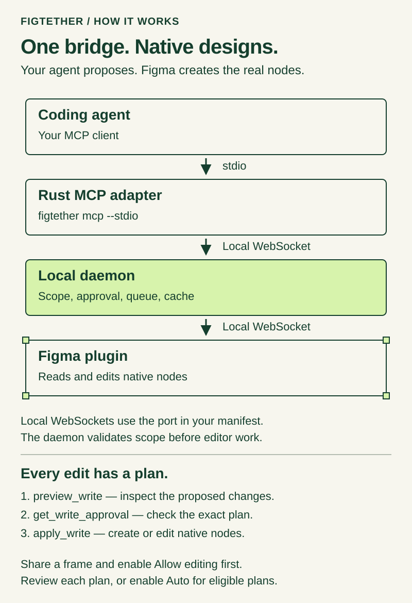
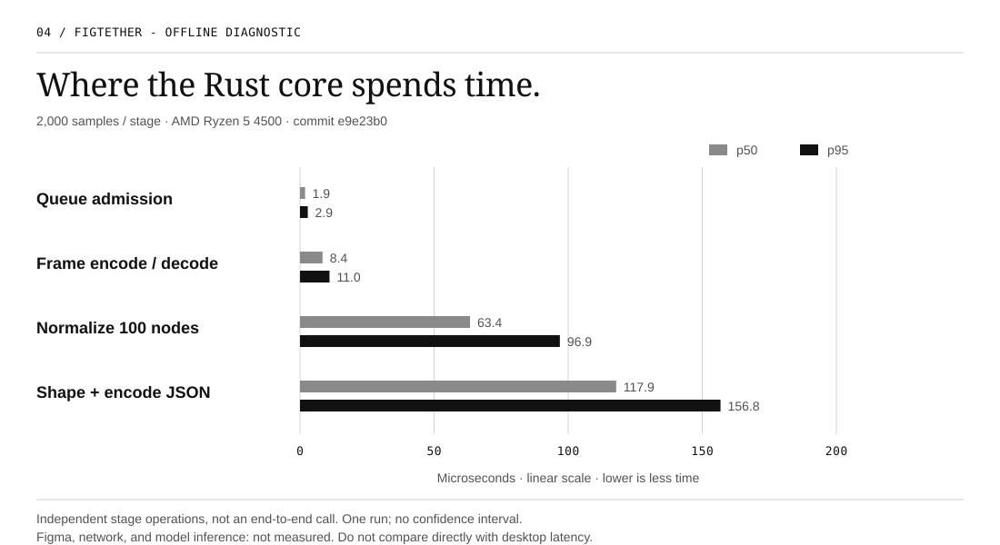

<h1 align="center">FigTether</h1>
<p align="center"><strong>Local Figma context for AI agents.</strong></p>
<p align="center">
  <a href="docs/quickstart.md">Quickstart</a> ·
  <a href="CONTRIBUTING.md">Contributing</a> ·
  <a href="benchmarks/README.md">Benchmarks</a> ·
  <a href="SECURITY.md">Security</a> ·
  <a href="LICENSE">MIT / Apache-2.0</a>
</p>

FigTether connects a running Figma Design plugin to your coding agent through a local Rust
daemon and the Model Context Protocol (MCP). Select the frames you want to share; the agent
requests their structure, layout, text, styles, and assets through read-only tools. A write path
is proposed on top of them: the agent proposes a change, the plugin shows the user what would
happen, and only an approved change reaches the document.

The design-reading path uses the documented Figma Plugin API, not the Figma REST API or the
official Figma MCP server. It does not need a personal access token. Figma permissions, editor
availability, and your AI provider's costs still apply.

> **Experimental, source builds only.** Automated tests exercise the Rust services and a simulated
> editor. A real Figma Desktop compatibility pass is still outstanding. Do not use confidential
> designs or treat this as a production-ready integration yet.

<p align="center">
  
</p>

## Contents

- [How it works](#how-it-works)
- [Build and connect](#build-and-connect)
- [Tools and current limits](#tools-and-current-limits)
- [Benchmarks](#benchmarks)
- [Privacy and security](#privacy-and-security)
- [Development](#development)
- [License and acknowledgements](#license-and-acknowledgements)

## How it works

1. Start the daemon on `127.0.0.1:38947` and open the development plugin in Figma Design.
2. Pair using a short-lived secret printed by the CLI. Select roots and grant read access in the plugin.
3. Configure your MCP client to launch `figtether mcp --stdio`.
4. Request a summary first, then inspect nodes or export assets. Pause or revoke access from the plugin.

Rust handles the protocol, scheduling, normalization, cache, and CLI. TypeScript is confined to
the Figma sandbox, the plugin UI, and their shared contract. A live read defaults to a fresh
plugin request; cached reads must be requested explicitly. Results carry their source,
observation time, and coverage so partial or old data is not mistaken for a complete live view.

## Build and connect

You need [Rust via rustup](https://rustup.rs/), **Node.js 22.14 or newer**, npm, and Figma
Desktop with permission to run development plugins. Run these commands from a checkout:

```sh
cargo build --locked --release -p figtether-cli
npm --prefix plugins/figma ci
npm --prefix plugins/figma run build
```

The binary is `target/release/figtether` (`figtether.exe` on Windows). Add that directory to
your `PATH`, or use the full path in the commands below.

```sh
figtether manifest --plugin-id YOUR_PLUGIN_ID --out plugins/figma/manifest.local.json
figtether daemon
```

Leave the daemon running. Import `plugins/figma/manifest.local.json` in Figma's development
plugin menu. In another terminal:

```sh
figtether pair
figtether config print --client generic
```

Enter the pairing secret **only in the plugin UI**, grant a frame, and copy the printed MCP
configuration into your client. Then check the connection:

```sh
figtether status
figtether doctor --manifest plugins/figma/manifest.local.json
```

See the [quickstart](docs/quickstart.md) for the plugin-ID step, Windows commands, recovery
actions, and limitations. No installer or Community plugin release is available yet.

## Tools and current limits

| Task                            | MCP tools                                                        |
| ------------------------------- | ---------------------------------------------------------------- |
| Discover the bridge and session | `get_bridge_status`, `list_sessions`, `get_selection`            |
| Read a design                   | `list_nodes`, `get_nodes`, `inspect_design`, `get_design_tokens` |
| Request PNG or SVG export       | `export_assets`                                                  |
| Inspect a queued job            | `get_job_status`                                                 |
| Propose an edit (proposed)      | `preview_write`, `get_write_approval`, `apply_write`             |

The server also advertises `get_snapshot_info`, `watch_scope`, and `get_changes`. **Snapshot
storage, offline bundles, and watch/resync are not available in the shipped daemon.** These
entries are not a promise that those workflows work. Asset download/resource delivery and
large chunked transfers also need further end-to-end work.

The write path is proposed and pending product approval (`ADR-013`), and it is implemented across
the Rust crates and the plugin. It needs a write grant, which is a separate user action in the
plugin UI, and a per plan approval that the user gives after seeing a preview of the change. The
applied plan is committed as a single step in the editor undo history. The tool set is therefore no
longer uniformly read only: `apply_write` changes the document, and the read tools are unchanged.

The editor behaviour is unverified. The automated suites use a simulated editor, so no write has
run in a Figma Desktop session and the undo step, the version checkpoint, and the approval panel
in a real session are not claimed. Treat the three write tools as unavailable for production use:
the write path is proposed and pending product approval. The
[implementation status](docs/10-implementation/01-implementation-status.md) records what is
implemented and what is not, the [write path design](docs/11-write-path/01-write-path-design.md)
describes the intended contract, and `schemas/` publishes its wire shapes.

The default budget is one editor operation per session, 50 IDs per batch, depth 32, and a
64 KiB JSON response. Traversals are bounded and report truncation. The
[tool catalog](docs/04-data-contracts/02-tool-catalog.md) describes the proposed full contract;
[implementation status](docs/10-implementation/01-implementation-status.md) records the gaps.

## Benchmarks

The chart below is a **single offline diagnostic run**, not Figma latency, a product SLA, or a
comparison with another MCP server. It measures the Rust core with synthetic fixtures. There is
no network round trip, editor work, or model inference in these numbers.

<p align="center">
  
</p>

[Data and reproduction notes](benchmarks/published/README.md) accompany the chart. To run the
same diagnostic workload:

```sh
cargo bench --locked -p figtether-bench --bench w5_decomposition -- --test
```

For repeated measurements, workload definitions, and the distinction between a local diagnostic
and release evidence, see the [benchmark guide](benchmarks/README.md). Editor performance targets
remain unmeasured.

## Privacy and security

- The daemon listens on loopback, not your LAN. Do not expose it through a tunnel or reverse proxy.
- Pairing and session grants limit access; names and text inside a design remain untrusted input.
- The bridge does not send designs to a project-hosted service. **Your MCP client may send the
  returned content to its model provider.** Figma has its own network connections too.
- Revoking access stops future reads; it cannot recall data already delivered to a client.
- A local process with your user permissions may read runtime credentials. This is not a
  sandbox against malware on your machine.

Read the [security policy](SECURITY.md) before testing. [PentAGI assessment tooling](security/pentagi/README.md)
is opt-in and intended for an isolated test machine; it has not been run as an external audit.

## Development

[CONTRIBUTING.md](CONTRIBUTING.md) covers setup, crate boundaries, schema changes, tests,
benchmarks, and pull requests. A small change with a regression test is more useful than a
large rewrite.

The [documentation index](docs/README.md) separates practical guides from the original design
proposals. Architecture, UML, and release definitions stay in the public repository; credentials,
runtime state, build output, and raw assessment evidence do not. See the
[publication checklist](docs/maintainers/publication.md) before pushing.

## License and acknowledgements

FigTether is licensed under **MIT OR Apache-2.0**. See [LICENSE](LICENSE),
[LICENSE-MIT](LICENSE-MIT), [LICENSE-APACHE](LICENSE-APACHE), and [NOTICE](NOTICE).

The README's presentation is inspired by [Harness²](https://github.com/google-research/harness2).
Its artwork and benchmark results are not reused here. FigTether's diagrams and chart are
generated from this repository. [Harness² research notes](docs/08-harness2/01-harness2-overview.md)
and [PentAGI](https://github.com/vxcontrol/pentagi) are separate, optional development work; neither
is a runtime dependency.

FigTether is not affiliated with Figma, Google, or VXControl.
