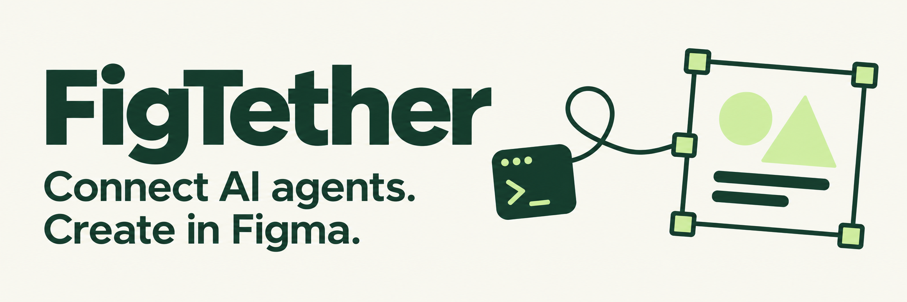
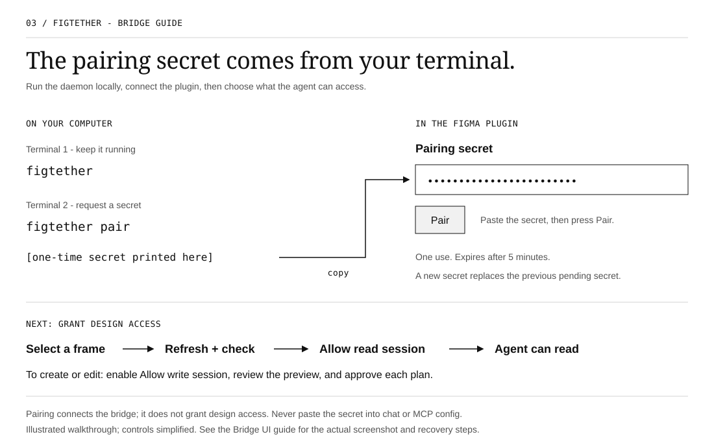
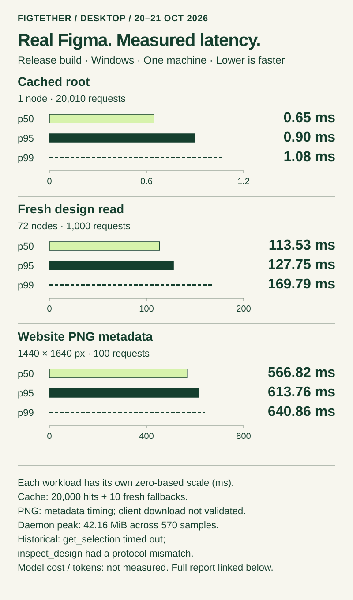

# FigTether

**Read, create, and edit Figma designs with local AI tools.**

[Install and connect](#build-and-connect) · [Quickstart](docs/quickstart.md) · [Bridge UI guide](docs/bridge-ui-guide.md) ·
[Contributing](CONTRIBUTING.md) · [Benchmarks](benchmarks/README.md) ·
[Security](SECURITY.md) · [MIT / Apache-2.0](LICENSE)

## Abstract

**FigTether lets AI agents read, create, and edit native Figma designs through a local bridge.**
An agent can inspect an existing layout or build a new design inside a user-granted frame:
create nodes, arrange elements, set text and fills, and change supported properties. A Rust
daemon validates scope, budgets, and approvals; a Figma plugin performs the actual reads
and mutations through the documented Plugin API. The implemented, experimental write path
requires a separate write grant, a preview, and approval bound to each exact plan. Manual
review is the default; a user can explicitly enable session-only Auto mode for new plans
without warnings, blocks, or deletions. Fresh and
explicitly cached reads carry provenance and coverage information.

An initial Windows Figma Desktop evaluation created a website with **71 editable children**
and measured the resulting 72-node scene. The corrected build recorded p95 latency of
**0.90 ms for cached-root requests**, **127.75 ms for fresh 72-node reads**, and **613.76 ms
for website PNG render/export metadata**. These are distinct workloads on one machine;
they do not measure model inference or complete asset download delivery. Version hashes,
sample counts, failures, and reproduction steps accompany the
[desktop results](benchmarks/published/desktop-2026-10-20.md). Model cost and tokens were
**not measured**.

FigTether provides **its own local MCP server** for the agent integration. Its read and write
paths use the Figma Plugin API and do not call the Figma REST API or Figma's official MCP
service. No Figma personal access token is needed. This avoids a dependency on that official
MCP service; it does not remove Figma editor requirements or your AI provider's costs.

> **Experimental, source builds only.** Automated tests exercise the Rust services and a simulated
> editor. A synthetic website was also created, read back, and exported in Figma Desktop 126.10.10
> on Windows; [measured results](benchmarks/published/desktop-2026-10-20.md) include failures and
> limits. This is a limited compatibility test, not a production release.

## Contents

- [Abstract](#abstract)
- [How it works](#how-it-works)
- [Build and connect](#build-and-connect)
- [Update FigTether](#update-figtether)
- [Tools and current limits](#tools-and-current-limits)
- [Benchmarks](#benchmarks)
- [Privacy and security](#privacy-and-security)
- [Development](#development)
- [License and acknowledgements](#license-and-acknowledgements)

## How it works

[](assets/architecture.svg)

1. Install the CLI and plugin dependencies, then run `figtether start` to prepare the plugin and start the daemon.
2. Import the printed manifest into Figma Desktop and paste the pairing secret from the same terminal.
3. Select a frame and grant read access. Enable write access if the agent should design or edit.
4. Connect your agent to `figtether mcp --stdio`. Review proposed changes in the Bridge; optionally enable Auto mode for new warning-free plans.

Rust handles the protocol, scheduling, normalization, cache, and CLI. TypeScript is confined to
the Figma sandbox, the plugin UI, and their shared contract. A live read defaults to a fresh
plugin request; cached reads must be requested explicitly. Results carry their source,
observation time, and coverage so partial or old data is not mistaken for a complete live view.

## Build and connect

### 1. Choose an installation method

**Today, install from this repository's source.** There is no published FigTether installer,
npm CLI package, or Figma Community plugin. The release workflow builds candidate artifacts;
it does not publish a download or package automatically.

| Method                                                                | Available now?            | What to use                                                                                                      |
| --------------------------------------------------------------------- | ------------------------- | ---------------------------------------------------------------------------------------------------------------- |
| Windows `figtether.exe`                                               | Yes, built locally        | Install the CLI from source with Cargo below. This creates a command-line executable, not a graphical installer. |
| Downloadable `.exe` installer or portable release                     | No published distribution | No download step is available yet.                                                                               |
| `npm install`, `npx`, `pnpm add`, or `pnpm dlx` for the FigTether CLI | No published package      | These are not installation or launch commands for this project.                                                  |
| npm for the Figma plugin                                              | Yes, in a source checkout | Use `npm ci` and `npm run build` below. This builds the plugin; it does not install the Rust CLI.                |

You need [Rust via rustup](https://rustup.rs/), [Node.js](https://nodejs.org/en/download)
**22.14 or newer** with npm, and [Figma Desktop](https://www.figma.com/downloads/) with
permission to create and run development plugins. Windows also needs the MSVC C++ build
tools. See [prerequisites and platform limits](docs/quickstart.md#prerequisites).

Download this repository's source ZIP and extract it, or clone it using the URL shown in
GitHub's **Code** menu. Open a terminal in the resulting `figtether` folder, where `Cargo.toml`
is located. Run:

```sh
cargo install --locked --path crates/cli
npm --prefix plugins/figma ci
figtether --help
```

Cargo installs `figtether.exe` in its installation `bin` directory, normally
`C:\Users\USERNAME\.cargo\bin` on Windows or `~/.cargo/bin` on macOS.
If `figtether` is not recognized, reopen the terminal or use
[the full executable path](docs/quickstart.md#figtether-is-not-recognized).
Custom Cargo installation settings can change this location. See
[Cargo's installation documentation](https://doc.rust-lang.org/cargo/commands/cargo-install.html).

**Checkpoint:** `figtether --help` lists commands. The next step generates the local manifest
and builds its matching plugin bundle. Keep the plugin folder in place after importing it.

### 2. Import the plugin into Figma Desktop

The plugin runs inside Figma; installing the executable alone does not add it to Figma.

1. Open a **Figma Design** file in Figma Desktop.
2. Open **Plugins → Development → New plugin**. Choose **Figma design**, name it
   `FigTether Local`, select **Custom UI**, and save the starter files in a separate folder.
3. Open that starter folder's `manifest.json` in a text editor and copy its **`id`** value.
   Figma generates this ID; it is not a pairing secret. See
   [Figma's plugin quickstart](https://developers.figma.com/docs/plugins/plugin-quickstart-guide/).
4. In the terminal, from this repository's root, replace `YOUR_PLUGIN_ID` and run:

```sh
figtether start --plugin-id YOUR_PLUGIN_ID
```

This creates the manifest, builds the plugin for its port, starts the foreground daemon,
and prints a one-use pairing secret. Leave that terminal open. On later starts, use
`figtether start`; your plugin id and port are kept. An unavailable manifest port is reported;
choose another explicitly with `figtether start --port PORT`, then reimport the manifest.

5. In Figma, choose **Plugins → Development → Import plugin from manifest** and select
   **this repository's `plugins/figma/dist/manifest.json`**. Figma requires the filename
   `manifest.json`; `manifest.local.json` is only the build input.
6. Run the imported **FigTether** plugin from **Plugins → Development**. The UI identifies
   itself as FigTether Bridge. Keep it open while the agent works.

### 3. Pair the Bridge

Copy the pairing secret printed by `figtether start` into the plugin's **Pairing secret** field,
then click **Pair**. It works once and expires after five minutes. If it expires, run
`figtether pair` in another terminal for a replacement. The agent and MCP configuration do not
need this secret.

For an existing installation, the shorter startup command is:

```sh
figtether start
```

If the daemon already runs, `start` reuses it and prints a new secret. It does not start a second
daemon or rebuild files used by an active plugin. `figtether` and `figtether daemon` remain
available for starting only the daemon, with a separate `figtether pair` command.

`start` currently prepares a **source installation**, so Node.js and the plugin source remain
required. A copied `.exe` alone does not install the plugin or register MCP in your agent.

To stop a daemon later, use `figtether stop` (also spelled `figtether terminate`) instead of
killing the process. It performs the graceful shutdown: queued work is cancelled, credentials
are revoked, sockets are closed, the design memory is wiped, and the stale runtime file is
removed.

The guide below summarizes startup, pairing and sharing:



**Checkpoint:** the plugin reports **Connected** and **Paired with the local daemon**.
Pairing connects the bridge; you still need to choose what design to share.
The default port is `38947`. If Windows reserves it (error 10013), follow the
[custom-port recovery steps](docs/agent-setup.md#windows-error-10013-reserved-port) to rebuild
the plugin and regenerate its manifest for a free port.

### 4. Share a frame and allow editing

1. Create an empty frame for a new design, or select an existing frame on the canvas.
   Name it something recognizable, such as `Website Test`.
2. Under **Choose what to share**, click **Update selection**.
3. Check the intended frame, then click **Share selected frames**.
4. To let the agent create or edit native nodes, also click **Allow editing**.

**Checkpoint:** the session shows the expected granted root count and write access.
Selecting a different frame later does not share it automatically. Read access alone
does not permit editing. The [illustrated Bridge guide](docs/bridge-ui-guide.md) explains
the controls and shows the plugin UI.

### 5. Connect your AI agent

For **Codex CLI/local IDE**, **Gemini CLI**, or **Claude Code**, open your design workspace
and preview a project-local setup. Replace `codex` with `gemini` or `claude` for your host:

```sh
figtether setup --client codex
figtether setup --client codex --apply
figtether setup --client codex --check --json
```

Setup installs the correct host configuration and the shared design workflow. It preserves
unrelated settings and defaults to preview only. Refresh MCP in the host, then ask it to call
`open_design` for your shared frame. Pairing Figma alone does not expose tools in the agent.
See the [host setup tutorial](docs/agent-setup.md) for all three profiles, removal, and recovery.

For other clients, or manual configuration:

```sh
figtether config print --client generic
```

Copy the **JSON object** from the output into your agent application's local MCP server
configuration, or use its **Add MCP server** form. For a form, choose **stdio**, use the
printed absolute executable path as the command, and supply `mcp` and `--stdio` as separate
arguments. Merge the entry with any existing servers; restart or reload the FigTether MCP
entry after saving. Configuration location and format depend on the agent application.

For clients that accept `mcpServers` JSON, the entry looks like this:

```json
{
  "mcpServers": {
    "figtether": {
      "command": "C:/Users/USERNAME/.cargo/bin/figtether.exe",
      "args": ["mcp", "--stdio"]
    }
  }
}
```

Use the path printed on **your** computer; the example is not a download location.
The agent launches the MCP adapter; Terminal A continues running the daemon separately.
MCP provides core canvas-first guidance automatically. Loading the complete design skill
depends on your agent client and its permissions; see [agent guidance and skills](docs/agent-workflow.md).

### 6. Make your first design

Send your connected agent this prompt:

```text
Use FigTether to find my shared frame named Website Test.
Create an editable desktop website for a small architecture studio inside that frame.
Use native Figma text, frames, and shapes. Begin with bridge/session discovery and a
small read of the granted frame, then preview a write plan for me to review.
Wait for my approval in FigTether Bridge before applying it. Verify the result afterward.
```

In the plugin, scroll to **Proposed change**, review the plan and its node counts, then
click **Approve** or **Reject**. The agent retrieves the approval and applies that exact
plan. A larger design can require several plans and a separate approval for each one.
Clicking **Allow editing** does not approve future plans automatically.

### Optional: work outside Figma and use Auto mode

After connecting, click **Open outside Figma** in the Bridge header. It opens a private
local browser companion. Drag the browser tab into its own window and move it to another
monitor. Keep the Figma plugin open; it still performs document operations. The companion
shows the named frames, editing access, proposed changes, and activity. **Stop sharing**
requires a second confirmation and affects all agents using that session.

**Auto mode is off by default.** After sharing frames and allowing editing, enable it yourself
to approve new warning-free plans automatically. Warnings, blocked plans, deletions, or
incomplete preview checks pause it for manual review. Reconnecting or changing access turns
it off. It does not assess whether the design looks good. Closing the browser tab does not
stop sharing or turn off Auto mode; use the controls before leaving.

These controls need the updated daemon and plugin. See the
[Bridge UI guide](docs/bridge-ui-guide.md) for screenshots, behavior, and recovery.

**Checkpoint:** editable layers appear inside the shared frame. If nothing changes, check
whether the plan is still waiting for approval. If the agent cannot find the frame, check
the grant and MCP connection first.

### Next time, recovery, and stopping

For another session, start the daemon if needed, run the imported plugin, and check its
connection and shared frames. Generate a fresh pairing secret if authentication has expired
or access was revoked. You do not need to recreate the plugin ID for every session.

- **Command not found:** use the [Windows executable and PATH instructions](docs/quickstart.md#figtether-is-not-recognized).
- **Connection problem:** run `figtether status` and
  `figtether doctor --manifest plugins/figma/manifest.local.json` from the checkout.
- **Manifest error in Figma:** Figma rejects a manifest that starts with a byte order mark or
  that is not valid JSON. `figtether doctor` names the cause, and
  [the manifest section](docs/quickstart.md#when-figma-shows-a-manifest-error) explains the fix.
- **Revoked session:** run `figtether pair`, pair in the plugin, and grant the frames again.
- **Updated plugin code:** rebuild it, then close and reopen the plugin to load the new bundle.
- **Two agents:** the local installation shares its grant. Use distinct working frames;
  these names do not enforce isolation between agents. Revoking access affects both agents.
- **Finish working:** close your own MCP connection. When everyone is finished, revoke the
  shared session and stop the daemon with `figtether stop`. See
  [shutdown instructions](docs/quickstart.md#stopping-the-daemon).

The [quickstart](docs/quickstart.md) includes direct executable paths and troubleshooting;
the [Bridge UI guide](docs/bridge-ui-guide.md) explains each control.

## Update FigTether

After the initial source installation, run:

```sh
figtether update
```

The command uses the source checkout this executable was built from. It requires a clean
Git checkout with a configured upstream, pulls with `--ff-only`, builds a staged CLI with
the lockfile, rebuilds the Figma plugin with npm, and replaces the executable you ran.
Local edits are not discarded. Rust, Node.js, npm, and Git must remain installed.
This updates from your configured upstream branch; it is not a signed release downloader.

To inspect the steps first, or point to a moved checkout:

```sh
figtether update --dry-run
figtether update --source "C:/projects/figtether"
```

For a source ZIP, extract the updated source separately and rebuild from it without Git:

```sh
figtether update --source "C:/projects/figtether-new" --local
```

`--local` builds the source already on disk; it does not download a newer version. npm and
Cargo may still download locked build dependencies. If you change source folders, preserve
your local plugin ID, generate the local build input in the new folder, rebuild, and import
the new folder's `plugins/figma/dist/manifest.json` in Figma.

After a successful update, wait until all agents have finished, then restart the daemon and
your MCP server entry. Close and reopen the Figma plugin to load the new bundle. Pair and
grant the frames again if required. The updater does not stop shared agents automatically.
On Windows, a previous executable may remain as `figtether-previous-*.exe.bak`; remove it
after old processes have exited. A failed build leaves the CLI executable in place, although
the checkout, dependencies, or plugin build output may already have changed.

**Upgrading an older build without this command?** First run
`cargo install --locked --path crates/cli` from updated source once. Subsequent updates can
use `figtether update`.

## Tools and current limits

| Task                                    | MCP tools                                                        |
| --------------------------------------- | ---------------------------------------------------------------- |
| Open a named shared frame and its image | `open_design`                                                    |
| Discover the bridge and session         | `get_bridge_status`, `list_sessions`, `get_selection`            |
| Read a design                           | `list_nodes`, `get_nodes`, `inspect_design`, `get_design_tokens` |
| Request PNG or SVG export               | `export_assets`                                                  |
| Receive a bounded PNG image             | `get_asset`                                                      |
| Inspect a queued job                    | `get_job_status`                                                 |
| Create or edit a design (experimental)  | `preview_write`, `get_write_approval`, `apply_write`             |

The server also advertises `get_snapshot_info`, `watch_scope`, and `get_changes`. **Snapshot
storage, offline bundles, and watch/resync are not available in the shipped daemon.** These
entries are not a promise that those workflows work. `get_asset` delivers a grant-bound PNG
as a standard MCP image block, with a 1 MiB image limit and five-minute lifetime. Export a
smaller section or lower scale when needed. SVG byte delivery, general resource downloads,
and large chunked transfers remain unavailable. Host/model image support must be checked.

The write path is **implemented across Rust and the plugin**. It supports `create_node`,
`insert_child`, `set_properties`, `set_text`, `set_fills`, `move_node`, and `delete_node`.
The plugin can create frames, text, rectangles, components, vectors, sections, lines and ellipses,
subject to editor capabilities and the plan's validation rules. GROUP remains in the allowlist,
but its required child IDs are not carried by the current MCP schema; use a frame container.
This lets an agent
compose an editable design, rather than only retrieve a reference image.

To create a design, grant an empty frame for reading, enable **Allow editing**, and ask
the agent to build inside that frame. The agent calls `preview_write`; you review and approve
the exact plan in the Bridge, or explicitly enable Auto mode for new warning-free plans.
The agent calls `get_write_approval` and then `apply_write`.
Rust checks the plan hash, session, grant epoch, scope, and budget before forwarding a mutation.
Only the plugin sandbox calls the editor's creation and mutation methods.

The MCP connection now supplies canvas-first instructions: discover the shared frames, inspect
their render, propose an edit, then verify the result. New nodes can include initial fills,
text and fonts in one creation operation. See the [agent workflow](docs/agent-workflow.md) for
the focused design skill, reconnect behavior, and current validation limits. Repository and
research scans are not prerequisites for designing through the bridge.

The website test exercised real-editor previews, approval controls, writes, and text readback.
Apply results reported an undo commit; manual undo restoration and version checkpoints remain
unverified. The implementation is experimental, with limited desktop evidence rather than
production certification. The
[implementation status](docs/10-implementation/01-implementation-status.md) records what is
implemented and what is not, the [write path design](docs/11-write-path/01-write-path-design.md)
describes the contract and its original ADR proposal status, and `schemas/` publishes its wire shapes.
The [Rust write-path verification](docs/write-path-verification.md) maps these capabilities to
the actual adapter, daemon, plugin, and tests.

The default budget is one editor operation per session, 50 IDs per batch, depth 32, and a
64 KiB JSON response. Traversals are bounded and report truncation. The
[tool catalog](docs/04-data-contracts/02-tool-catalog.md) describes the proposed full contract;
[implementation status](docs/10-implementation/01-implementation-status.md) records the gaps.

The desktop website test verified `list_nodes`, `get_nodes`, approved writes and PNG export
metadata. It also found a `get_selection` timeout and an `inspect_design` protocol mismatch;
the [end-user feature review](docs/06-testing/end-user-feature-review.md) records subsequent
native results, fixes, regression coverage, and remaining feature gaps. FigTether does not
currently expose every Figma Design feature. The original report retains its failed calls.

## Benchmarks

The [21 October editable website test](benchmarks/published/website-2026-10-21.md) created
a 1440 x 4440 native design with 123 nodes through six approved plans. It includes
[the Figma render](benchmarks/published/figtether-website-2026-10-21.png), a new diagnostic
chart, build hashes, concurrent-client reads, and remaining rich-read/pagination failures.
Its debug-build measurements are separate from the earlier results below.

### Figma Desktop measurements

The chart uses the saved **20–21 October 2026 desktop measurements**, with Figma Desktop
126.10.10 on one Windows machine. Each latency panel has its own zero-based linear scale;
the workloads perform different amounts of work. The plotted lanes succeeded, while the
full report also retains setup failures and failing tools.

[](assets/benchmark-desktop.svg)

| Workload                    | Samples |       p50 |       p95 |       p99 |
| --------------------------- | ------: | --------: | --------: | --------: |
| Cached root request, 1 node |  20,010 |   0.65 ms |   0.90 ms |   1.08 ms |
| Fresh design read, 72 nodes |   1,000 | 113.53 ms | 127.75 ms | 169.79 ms |
| Website PNG, 1440 × 1640    |     100 | 566.82 ms | 613.76 ms | 640.86 ms |

The cache lane includes **20,000 confirmed hits and 10 fresh fallbacks**. PNG timings cover
rendering, transport, and export metadata; client download delivery was not validated.
`get_selection` timed out, and `inspect_design` returned a protocol mismatch in the final
functional controls. No model billing telemetry was available; missing cost is not zero cost.

[Desktop report](benchmarks/published/desktop-2026-10-20.md) ·
[Versioned source data](benchmarks/published/desktop-2026-10-20.json) ·
[Reproduce the desktop test](benchmarks/desktop-testing.md)

The report groups measurements by binary, plugin, and UI hashes, preserving earlier builds
and the incorrectly scoped run separately. These results are limited compatibility evidence;
no soak test, confidence interval, competitor ranking, or release certification is claimed.

### Offline Rust diagnostic

The following chart is a **separate, single offline diagnostic run**. It measures the Rust
core with synthetic fixtures. There is no network round trip, editor work, or model inference
in these numbers, so they should not be compared directly with desktop request latency.


[Data and reproduction notes](benchmarks/published/README.md) accompany the chart. To run the
same diagnostic workload:

```sh
cargo bench --locked -p figtether-bench --bench w5_decomposition -- --test
```

For repeated measurements, workload definitions, and the distinction between a local diagnostic
and release evidence, see the [benchmark guide](benchmarks/README.md).

## Privacy and security

- The daemon listens on loopback, not your LAN. Do not expose it through a tunnel or reverse proxy.
- Pairing and session grants limit access; names and text inside a design remain untrusted input.
- The bridge does not send designs to a project-hosted service. **Your MCP client may send the
  returned content to its model provider.** Figma has its own network connections too.
- Revoking access stops future reads; it cannot recall data already delivered to a client.
- A local process with your user permissions may read runtime credentials. This is not a
  sandbox against malware on your machine.

Read the [security policy](SECURITY.md) before testing. [PentAGI assessment tooling](security/pentagi/README.md)
is opt-in and intended for an isolated test machine; it has not been run as an external audit.

## Development

Documentation is maintained in English. See [current documentation status](docs/documentation-status.md)
for the distinction between historical proposals, implemented reads/writes, and measured evidence.
The [Design Evidence skill and research](docs/design-review.md) provide reproducible UI checks
with explicit coverage limits; they assess observable quality, not AI authorship.

[CONTRIBUTING.md](CONTRIBUTING.md) covers setup, crate boundaries, schema changes, tests,
benchmarks, and pull requests. A small change with a regression test is more useful than a
large rewrite.

The [documentation index](docs/README.md) separates practical guides from the original design
proposals. Architecture, UML, and release definitions stay in the public repository; credentials,
runtime state, build output, and raw assessment evidence do not. See the
[publication checklist](docs/maintainers/publication.md) before pushing.

## License and acknowledgements

FigTether is licensed under **MIT OR Apache-2.0**. See [LICENSE](LICENSE),
[LICENSE-MIT](LICENSE-MIT), [LICENSE-APACHE](LICENSE-APACHE), and [NOTICE](NOTICE).

The README's presentation is inspired by [Harness²](https://github.com/google-research/harness2)
and the illustrated banner in the Kiln project. Their artwork and benchmark results are not
reused here. FigTether's original banner was generated with the built-in image generation tool;
its diagrams and charts are generated from this repository's code and recorded data. See
[visual provenance and the banner prompt](assets/README.md).
[Harness² research notes](docs/08-harness2/01-harness2-overview.md)
and [PentAGI](https://github.com/vxcontrol/pentagi) are separate, optional development work; neither
is a runtime dependency.

FigTether is not affiliated with Figma, Google, or VXControl.
