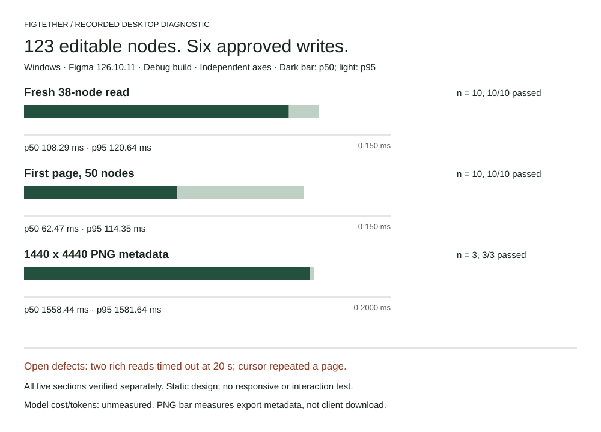

# Editable website test, 21 October 2026

FigTether created a native **1440 x 4440** website inside Codex Test in Figma Desktop
126.10.11. Five sections contain **123 distinct nodes including the root**, verified through
five separate bounded reads. Six approved plans were applied. Gemini Test was not mutated
by this runner. This is a static desktop design, not a responsive implementation or prototype.

[View the native Figma PNG](figtether-website-2026-10-21.png) · [Versioned data](website-2026-10-21.json)

| Workload                 | Samples | Passed |        p50 |        p95 |
| ------------------------ | ------: | -----: | ---------: | ---------: |
| Fresh 38-node read       |      10 |     10 |  108.29 ms |  120.64 ms |
| First page, 50 nodes     |      10 |     10 |   62.47 ms |  114.35 ms |
| 1440 x 4440 PNG metadata |       3 |      3 | 1558.44 ms | 1581.64 ms |

Measurements include MCP, daemon, transport, and editor work, excluding human approval wait.
The two concurrent clients completed fresh reads in 86.88 and 133.69 ms;
their request windows overlapped by 77.88 ms. They shared an installation credential.
This does not measure Gemini inference or prove per-agent isolation or concurrent write safety.

Two projected rich-text reads timed out at approximately 20 seconds. A full-root listing
returned 109 nodes with truncation; following its cursor repeated those nodes. Completeness
was verified by reading each section separately. The data retains these failures alongside
grant invalidation, a safely refused hash mismatch caused by test-harness text decoding, and
setup automation failures. These defects remain open; passing diagnostic lanes are not an
all-tools success claim.

The review PNG was copied from Figma separately at 2880 x 8880. MCP PNG calls returned
1440 x 4440 export metadata; client asset-download delivery was not verified. Manual undo,
responsive layouts, prototype interactions, peak memory, and model billing were not measured.
Missing cost/tokens are null, not zero.

The JSON records the tested debug binary/plugin/UI hashes, environment, raw-call hash, and
sample counts. These calls predate the source updater and must not be attributed to that
newer binary. This is one-machine diagnostic evidence, not a release benchmark.

To repeat, use the [desktop test guide](../desktop-testing.md), share a synthetic frame, keep
each other agent on its intended working frame, and approve each plan in Figma. Preserve
individual call timings and failures by build hash. Do not revoke a shared session merely
to clean up one client's connection.
