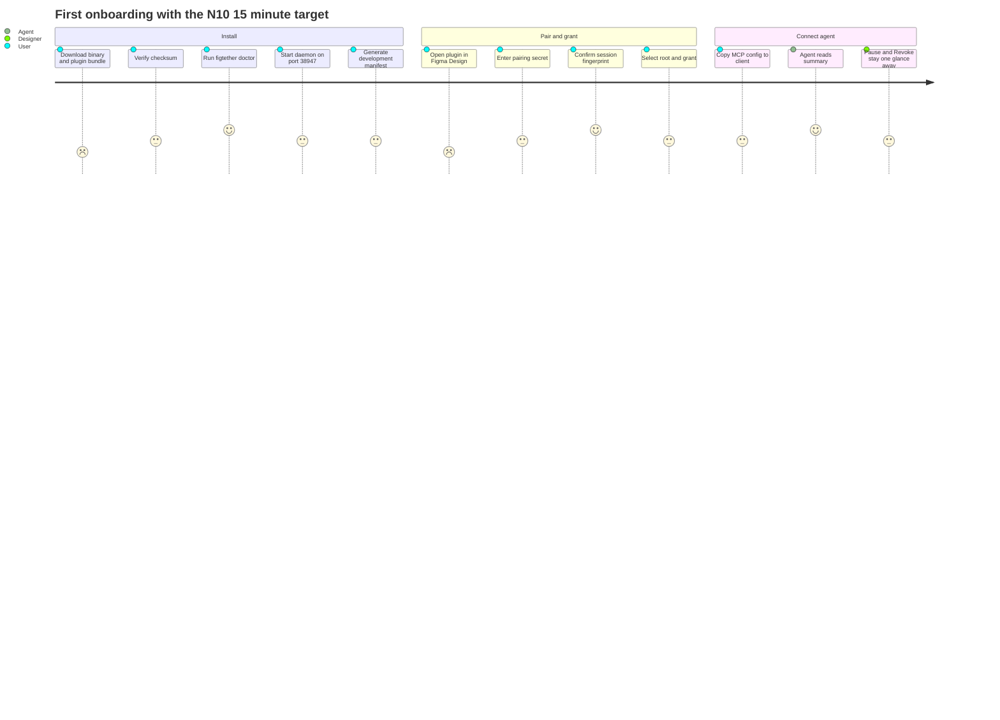

# Personas and Journeys

> **Design reference.** Original requirements and approval labels below are historical design
> records, not a feature-availability list. See [current documentation status](../documentation-status.md)
> for implemented reads/writes, observed desktop evidence, and remaining gaps.

Status: `Proposed`

This document registers the six personas exactly as the PRD fixes them in section 4.2, extended with one capabilities column so that docs, tests, and UI derive role behavior from a single inventory. It then walks four journeys in which product behavior is normative and observable: first onboarding (PRD 5.1 under the N10 budget), the daily agent loop (PRD 8.5.1), the designer control loop (PRD 5.3, FR15, N07), and the maintainer failure reproduction (FR18, R13). It closes with the failure moments an agent meets in the daily loop and the recovery the product must express (PRD 8.7). Every number in this file is a target, never a result, because G0 has not run (PRD 2.1).

## 1. Persona registry (PRD 4.2 verbatim, plus capabilities)

The first four columns carry the PRD rows in order, translated without weakening their commitments; no new IDs are minted. The capabilities column is a FigTether addition and names the tool surface, where the grant comes from, and what control rights remain.

| Persona                    | Need (PRD 4.2)                                   | User story (PRD 4.2)                                                                               | Priority | Capabilities: tools used, grant origin, control rights                                                                                                                                                                                                                                                                                                                                                                                                                                                                                                                              |
| -------------------------- | ------------------------------------------------ | -------------------------------------------------------------------------------------------------- | -------- | ----------------------------------------------------------------------------------------------------------------------------------------------------------------------------------------------------------------------------------------------------------------------------------------------------------------------------------------------------------------------------------------------------------------------------------------------------------------------------------------------------------------------------------------------------------------------------------- |
| Solo developer on Starter  | Read the same frame repeatedly while building UI | As a developer, I grant one frame, and the agent reads its layers and assets for the whole session | P0       | Tools: list_sessions, get_selection, list_nodes, inspect_design, get_design_tokens, export_assets (PRD 8.5.1). Grant origin: the user selects the root in the plugin UI and presses the grant action; the grant binds the root ID and later selection changes never widen it (PRD 5.1 step 6, FR03). Control: Pause, Resume, Capture snapshot, Revoke in the plugin UI (PRD 5.1 step 8, FR15).                                                                                                                                                                                      |
| Companion designer         | Control what gets shared                         | I can see access coverage, pause the session, and revoke access without closing the design         | P0       | Tools: none consumed directly; the plugin UI is the interface, backed by honest envelope coverage and freshness (FR12, PRD 8.5.2). Grant origin: grants are user made; agents cannot raise their own permissions through read tools (PRD 8.5.1 closing note). Control: status glance, Pause, Resume, Revoke, Capture snapshot (PRD 5.3); revoke stops future delivery but cannot retract data already received (PRD 5.3, PRD 8.4).                                                                                                                                                  |
| Developer on a client file | Be certain the permission and the file are right | I get a clear permission status before the agent reads the file                                    | P0       | Tools: list_sessions exposes only sessions granted to this client and every read names its session_id or snapshot_id (FR04); capability probes surface what the seat permits (FR09, AT12). Grant origin: an explicit grant after permission verification; the document label is a hint only, and the user confirms mapping when identity is unclear (PRD 8.4 identity rules). Control: fix platform permission outside the product or accept PERMISSION_DENIED and OUT_OF_SCOPE as explicit results (PRD 8.7); snapshots for analysis that must not touch live client state (FR05). |
| Multi-agent user           | Avoid tab mixups and overload                    | I connect two clients to the same session with a fair queue                                        | P1       | Tools: the same read surface per client with per-client queue caps, 16 per client inside a 64 total queue (PRD 8.5.5); full multi-client isolation lands in P1 (FR22). Grant origin: the session grant stays user made; no data, cursor, or asset crosses sessions even when node IDs collide (AT05). Control: pause and revoke are authoritative for every client (FR15); fair scheduling with aging prevents starvation (PRD 8.5.5).                                                                                                                                              |
| OSS maintainer             | Reproduce failures without private files         | I receive sanitized diagnostics and a public fixture                                               | P0       | Tools: CLI subcommands doctor, daemon, mcp, status, pair, config, manifest, revoke (PRD 8.4 component table); diagnostics stay sanitized by default (FR18). Grant origin: reproduction runs on public, clearly licensed fixtures, never client files as a prerequisite (PRD 2.1 fixture tiers; PRD 8.7 support row). Control: incident response revokes all sessions, halts distribution of a bad build, and publishes advisories with sanitized reproduction (PRD 8.7 incident row).                                                                                               |
| Offline user               | Analyze a snapshot that is already exported      | I open a local snapshot with an offline label and a clear schema version                           | P1       | Tools: get_snapshot_info plus read tools addressed to a snapshot source; source.kind is plugin_snapshot or offline_bundle and never posed as live (PRD 8.5.2, PRD 5.2). Grant origin: the snapshot was captured by a user in the UI during P0; versioned bundle import arrives in v0.2 (FR05, FR21). Control: TTL and deletion remain user owned; imports cannot claim to be live (FR21, PRD 5.2).                                                                                                                                                                                  |

## 2. Journey A: onboarding and first connection (PRD 5.1)

Budget: first onboarding p90 <= 15 minutes and repeat sessions <= 2 minutes, measured with at least 10 pilot users and per step failure logging (PRD 2.1, N10). The full span, install through first read on two operating systems, is the AT03 frame (AT03, G2).

| Step | Actor           | Action (PRD 5.1)                                                                                                                                                    | Artifact, AT, or metric                                                                                                |
| ---- | --------------- | ------------------------------------------------------------------------------------------------------------------------------------------------------------------- | ---------------------------------------------------------------------------------------------------------------------- |
| 1    | User            | Download the prebuilt binary for OS and architecture with the plugin bundle and checksums                                                                           | FR01; artifact chain in docs/07-ops/04-release-process.md                                                              |
| 2    | User            | Run figtether doctor to check version, runtime directory, port, and manifest; no PAT is requested                                                                   | FR18; doctor checklist in PRD 8.7                                                                                      |
| 3    | User            | Start figtether daemon on default port 38947, loopback only; a port collision fails loudly with a --port hint and manifest regeneration, never a silent port change | PRD 5.1 step 3; PRD 8.7 port collision row; N08 method includes port collision                                         |
| 4    | User            | Generate or import the development manifest with the user's plugin ID; the release bundle ships the prebuilt UI and adapter                                         | FR01; manifest constraints per S5                                                                                      |
| 5    | User and plugin | Open the plugin in Figma Design; enter the temporary pairing secret from the CLI; verify session name and fingerprint                                               | FR02: 256 bit, single use, 5 minute TTL, never in URL, logs, or tool schema; negative cases embedded in AT06           |
| 6    | User            | Select the root to share and press the grant action (Allow session read); the grant binds the root ID; later selection changes never widen the grant                | FR03; AT17 scope move or rename during reads                                                                           |
| 7    | User            | Install the MCP entry via figtether config print --client generic and copy it into the client; the CLI never silently writes another application's config           | FR17; AT14 handshake with clean stdout on two clients                                                                  |
| 8    | Agent and user  | The agent picks a session_id and reads a summary before requesting details; the user keeps Pause, Resume, Capture snapshot, and Revoke available                    | FR04, FR15; the N10 budget is judged at the first successful read; AT03 wraps install, pair, grant, and read on two OS |

Gap note: steps 2 and 7 are the historically failure prone steps for new users, which is why the N10 method demands failure counts per step in the pilot (PRD 2.1).

## 3. Journey B: daily agent loop (PRD 8.5.1)

Every tool here is a read tool; none mutates the document (FR24, AT18) and none sees a secret or the bridge endpoint (FR02, PRD 8.5.1 contract sentence).

| Step | Actor  | Action                                                                                                                                                                                                                     | Artifact, AT, or metric                         |
| ---- | ------ | -------------------------------------------------------------------------------------------------------------------------------------------------------------------------------------------------------------------------- | ----------------------------------------------- |
| 1    | Agent  | Optionally confirm daemon health with get_bridge_status, which returns version and health but no design content or secret                                                                                                  | PRD 8.5.1 tool table                            |
| 2    | Agent  | list_sessions shows only sessions granted to this client; the agent selects one session_id                                                                                                                                 | FR04, AT05                                      |
| 3    | Agent  | Stay summary first: list_nodes with field projection and pagination instead of one gigantic read                                                                                                                           | FR07, P04, AT07                                 |
| 4    | Agent  | inspect_design with consistency=fresh for implementation context; fresh is the only live default, cached requires explicit opt-in with max_age_ms                                                                          | FR08, FR12, D04, AT10                           |
| 5    | Agent  | get_design_tokens for scoped styles and variables; unresolved aliases and ambiguous modes return reported, never silent                                                                                                    | FR10, AT10                                      |
| 6    | Agent  | export_assets for PNG or SVG when visuals matter; results carry asset_id, hash, MIME, size, and grant bound resource URIs                                                                                                  | FR11, S4, AT11                                  |
| 7    | System | Every response uses the common envelope: source, observation, coverage, data, warnings                                                                                                                                     | FR12, PRD 8.5.2                                 |
| 8    | System | Bounded recovery on limits: BUSY carries retry_after_ms; SCOPE_TOO_LARGE asks for a narrower root, fields, or depth; CURSOR_EXPIRED restarts the traversal; DOCUMENT_CHANGED allows exactly one retry or a snapshot switch | FR13, FR07, PRD 8.3; section 6 of this document |
| 9    | System | Late or cancelled reads are discarded; a revoked grant never comes back alive through a retry                                                                                                                              | FR14, FR15, N07                                 |

## 4. Journey C: designer control loop (PRD 5.3)

| Step | Actor               | Action                                                                                                                                        | Artifact, AT, or metric                                                                                               |
| ---- | ------------------- | --------------------------------------------------------------------------------------------------------------------------------------------- | --------------------------------------------------------------------------------------------------------------------- |
| 1    | Designer            | Status glance: connection status, shared root, mode, last read time, queue, available capabilities; status never relies on color alone        | PRD 5.3 UI minimum                                                                                                    |
| 2    | Designer            | Pause: new live and snapshot reads are rejected and agents receive PAUSED until resume                                                        | FR15; PAUSED row in the PRD 8.7 error table; FR15 maps to AT06 and AT15 in docs/00-overview/01-prd-analysis.md        |
| 3    | Designer            | Resume: reads are allowed again; the state machine returns from PAUSED to READY without touching the grant or epochs                          | State machine in PRD 8.4                                                                                              |
| 4    | Designer            | Capture snapshot: an explicit capture mints an immutable snapshot_id and content hash that stays snapshot labeled forever                     | FR05, AT04, PRD 5.2                                                                                                   |
| 5    | Designer            | Revoke: queues and transfers stop, unsent results are dropped, cache and assets are cleared, agents get REVOKED, and late frames are rejected | FR15; N07 target: logical cancel or revoke within 1 second, no payload after revoke; AT15; heartbeat rules in PRD 8.4 |
| 6    | System and designer | The UI states the honest boundary of step 5: revoke cannot retract data the client already received                                           | PRD 5.3; residual clause in PRD 8.4                                                                                   |

N07 is a target pending G0, not a measurement (PRD 2.1).

## 5. Journey D: maintainer failure reproduction (FR18, R13)

| Step | Actor              | Action                                                                                                                                                                                               | Artifact, AT, or metric                                                |
| ---- | ------------------ | ---------------------------------------------------------------------------------------------------------------------------------------------------------------------------------------------------- | ---------------------------------------------------------------------- |
| 1    | User               | Open an issue with the template: version, OS, capability context, error ID, public fixture; no client file is required as a prerequisite                                                             | PRD 8.7 support row; R13 trigger scenario                              |
| 2    | User or maintainer | Run figtether doctor; output is sanitized: queue, cache, and latency metrics, error code, versions; no layer names, text content, tokens, or design data by default                                  | FR18; log storage rules in PRD 8.6.2                                   |
| 3    | Maintainer         | Reproduce on a public fixture from the registered tiers: small 100 nodes, medium 1,000, large 10,000 within scope; private designs stay out                                                          | PRD 2.1 fixture paragraph; PRD 8.7 support row                         |
| 4    | Maintainer         | Attach sanitized diagnostics only: local correlation ID, error code, versions, resource counts                                                                                                       | FR18; diagnostics row in PRD 8.7                                       |
| 5    | Maintainer         | On suspected leak or exploit: revoke all sessions, stop distribution of the bad build, publish an advisory and patch with a sanitized reproduction; remove any disclosed data and rotate credentials | PRD 8.7 incident row; R13 mitigation                                   |
| 6    | Maintainer         | Land the fix behind CI guards: schema contracts, fuzz corpus, dependency and egress checks; record evidence at the exact commit                                                                      | PRD 8.11 CI row; PRD 8.10.2; docs/06-testing/03-traceability-matrix.md |

## 6. Failure moments in the daily loop (PRD 8.7)

Failures are structured tool results with code, message, retryable, action, request_id, and optional retry_after_ms (PRD 8.7 closing note); every row below ends in a recovery action, never a silent fallback (PRD 8.3; committed interpretation 2 in docs/00-overview/01-prd-analysis.md).

| Code            | Trigger                                                                                             | Agent experience                                                                                                              | User recovery                                                                     | Refs                                                                                           |
| --------------- | --------------------------------------------------------------------------------------------------- | ----------------------------------------------------------------------------------------------------------------------------- | --------------------------------------------------------------------------------- | ---------------------------------------------------------------------------------------------- |
| PLUGIN_OFFLINE  | Plugin closed, machine asleep, or local network dropped; fresh reads cannot be served (PRD 8.3)     | Fresh reads fail with PLUGIN_OFFLINE and no snapshot is substituted silently; SESSION_NOT_FOUND means the old session is gone | Reopen and re-pair the session; run list_sessions again and continue              | FR16, P11, AT09; N08 targets offline detection within 15 s and reconnect readiness within 10 s |
| BUSY            | The queue is full (64 total, 16 per client) or another editor operation is active, one per session  | BUSY with retry_after_ms; retry within the deadline, never a tight loop                                                       | None required; optionally lower client concurrency                                | FR13, P05, AT08; PRD 8.5.5                                                                     |
| REVOKED         | The user pressed Revoke; the grant epoch moved                                                      | Every read, ongoing transfer, and later retry returns REVOKED                                                                 | Re-granting is a new user decision; Resume does not undo Revoke                   | FR15, N07, AT15; state machine in PRD 8.4                                                      |
| CURSOR_EXPIRED  | Scope or epoch changed, the observation expired, or membership was invalidated mid-traversal        | CURSOR_EXPIRED or RESYNC_REQUIRED; restart the traversal or use a snapshot for stable structure                               | No action required; optionally re-grant or capture a snapshot                     | FR07, FR03, AT07, AT17; pagination rules in PRD 8.3                                            |
| SCOPE_TOO_LARGE | The traversal exceeded its budget of 10,000 visited nodes per operation and cannot continue cleanly | SCOPE_TOO_LARGE with no fake partial that pretends completeness                                                               | Narrow the root, fields, or depth and paginate; the user may grant a tighter root | FR07; PRD 8.5.5; R04; AT07 partial plus cursor correctness                                     |

Remaining codes (AUTH_REQUIRED, PERMISSION_DENIED, OUT_OF_SCOPE, NODE_NOT_FOUND, CAPABILITY_UNAVAILABLE, PAYLOAD_TOO_LARGE, INVALID_LIMIT, TIMEOUT, CANCELLED, DOCUMENT_CHANGED, UNSUPPORTED_SCHEMA, EXPORT_FAILED, FONT_UNAVAILABLE, INTERNAL_ERROR) live in the full error contract under docs/04-data-contracts/ (PRD 8.7).

## 7. Copy and accessibility rules carried by the journeys

| Rule                                                                                                                                          | Journeys affected                   | Refs             |
| --------------------------------------------------------------------------------------------------------------------------------------------- | ----------------------------------- | ---------------- |
| Keyboard navigation, visible focus, screen reader labels, WCAG AA contrast as a target, and status never relying on color alone               | A steps 5 to 7; C all steps         | PRD 5.3          |
| Error messages name the recovery action                                                                                                       | B step 8; C steps 2 and 5; D step 1 | PRD 5.3; PRD 8.7 |
| The UI explains that data read by the client can be forwarded to the AI model per the client's configuration, even though the bridge is local | A steps 5 to 7; C step 6            | PRD 5.3          |
| No UI or marketing copy implies unlimited capacity or guaranteed feature parity                                                               | B throughout                        | P14, AT16        |
| Diagnostics and issues never contain design content or secrets by default                                                                     | D steps 2 and 4                     | FR18, R13        |

## 8. Journey diagram (onboarding)

Caption: onboarding with illustrative satisfaction shading; the only measurable budget in this figure is the N10 15 minute target, which nobody has measured yet (PRD 2.1).

Read as: the diagram mirrors the eight PRD 5.1 steps compressed into three phases; it adds no behavior and no measured result.

## 9. Journey to evidence mapping

| Journey                   | Primary acceptance                                  | Secondary anchors                                      | Where results land                                                              |
| ------------------------- | --------------------------------------------------- | ------------------------------------------------------ | ------------------------------------------------------------------------------- |
| A onboarding              | AT03 (install, pair, grant, read on two OS)         | N10 per step pilot logging; AT14 client install        | docs/06-testing/03-traceability-matrix.md and docs/07-ops/04-release-process.md |
| B daily agent loop        | AT05, AT07, AT10, AT11, AT18                        | AT04 freshness behavior; AT08 queue behavior           | Same evidence chain                                                             |
| C designer control        | AT15 revoke behavior, with N07 as its timing target | AT06 negative auth set; AT09 lifecycle                 | Same evidence chain                                                             |
| D maintainer reproduction | FR18 review at G1                                   | R13 issue hygiene monitoring; AT13 fuzz corpus support | Same evidence chain                                                             |

If this file and the PRD ever disagree, the PRD wins and this file is corrected in the same change; that rule lives in docs/README.md change management item 2.
