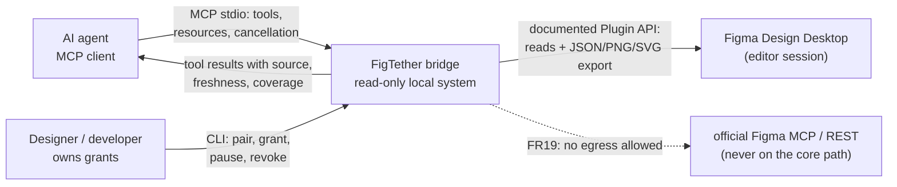
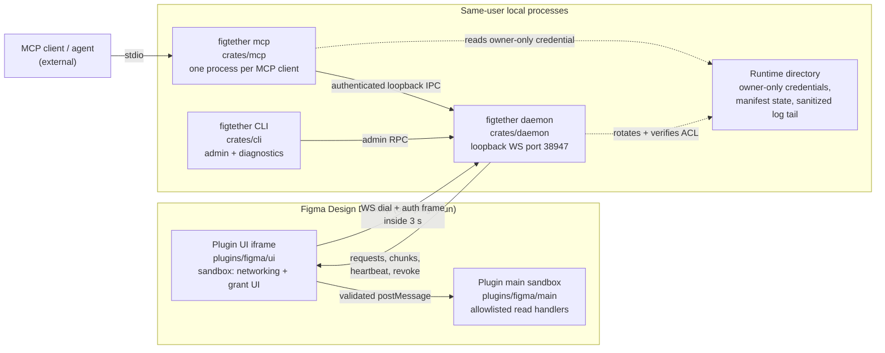
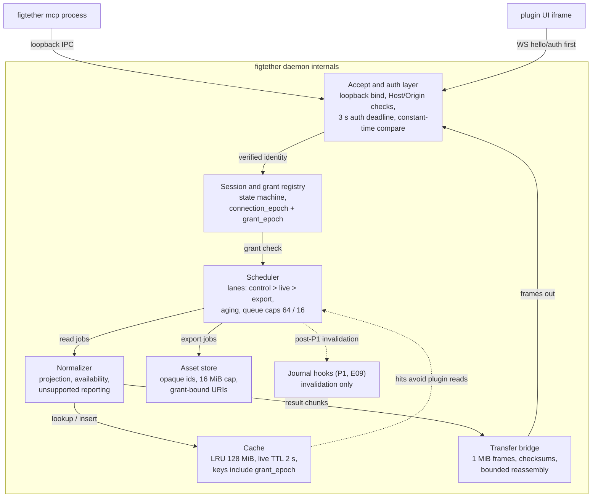

# FigTether System Design

> **Design reference.** Original requirements and approval labels below are historical design
> records, not a feature-availability list. See [current documentation status](../documentation-status.md)
> for implemented reads/writes, observed desktop evidence, and remaining gaps.

Status: `Proposed`

FigTether is a local, read-only bridge between AI agents and a Figma Design document that a still-running
plugin exposes. This document is the architectural record for that bridge: design principles, C4 levels 1 to
3, the Rust crate workspace, the process and threading model, three end-to-end data flows, the failure
isolation matrix, performance design notes, and the configuration surface. It is normative for `crates/` and
`plugins/figma/` under v0.1 and bound to PRD `FGT-PRD-001` sections 8.3 to 8.6. Every performance number here
is a target until benchmarked (PRD section 2.1), Gate G0 has not run, and the frozen cap table lives in
`docs/04-data-contracts/06-resource-limits.md`. Companion views: `docs/03-uml/`, `docs/05-security/01-threat-model.md`, and test procedures under `docs/06-testing/`.

## 1. Design principles

| #   | Principle          | Design consequence                                                                                                                                                                                                                  | Anchors                            |
| --- | ------------------ | ----------------------------------------------------------------------------------------------------------------------------------------------------------------------------------------------------------------------------------- | ---------------------------------- |
| 1   | Read-only          | No tool, bridge handler, or IPC path mutates the document; reads must not touch selection, page, or scene state; export is rendered output only. Handler allowlists only, no eval, no shell, no arbitrary JS.                       | FR24, D03, AT18                    |
| 2   | Local-first        | The core path never calls official Figma MCP or REST endpoints, needs no PAT, has no cloud component, and has no default telemetry.                                                                                                 | FR19, N09, G01, AT01, AT02         |
| 3   | Bounded resources  | Every queue, frame, transfer, cache, asset, and traversal has a frozen cap; exceeding a cap is a structured error such as BUSY or PAYLOAD_TOO_LARGE, never silent acceptance. Caps: `docs/04-data-contracts/06-resource-limits.md`. | FR07, FR13, 8.5.5, AT07, AT08      |
| 4   | Explicit semantics | Every result carries `source.kind`, observation timestamps, `consistency`, `freshness`, `cache_age_ms` when cached, and coverage. Cached or snapshot data never poses as live.                                                      | FR12, FR06, FR05, 8.3, 8.5.2, AT04 |
| 5   | Fail-closed        | Missing or expired credentials, unknown capabilities, version conflicts, and uncertain scope deny or report unsupported; uncertainty never becomes data.                                                                            | 8.6.1, FR03, FR09, AT06            |
| 6   | Double enforcement | The Rust daemon and the plugin sandbox both re-verify `session_id`, `grant_epoch`, and root membership on every request; one buggy side cannot leak scope.                                                                          | FR03, 8.4, AT05, AT17              |
| 7   | No silent fallback | No automatic REST fallback, no snapshot standing in for a failed fresh read, no scope widening via selection changes. The primary path failing produces a structured error, not a different data source.                            | 8.3, P02, D02, AT02                |

Principles are enforced by structure, not convention: see the component invariants in section 4, the crate
dependency rules in section 5, and the lowering-only configuration contract in section 10.

## 2. C4 Level 1: System context

Figure 1: System context, one subject and three actors.



Read as: one local system serves agents on the loopback only and reads the document through the editor that
already has user-granted access. The dotted edge is a forbidden direction, asserted by FR19 and audited at
release time (N09).

## 3. C4 Level 2: Containers

Figure 2: Deployable containers on one user session.



Read as: the daemon owns state and scheduling, the MCP process is stateless per client, the plugin UI iframe
is the only network leg inside the editor, and the runtime directory is the only on-disk secret surface
(PRD 8.4, 8.6.2). The main sandbox never touches the network; it receives validated messages from the UI.

## 4. C4 Level 3: Daemon internals

Figure 3: Daemon component breakdown.



Read as: every byte enters through the accept and auth layer, is admitted by the registry, then scheduled;
control traffic (revoke, cancel, heartbeat) always outranks data reads.

| Component                  | Location                                     | Responsibilities                                                                                                                                          | Key invariants                                                                                    | Anchors                       |
| -------------------------- | -------------------------------------------- | --------------------------------------------------------------------------------------------------------------------------------------------------------- | ------------------------------------------------------------------------------------------------- | ----------------------------- |
| Accept and auth            | `crates/daemon/src/accept`                   | Loopback bind, Host/Origin validation, path allowlist, auth-frame deadline 3 s, constant-time credential checks                                           | Zero design data or session metadata before auth; no bind to 0.0.0.0                              | 8.5.4, 8.6.1, AT06            |
| Session and grant registry | `crates/daemon/src/sessions`                 | State machine UNPAIRED / PAIRED / AWAITING_GRANT / READY / PAUSED / REVOKED / OFFLINE, epoch counters, 4-session cap                                      | Session identity independent of fileKey; PAUSED blocks new live and snapshot reads                | 8.4, 8.3, AT05, AT06          |
| Scheduler                  | `crates/core/src/scheduler`                  | One active editor op per session, one global export lane, bounded queues, priority control > small reads > export with aging, deadline-inclusive queueing | Requests whose deadline lapses while queued are not executed                                      | FR13, FR14, 8.5.5, AT08       |
| Cache                      | `crates/core/src/cache`                      | LRU 128 MiB shared design + assets, live TTL 2 s for explicit cached reads only, snapshot idle TTL 30 min, conservative invalidation                      | Keys include session/snapshot, grant_epoch, node ids, projection, export settings, schema version | 8.3, 8.5.5, FR12              |
| Asset store                | `crates/assets`                              | Opaque asset ids, MIME, sha256, byte caps, grant-bound resource URIs, eviction                                                                            | Single asset 16 MiB cap; revoke invalidates URIs and wipes related entries                        | FR11, FR15, 8.5.5             |
| Normalizer                 | `crates/core/src/normalize` + `crates/model` | Field projection, availability reporting, per-item batch errors, 64 KiB envelope shaping                                                                  | Unknown node types are preserved as unsupported, never dropped silently                           | FR07, FR08, PR08 (P08), 8.5.3 |
| Transfer bridge            | `crates/daemon/src/transfer`                 | 1 MiB frame cap, 32 MiB transfer cap, transfer_id sequencing, checksum at final frame, bounded reassembly, stale-transfer expiry                          | Compression off in P0; frame numbers checked before allocation                                    | 8.5.4, 8.5.5                  |
| Journal hooks (P1)         | `crates/core/src/journal`                    | Watch invalidation log, debounced 250 ms, max 10 batches/s/session, 10k events or 5 min, gap markers                                                      | Invalidation only; events are never a truth source, which stays D07                               | FR20, E09, 8.3                |

## 5. Crate workspace and dependency direction

Workspace layout per PRD 8.4: `crates/{cli,daemon,mcp,core,protocol,model,assets}`, `plugins/figma/{main,ui}`,
`schemas/`, `fixtures/`, `benchmarks/`. One binary exposes all subcommands; crate boundaries may shrink only
if domains stay separate (PRD 8.4 wording).

| Crate      | Owns                                                                                                 | May depend on                                | Must not do                                                                    |
| ---------- | ---------------------------------------------------------------------------------------------------- | -------------------------------------------- | ------------------------------------------------------------------------------ |
| `model`    | Envelope, normalized design DTOs, schema versioning                                                  | serde, serde_json, schemars only             | Any IO, network, or dependency on other internal crates                        |
| `protocol` | Bridge envelope, message types, chunk frames, JSON schemas                                           | `model`                                      | Business rules; direct socket use                                              |
| `core`     | Scheduler, sessions and grants, scope enforcement, normalizer, cache, journal hooks                  | `model`, `protocol`, `assets`                | Never imports `mcp`, `daemon`, or `cli`; never official MCP/REST egress (FR19) |
| `assets`   | Byte store, hashing, MIME typing, opaque ids, eviction                                               | `model`                                      | Accept or retain oversize items itself                                         |
| `daemon`   | Axum WS transport, accept/auth, reassembly, registry wiring, local IPC for MCP, heartbeat, lifecycle | `core`, `protocol`, `model`, `assets`        | Bind non-loopback; call official endpoints                                     |
| `mcp`      | rmcp tools and resources, stdio framing, negotiation                                                 | `core` API, `protocol`, `model`              | Never imports `daemon`; opens only loopback connections for IPC                |
| `cli`      | Subcommands doctor, daemon, mcp, status, pair, config, manifest, revoke; config parsing              | `daemon`, `mcp`, `core`, `protocol`, `model` | Adds domain rules; writes other apps' config silently; prints secrets          |

Dependency-direction rules, binding on all code review: `core` never imports `mcp` (the adapter is a skin over
the core API, PRD 8.4); `protocol` and `model` are shared at every boundary and serde/schemars derived, with
published schema artifacts under `schemas/` and cross-language tests (E02); `cli` wraps `daemon`/`mcp` and adds
no logic. Egress policy is enforced structurally: only `crates/daemon` opens sockets, and only on loopback;
`core` and `mcp` are egress-free by construction and by the deny-egress test harness (FR19, AT02, N09). The TS
side mirrors this: `plugins/figma/main` has no network capability, `plugins/figma/ui` dials loopback only within
manifest allowlisted domains (PRD S5, 8.6.1).

## 6. Process and threading model

Three process shapes, one Tokio runtime each: `figtether daemon` is the single instance per user and port, a
multi-thread runtime whose worker count defaults to `min(4, available parallelism)` (raised defaults are not
allowed, section 10, and lowered values trade throughput for the N04 RSS budget). Blocking work such as
hashing and serialization runs on `spawn_blocking` behind a bounded semaphore. `figtether mcp` starts one
current-thread runtime per process; it handles exactly one MCP client over stdio, so one client failing never
touches another (FR17, PRD 8.4). CLI subcommands are short-lived; `pair`, `doctor`, `revoke`, and `config` use
synchronous paths, and the secret is printed only by an explicit local CLI action (FR02).

Bounded task inventory inside the daemon:

- one accept loop that holds no state and hands off to connection supervisors;
- one supervisor task per connection: frame validation, auth deadline, heartbeat, offline rule (5 s interval, 3 missed heartbeats = offline, reconnect raises `connection_epoch`, no blind replay, FR16);
- one worker task per session consuming a single-op queue in strict order with control precedence;
- one global export worker shared by all sessions, so export work never blocks reads for everyone;
- bounded channels: 64 requests total, 16 per client, allocation after admission only (8.5.5);
- a coalescing map per session keyed by canonical request (source, ids, projection, filters, epoch) so
  identical concurrent fresh reads share one observation window (8.3);
- an overdue sweeper that discards queued work with lapsed deadlines instead of executing it (FR14);
- housekeeping for snapshot idle TTL (30 min) and cache eviction under the LRU budget.

Graceful shutdown sequence, per PRD 8.7 runs in this fixed order:

1. Stop the accept loop: new WS and IPC connections are refused, existing ones get a teardown notice.
2. Cancel queued jobs and in-flight transfers; late frames arriving after cancellation are dropped, and clients get CANCELLED or INTERNAL style structured errors, not hangs.
3. Revoke credentials: drop session credentials, invalidate any unused pairing secret, reject late work.
4. Close sockets cleanly (daemon WS listener, IPC endpoints), letting peers see EOF.
5. Wipe runtime files (credential files, temp manifest state) and design memory (cache, assets, snapshots), then exit with a clean status. Diagnostic logs are retained per the 7 days / 10 MiB rotation policy (8.6.2).

## 7. End-to-end data flows

### 7.1 Fresh live read with coalescing and the BUSY path

Fresh is the default live consistency: the cache never satisfies it (8.3, D04). A duplicate observation may be
merged only when requests are identical, in flight, and same-session-same-epoch.

Figure 4: Fresh live read.

```mermaid
sequenceDiagram
    autonumber
    participant A1 as Agent A (client 1)
    participant A2 as Agent B (client 2)
    participant M as figtether mcp
    participant D as daemon scheduler
    participant P as plugin sandbox
    A1->>M: get_nodes(session, root, consistency=fresh)
    A2->>M: get_nodes(session, root, consistency=fresh)
    M->>D: authenticated request (session + epochs)
    D->>D: scope check: session, grant_epoch, root membership
    alt an identical fresh request is already in flight (shared window)
        D-->>M: one observation id registered for both waiters
        P-->>D: single plugin read; result segments
        D-->>M: envelope with freshness=fresh_read
        M-->>A1: tool result (observation obs_N)
        M-->>A2: tool result (same observation obs_N)
    else no duplicate and a queue slot is free
        D-->>P: request frame with deadline_ms (read cap 20 s)
        P-->>D: progress, then result segments
        D-->>M: envelope with observation timestamps + coverage
        M-->>A1: tool result (64 KiB max or cursor)
        M-->>A2: tool result from its own observation
    else queue caps reached (64 total / 16 per client)
        D-->>M: BUSY + retry_after_ms
        M-->>A1: structured error; agent backs off, no tight loop
    end
```

Read as: admission (scope, epoch, queue) happens before any plugin contact; merging and BUSY are scheduler
decisions that never change data semantics. A cached request (`consistency=cached` plus `max_age_ms`) resolves
from the LRU with `cache_age_ms` reported and never attaches to a fresh window (8.3).

### 7.2 Snapshot capture pipeline

Capture is user-initiated from the plugin UI in P0 (PRD 8.5.1). Agents cannot create snapshots.

Figure 5: Snapshot capture.

```mermaid
sequenceDiagram
    autonumber
    participant U as Designer (plugin UI)
    participant D as daemon scheduler
    participant P as plugin sandbox
    U->>D: Capture snapshot (root inside grant)
    alt session not ready (PAUSED / REVOKED)
        D-->>U: structured rejection: PAUSED or REVOKED
    else capture accepted on the session lane
        D->>P: capture request (batch 50, depth 32, 10k visited cap)
        P->>P: sliced traversal, 8 ms slices, adaptive batch shrink
        P-->>D: traversal pages as chunks (1 MiB frames)
        D->>D: checksum verify + canonical content hash
        D->>D: store in bounded memory, bound to session + grant_epoch
        D-->>U: capture summary (snapshot_id, hash, coverage, truncated)
    end
    Note over D,P: snapshot is immutable and labeled consistency=best_effort;<br/>agents read it only via snapshot_id, never as live data
```

Read as: capture is an ordinary scheduled editor op, so it respects the one-active-op rule and deadline
discipline. The capture itself may coincide with user edits; that is why the label stays best_effort rather
than claiming an atomic version (8.3, R14).

### 7.3 Asset export pipeline

Figure 6: PNG/SVG asset export through the single global lane.

```mermaid
sequenceDiagram
    autonumber
    participant A as Agent
    participant M as figtether mcp
    participant D as daemon (single export lane)
    participant P as plugin sandbox
    A->>M: export_assets(session, node_ids, format, scale)
    M->>D: authenticated request (epochs)
    D->>D: scope check + limit validation (16 MP max, scale 0.25 to 2)
    D->>D: enqueue on the global export lane (one export at a time)
    D->>P: export job when the lane frees (serial, no parallel export)
    P-->>D: chunked transfer (transfer_id, sequence, 1 MiB frames, 32 MiB cap)
    P-->>D: final frame with checksum
    D->>D: bounded reassembly + checksum verify + sha256
    D->>D: asset store write (opaque asset_id, 16 MiB cap, LRU)
    D-->>M: asset_id + resource URI reference bound to grant_epoch
    A->>M: read resource by URI
    M-->>A: MIME, hash, size; inline caps 1 MiB raw / 2 MiB encoded
    Note over D,M: revoke cancels queued exports, drops unshipped frames,<br/>and invalidates the resource URI (FR15, N07)
```

Read as: the tool result never carries raw pixels; it carries an opaque, grant-bound reference (the pageref),
and bytes move only on a resource read that the grant epoch still authorizes. A queue-full lane yields BUSY
with `retry_after_ms` exactly like reads (8.5.5), preserving fairness across sessions.

## 8. Failure isolation matrix

Failures are contained at the smallest component. Error codes are verbatim from PRD 8.7.

| Failure domain                      | Contained by                                                                     | User-visible behavior                                                      | Error code(s)                          |
| ----------------------------------- | -------------------------------------------------------------------------------- | -------------------------------------------------------------------------- | -------------------------------------- |
| MCP process crash                   | One process per client; daemon keeps serving others (FR17)                       | Agent restarts `figtether mcp`; other clients unaffected                   | none (protocol close)                  |
| Daemon crash                        | New daemon_instance_id, credentials regenerated; stale runtime files not trusted | Clients must reconnect and re-handshake; plugins re-pair only if needed    | AUTH_REQUIRED / AUTH_EXPIRED           |
| Bad or expired credential           | Accept layer rejects pre-auth (8.5.4, 8.6.1)                                     | Connection closed before any data                                          | AUTH_REQUIRED / AUTH_EXPIRED           |
| Plugin closed, slept, socket loss   | Heartbeat watchdog, 5 s / 3 misses, offline within 15 s (FR16, N08)              | Fresh reads fail; snapshot reads still available via explicit source (8.3) | PLUGIN_OFFLINE / SESSION_NOT_FOUND     |
| Scheduler overload                  | Queue caps 64 / 16; deadline-inclusive admission (8.5.5, FR13)                   | Callers receive a retry hint and must back off                             | BUSY (+ retry_after_ms)                |
| Scope violation (node left subtree) | Double enforcement on both sides (FR03, 8.4)                                     | Member checks fail per request, per item                                   | PERMISSION_DENIED / OUT_OF_SCOPE       |
| Missing node / wrong id             | Per-item batch status (8.7, FR07)                                                | Other items in the batch still return                                      | NODE_NOT_FOUND                         |
| Seat or platform limitation         | Runtime capability probes (FR09, D09)                                            | unsupported is a valid answer, never an invented value                     | CAPABILITY_UNAVAILABLE                 |
| Oversized payload                   | Caps checked before allocation (frame, transfer, image, JSON)                    | Request rejected, no partial allocation                                    | PAYLOAD_TOO_LARGE                      |
| Traversal over 10k nodes            | Traversal budget + projected fields (8.5.5, FR07)                                | Partial results plus cursor, or submit-time rejection                      | SCOPE_TOO_LARGE / INVALID_LIMIT        |
| Document edited mid-traversal       | Observation windows and one-bounded retry (8.3, FR14)                            | best_effort result or a fresh retry, max once                              | DOCUMENT_CHANGED                       |
| Stale cursor or epoch change        | Cursor bound to observation, scope, epoch (8.3)                                  | Traversal restarts from a new baseline                                     | CURSOR_EXPIRED / RESYNC_REQUIRED       |
| Render failure / missing font       | Per-item export errors; no node or font mutation (8.7, AT18)                     | Binary alternative format only if the user selected one                    | EXPORT_FAILED / FONT_UNAVAILABLE       |
| Protocol or schema mismatch         | Handshake negotiation; doctor lists compatible pairs (8.7, D08)                  | Upgrade guidance, no guessing latest                                       | UNSUPPORTED_SCHEMA / PROTOCOL_MISMATCH |
| Session cap reached (4)             | Registry admission (8.5.5)                                                       | User must select or close a session                                        | SESSION_LIMIT                          |
| Unexpected internal bug             | Sanitized correlation id, no auto-retry (FR18, 8.7)                              | Bug report path with no design content                                     | INTERNAL_ERROR                         |
| User pause or revoke                | Scheduler honors flags; revoke wipes cache, assets, URIs (FR15, AT15)            | Revoked requests stop even mid-transfer                                    | PAUSED / REVOKED                       |

## 9. Performance design notes

- Traversal slicing: the plugin executes batch steps with an 8 ms slice target, then yields whenever the
  runtime allows it, so our traversal never holds the editor thread (8.5.5, N06 freeze budget > 1 s).
- Adaptive batch shrink: repeated slice overruns or slow progress halve the effective batch size toward a
  floor; persistent saturation waves the operation back as partial results plus a cursor (8.5.5).
- Memory: the shared LRU budget is 128 MiB for design plus assets, single assets capped at 16 MiB; items
  larger than a cap are rejected, not truncated. Caps are checked pre-decode and pre-allocation.
- RSS accounting: cache and asset caps are not RSS guarantees (parsing, allocator, transport buffers add
  overhead), so N04 sampling (idle <= 50 MiB, peak <= 256 MiB) runs on the release build, documented in
  `docs/06-testing/04-benchmark-plan.md`.
- Latency discipline: cached metadata aims at 100 ms p95 with small envelopes (N01); fresh reads are designed
  toward the 2 s p95 target (N02) with a hard 20 s read deadline that includes queue wait; exports target
  5 s p95 (N03) on an isolated lane with a 60 s deadline.
- Response shaping: the 64 KiB encoded UTF-8 response cap is enforced by projection and pagination, never by
  silently truncating content; `truncated` is always explicit (FR07, P04, AT07).
- Full cap table with change rules: `docs/04-data-contracts/06-resource-limits.md`.

## 10. Configuration surface

Sources in strict precedence: built-in frozen defaults from `docs/04-data-contracts/06-resource-limits.md`,
then an optional config file (exact format is open question Q3), then CLI flags. `figtether doctor` prints the
effective values and their source (8.7). The contract is lowering-only: an explicit override is accepted only
when it is less than or equal to the frozen default. A request to exceed a default is a startup error with a
clear message, not a silent clamp and not an accepted raise. Rationale: caps freeze the benchmarked profile
(8.5.5 warns that anything above the tested profile is custom/unvalidated), and allowing silent raises would
manufacture unvalidated claims while lowering keeps marginal hardware working (R12).

| Knob                                    | Frozen default        | Raise attempt                                                                                        | Anchors     |
| --------------------------------------- | --------------------- | ---------------------------------------------------------------------------------------------------- | ----------- |
| `port`                                  | 38947, loopback       | free value, but collision fails at startup with `--port` guidance and manifest regeneration, PRD 5.1 | 5.1, 8.7    |
| `read_timeout_ms`                       | 20000                 | startup error                                                                                        | 8.5.5       |
| `export_timeout_ms`                     | 60000                 | startup error                                                                                        | 8.5.5       |
| `cache_cap_mib`                         | 128                   | startup error                                                                                        | 8.5.5       |
| `max_asset_mib`                         | 16                    | startup error                                                                                        | 8.5.5       |
| `queue_total`                           | 64                    | startup error                                                                                        | 8.5.5       |
| `queue_per_client`                      | 16                    | startup error                                                                                        | 8.5.5       |
| `max_sessions`                          | 4                     | startup error                                                                                        | 8.5.5       |
| `live_cache_ttl_ms`                     | 2000                  | startup error                                                                                        | 8.3         |
| `snapshot_idle_ttl_min`                 | 30                    | startup error                                                                                        | 8.3         |
| `mcp_json_kib`                          | 64                    | startup error                                                                                        | 8.5.5       |
| level knobs (`--verbose`, log rotation) | off / 7 days + 10 MiB | n/a                                                                                                  | FR18, 8.6.2 |

Configuration never carries secrets: the pairing secret is generated per run and shown only by explicit local
action (FR02), and the IPC credential file is owner-only (Windows DACL verified, POSIX mode verified) per 8.6.2.
The CLI never writes another application's MCP config silently; `figtether config print --client generic` only
prints (PRD 5.1, 8.5.1).

## 11. Traceability

| Design element in this document                       | Anchors                                                                         |
| ----------------------------------------------------- | ------------------------------------------------------------------------------- |
| Design principles (section 1)                         | FR03, FR06, FR12, FR19, FR24, D02, D03, D04, 8.3, 8.6.1, AT01, AT02, AT04, AT18 |
| C4 containers and runtime directory (sections 2 to 4) | 8.4, 8.6.2, FR17, AT03, AT06                                                    |
| Daemon components, invariant table (section 4)        | FR03, FR07, FR09, FR11, FR13, FR15, FR20, 8.5.4, 8.5.5                          |
| Process and threading model, shutdown (section 6)     | FR02, FR13, FR14, FR16, FR18, N04, N07, 8.7                                     |
| Data flows (section 7)                                | FR05, FR06, FR07, FR11, FR13, FR14, FR15, 8.3                                   |
| Failure isolation matrix (section 8)                  | 8.7 error table, FR09, FR16, FR18, AT06, AT09, AT15                             |
| Performance notes (section 9)                         | N01 to N06, 8.5.5, FR07, AT07, AT08                                             |
| Configuration surface (section 10)                    | 5.1, 8.5.5, 8.6.2, FR18, R12                                                    |

## 12. Open questions

| Q   | Question                                                                                                                           | Impact                                                                          | Closure path                                                                           |
| --- | ---------------------------------------------------------------------------------------------------------------------------------- | ------------------------------------------------------------------------------- | -------------------------------------------------------------------------------------- |
| Q1  | Daemon worker thread count and blocking-pool size for the N04 RSS budget on the 4-core reference profile                           | Default `min(4, parallelism)` may be tuned; must be measured before publication | `docs/06-testing/04-benchmark-plan.md`, G1                                             |
| Q2  | Exact MCP-to-daemon IPC mechanism: separate loopback listener versus OS-local socket or named pipe, and the credential file format | Affects `crates/daemon` and `crates/mcp` boundaries                             | ADR candidate in `docs/02-architecture/adr/`, decided with G0 transport evidence (D06) |
| Q3  | Config file format (TOML proposed) and the canonical flag or key names for the lowering-only knobs                                 | Affects `crates/cli` and documentation                                          | Freeze together with the cap table at E02/G1                                           |
| Q4  | Canonical coalescing key (field projection normalization, filter ordering) so "identical" is unambiguous                           | Affects `crates/core/src/scheduler` and correctness of 8.3 merging              | Design note + property tests before E06                                                |
| Q5  | Whether snapshot capture occupies the session's single editor-op lane or a dedicated capture lane                                  | Scheduler fairness for interactive users during bulk capture                    | Plugin performance tests at E04                                                        |
| Q6  | Heartbeat watchdog placement: UI iframe timers versus main sandbox timer behavior on the target OS                                 | Affects FR16 reliability and the 15 s offline bound                             | G0 timer probe (gap list in `docs/00-overview/01-prd-analysis.md`)                     |
| Q7  | CLI `revoke` semantics when the daemon is not running (nothing to revoke versus deferred marker file)                              | Affects `crates/cli/src/cmd/revoke`                                             | Runbook decision in `docs/07-ops/`                                                     |
