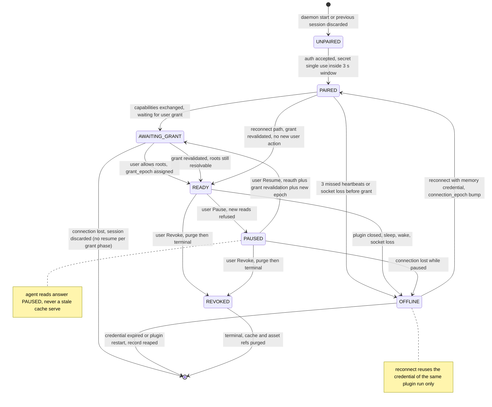

# State Machines (Session, Connection, Job)

> **Design reference.** Original requirements and approval labels below are historical design
> records, not a feature-availability list. See [current documentation status](../documentation-status.md)
> for implemented reads/writes, observed desktop evidence, and remaining gaps.

Status: `Proposed`

This document fixes the three coordinated state machines: the plugin session FSM (PRD chain
UNPAIRED, PAIRED, AWAITING_GRANT, READY, PAUSED, REVOKED, with OFFLINE), the per socket connection
FSM, and the scheduler job FSM used for every read, export and snapshot capture. Each transition
table lists state, event, guard, action and next state, including side effects such as cache
invalidation on revoke, epoch bumps on reconnect, and the rule that old queued work is never
blindly replayed. Normative sources: PRD 8.4 (state machine and heartbeat paragraph), 8.5.5
(deadlines and scheduler), 8.6.1 (revocation), section 2.1 (N07 and N08 targets).

## 1. Scope and references

- Session FSM covers the authorization lifecycle of one plugin run against one daemon instance.
- Connection FSM covers the sockets of that run, including the reconnect loop and epoch rules.
- Job FSM covers scheduler work items; P1 watch adds no new states (FR20).
- Sibling documents: transport and frame rules in `docs/02-architecture/02-bridge-design.md`;
  MCP handling of PAUSED, REVOKED and PLUGIN_OFFLINE in `docs/02-architecture/03-mcp-design.md`;
  plugin UI states in `docs/02-architecture/04-plugin-design.md`.

## 2. Session FSM

Read as: authorization moves forward only through user actions, connectivity loss is recoverable
exactly once per run, and REVOKED is terminal with cleanup as part of entry.

| State            | Meaning                                          | Allowed inbound messages                                                    |
| ---------------- | ------------------------------------------------ | --------------------------------------------------------------------------- |
| `UNPAIRED`       | Resting; no session record.                      | `auth` only.                                                                |
| `PAIRED`         | Authenticated, capability exchange not finished. | `capabilities`, heartbeat.                                                  |
| `AWAITING_GRANT` | Grant entry in progress in the UI.               | heartbeat only; grant arrives via user action.                              |
| `READY`          | Grant bound, reads and exports allowed.          | `request`, `cancel`, `revoke`, `grant_update`, heartbeat.                   |
| `PAUSED`         | Grant intact, new reads refused.                 | `revoke`, `grant_update`, heartbeat.                                        |
| `OFFLINE`        | Connection lost; no work accepted.               | heartbeat silence only; no frames accepted (reject unknown or late frames). |
| `REVOKED`        | Terminal; purged.                                | late frames rejected silently.                                              |

## 3. Session transition table

| State                   | Event                                                        | Guard                                                                                         | Action and side effects                                                                                                                                                                                                                                                                                    | Next                      |
| ----------------------- | ------------------------------------------------------------ | --------------------------------------------------------------------------------------------- | ---------------------------------------------------------------------------------------------------------------------------------------------------------------------------------------------------------------------------------------------------------------------------------------------------------- | ------------------------- |
| UNPAIRED                | `auth` frame                                                 | Within 3 s window, secret inside 5 min TTL, unused, protocol major matches                    | Create session instance, mint ephemeral memory only credential, zeroize secret bytes, start heartbeat accounting                                                                                                                                                                                           | PAIRED                    |
| UNPAIRED                | Window breach or invalid secret                              | Any                                                                                           | Close socket; no capability, enqueue or session metadata was exposed (PRD 8.5.4). Failed attempts do not consume the secret                                                                                                                                                                                | UNPAIRED                  |
| PAIRED                  | `capabilities` frame                                         | Fingerprint parses                                                                            | Store capability fingerprint; UI opens grant panel                                                                                                                                                                                                                                                         | AWAITING_GRANT            |
| PAIRED                  | 3 missed heartbeats or socket error                          | none                                                                                          | Mark OFFLINE; refuse all work; agent reads answer PLUGIN_OFFLINE                                                                                                                                                                                                                                           | OFFLINE                   |
| AWAITING_GRANT          | User selects roots and allows                                | Roots resolvable in the document, membership verified in the plugin and the daemon (FR03)     | Bind `grant_id`, assign `grant_epoch`, namespace cache keys, session becomes visible to the paired client (FR04)                                                                                                                                                                                           | READY                     |
| AWAITING_GRANT          | Connection loss                                              | none                                                                                          | Session discarded; no reconnection is possible because the grant phase predates any resumable state                                                                                                                                                                                                        | session ended             |
| READY                   | User Pause                                                   | none                                                                                          | Refuse new live and snapshot reads (PAUSED); in flight operations finish or are cancelled; queues drain but admit nothing new                                                                                                                                                                              | PAUSED                    |
| PAUSED                  | User Resume                                                  | Transport auth valid, grant revalidated: roots still resolvable, out of subtree nodes dropped | Reassign `grant_epoch` so cursors and asset URIs minted before the pause expire (committed interpretation, see section 7); membership reverified on both sides; the session passes through `AWAITING_GRANT` as the revalidation gate and is promoted to `READY` by the daemon once the roots resolve again | AWAITING_GRANT then READY |
| READY or PAUSED         | User Revoke (UI or CLI)                                      | none                                                                                          | Stop sends; cancel queue and open transfers; purge design cache, assets, cursors and asset URIs of the grant; answer later reads REVOKED; never send post revoke payload (N07)                                                                                                                             | REVOKED                   |
| PAIRED, READY or PAUSED | 3 missed heartbeats, plugin close, sleep, wake, socket death | none                                                                                          | Mark OFFLINE; keep the record; no new enqueue                                                                                                                                                                                                                                                              | OFFLINE                   |
| OFFLINE                 | Reconnect attempt succeeds                                   | Memory credential of the same plugin run still valid                                          | New `connection_epoch`; cancel every job of the old epoch (no blind replay, FR16); drop frames with stale epochs                                                                                                                                                                                           | PAIRED                    |
| PAIRED (reconnect path) | Grant revalidation                                           | Scope membership still verified                                                               | No new user action; instruction to resume reads                                                                                                                                                                                                                                                            | READY                     |
| OFFLINE                 | Credential expired, plugin restart destroys in memory state  | none                                                                                          | Reap the record; restart of plugin or daemon always means a new session and a new grant (PRD 8.4)                                                                                                                                                                                                          | session ended             |

## 4. Connection FSM (per socket within a run)

| State          | Event                                              | Guard                                                    | Action                                                                                      | Next           |
| -------------- | -------------------------------------------------- | -------------------------------------------------------- | ------------------------------------------------------------------------------------------- | -------------- |
| DIALING        | Iframe opens socket                                | Target is the loopback endpoint only                     | Enforce byte bounded pre-auth read budget (1 MiB frame cap)                                 | AUTHENTICATING |
| AUTHENTICATING | First frame is valid auth                          | Secret valid, unused, inside TTL; protocol major matches | Constant time compare (PRD 8.6.1); issue session credential, initial `connection_epoch` = 1 | ACTIVE         |
| AUTHENTICATING | Wrong or reused secret, or 3 s elapsed without it  | Any                                                      | Fail closed: close socket, log category only, no metadata leaked                            | CLOSED         |
| ACTIVE         | Frames and heartbeats exchanged                    | Session FSM in PAIRED through PAUSED                     | Serve allowlist with epochs; no work without a bound grant                                  | ACTIVE         |
| ACTIVE         | 3 missed heartbeats or socket error                | none                                                     | Session FSM enters OFFLINE                                                                  | LOST           |
| LOST           | Reconnect attempted                                | Memory credential still valid                            | Dial again; on success bump `connection_epoch`, cancel old epoch jobs                       | RECONNECTING   |
| LOST           | Credential expired, plugin restarted, user cancels | none                                                     | Discard; session reaped                                                                     | CLOSED         |
| RECONNECTING   | Handshake succeeds                                 | none                                                     | New epoch assignment, old epoch frames ignored, resume the session FSM per section 3        | ACTIVE         |
| RECONNECTING   | Handshake rejected repeatedly                      | Credential unusable                                      | Close; user pairs again                                                                     | CLOSED         |

## 5. Job FSM (scheduler work items)

States: `QUEUED`, `RUNNING`, `AWAITING_PLUGIN`, terminal `COMPLETED`, `FAILED`, `CANCELLED`,
`TIMED_OUT`, `SUPERSEDED`. One job covers one read, one export, or one snapshot capture; watch P1
adds no new states. Deadlines come from the request kind: 20,000 ms read, 60,000 ms export and
capture indexing, queue wait counted (PRD 8.5.5).

| State                      | Event                                          | Guard                                                                                                                                                      | Action and side effects                                                                                          | Next            |
| -------------------------- | ---------------------------------------------- | ---------------------------------------------------------------------------------------------------------------------------------------------------------- | ---------------------------------------------------------------------------------------------------------------- | --------------- |
| -                          | MCP request or UI capture admitted             | Queue caps hold: 64 total, 16 per client                                                                                                                   | Record `request_id`, deadline, epochs; otherwise reject at admission with BUSY plus `retry_after_ms` (PRD 8.5.5) | QUEUED          |
| QUEUED                     | Deadline reaches zero                          | none                                                                                                                                                       | Discard; never executed (PRD 8.5.5 queued deadline row)                                                          | TIMED_OUT       |
| QUEUED                     | Scheduler picks                                | Active editor op free: 1 per session, 1 global export; priority revoke, cancel, heartbeat, then reads, then exports, aging prevents starvation (PRD 8.5.5) | Reserve slot; assign `job_id`                                                                                    | RUNNING         |
| QUEUED                     | MCP cancel notification, revoke or pause drain | none                                                                                                                                                       | Drop without contacting the plugin                                                                               | CANCELLED       |
| RUNNING                    | Request frame dispatched                       | Session READY, epoch current                                                                                                                               | Send `request` with `deadline_ms`; record dispatched epoch                                                       | AWAITING_PLUGIN |
| RUNNING                    | Pre dispatch validation fails                  | Grant missing, node out of scope, schema unknown                                                                                                           | Structured error only; no plugin frame sent                                                                      | FAILED          |
| RUNNING or AWAITING_PLUGIN | MCP cancel forwarded, or revoke                | none                                                                                                                                                       | Bridge `cancel` frame; plugin drops work; late results discarded (FR14)                                          | CANCELLED       |
| AWAITING_PLUGIN            | Result complete and verified                   | Checksum verified, epochs still current, deadline holds                                                                                                    | Normalize, label source and observation metadata; cache only per `docs/04-data-contracts/` rules                 | COMPLETED       |
| AWAITING_PLUGIN            | Error frame                                    | Transient read failure with retry budget left                                                                                                              | Requeue once; retry inherits the remaining deadline of the enclosing request, never a fresh full deadline        | QUEUED          |
| AWAITING_PLUGIN            | Error frame                                    | Non transient, budget exhausted, or DOCUMENT_CHANGED after the one allowed retry                                                                           | Structured error; per item status for batches (PRD 8.7)                                                          | FAILED          |
| AWAITING_PLUGIN            | Deadline passes with no verified result        | none                                                                                                                                                       | Discard; every later chunk, partial and result of this transfer is rejected (PRD 8.3 late read rule)             | TIMED_OUT       |
| AWAITING_PLUGIN            | An identical concurrent fresh request exists   | Same observation window allowed by PRD 8.3                                                                                                                 | Keep the master job; record the duplicate request as a follower of the master                                    | SUPERSEDED      |
| SUPERSEDED                 | Follower completes                             | none                                                                                                                                                       | Deliver the master payload under its own `request_id`; no second editor read happened                            | COMPLETED       |

## 6. Side effect rules across transitions

- Revoke: cache invalidation is synchronous with the REVOKED verdict; asset URIs and cursors are
  invalidated before any response reuses old data (FR15, AT15).
- Reconnect: the epoch bump cancels, never replays. Jobs of the previous `connection_epoch` are
  CANCELLED; no queued or inflight work from the old socket is re-sent on the new one (FR16, no
  blind replay).
- Pause: refuses new live and snapshot reads; cached and snapshot reads already in flight are
  honored; new request admissions answer PAUSED (PRD 8.3 cache TTL row, 5.2 table).
- Grant epoch bump on scope change: invalidates cursors and asset URIs coined under the previous
  epoch; out of scope subtree membership stops resolving on the next request (PRD 8.4, FR03).
- Plugin or daemon restart: new session, new grant, stale runtime files detected and not trusted
  (PRD 8.7 crash row). Old snapshots stay readable as snapshot sources only, never as live.

## 7. Committed interpretations

1. Resume bumps `grant_epoch` even though the scope is unchanged, because the PRD pairs resume
   with revalidation (PRD 8.4) and the transition needs a new anchor for cursor and asset expiry.
   Cursor based callers treat the bump as a normal CURSOR_EXPIRED (PRD 8.3).
2. OFFLINE is reachable only from PAIRED, READY and PAUSED (PRD 8.4). Connection loss during
   AWAITING_GRANT discards the session, because no resumable grant exists yet.
3. In flight jobs on Pause finish rather than being cancelled, unless the user anyway revokes;
   the PRD only refuses new reads during pause (PRD 8.3).

## 8. Invariants

- INV01: A `session_id` belongs to exactly one plugin run; restarts always mint a new id (PRD 8.4).
- INV02: Frames carrying a stale `connection_epoch` or `grant_epoch` are dropped before any
  handler or cache interaction (PRD 8.4).
- INV03: No session enters READY without a user created grant containing at least one root; the
  union of granted subtrees, dedup descendants, is the only scope (PRD 8.4).
- INV04: Selection changes never widen scope; nodes leaving the subtree stop resolving (PRD 8.4).
- INV05: Cursor and asset references bind to the grant epoch; any epoch change invalidates them.
- INV06: Revoke purges cache and assets and denies later reads with REVOKED; already delivered
  data cannot be recalled by the daemon (PRD 5.3).
- INV07: Pause refuses new reads; resume requires reauthorization plus grant revalidation (PRD
  8.4) plus the new epoch of section 7.
- INV08: A late result after its deadline is discarded, whatever its content (PRD 8.3).
- INV09: The secret is consumed exactly once on success, fails closed otherwise, and never
  appears in URLs, logs or tool schemas (FR02).
- INV10: Reconnect reuses credentials of the same plugin run only; after restart, a new session
  and a new grant are mandatory (PRD 8.4).
- INV11: Snapshots are immutable after mint and always labeled `consistency=best_effort`; a
  snapshot never substitutes for a fresh live read (PRD 8.3).
- INV12: Offline detection arrives within 15 s of connection loss (3 missed heartbeats at 5 s);
  detection of plugin close, sleep or restart is exercised by AT09 (N08 target).
- INV13: Every non terminal state rejects message types outside its allowed set of section 2;
  unexpected frames never mutate state.
- INV14: A request beyond its deadline while queued is never executed (PRD 8.5.5).

## 9. Reconnect readiness wording (N08)

N08 is a target pair, not a result (PRD 2.1): offline recognized within 15 s, reconnect readiness
within 10 s after the transport recovers. The readiness point is defined functionally: the socket
is re established, authentication and grant revalidation succeeded, `connection_epoch` was bumped,
old epoch jobs were cancelled, and the session FSM is back in READY. Words like connected in a
status row refer to this definition, not merely to the socket opening. Evidence is collected by
AT09 with timestamps from the daemon and plugin (N07 method), and reported per
`docs/06-testing/04-benchmark-plan.md`.

## 10. Traceability

| Anchor                                     | Covered by                                                           |
| ------------------------------------------ | -------------------------------------------------------------------- |
| FR03 double enforcement and grant epochs   | Session rows for READY entry and resume; INV03 to INV05; AT05, AT17. |
| FR13 scheduler and backpressure            | Job FSM admission and selection rows; AT08.                          |
| FR14 deadline, cancellation, bounded retry | Job FSM TIMED_OUT, CANCELLED and retry rows; AT08, AT15.             |
| FR15 pause and revoke                      | Session rows and INV06, INV07; AT06, AT15.                           |
| FR16 heartbeat, offline, reconnect         | OFFLINE rows and section 9; AT09, AT15.                              |
| FR05 immutable snapshot                    | INV11; AT04.                                                         |

## 11. Open questions

1. Reap delay for OFFLINE and REVOKED session records in the daemon: default proposal is purge on
   credential expiry or daemon restart (PRD 8.7 crash row); confirm with operations.
2. Whether Resume should also cancel in flight operations instead of finishing them; the current
   design follows PRD 8.3 wording that only new reads are refused.
3. Whether the SUPERSEDED coalescing path must also apply to snapshot captures or only fresh
   reads; PRD 8.3 allows coalescing for identical concurrent requests with one observation window.
4. Heartbeat timing owner on sleep and wake: both sides check 3 misses independently today; G0
   decides whether a single authoritative clock simpler design is safer per OS (R02).
