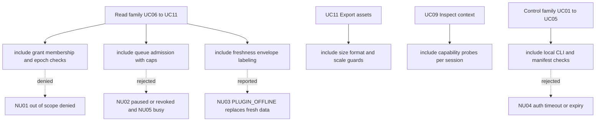

# UML Use Case Diagrams

> **Design reference.** Original requirements and approval labels below are historical design
> records, not a feature-availability list. See [current documentation status](../documentation-status.md)
> for implemented reads/writes, observed desktop evidence, and remaining gaps.

Status: `Proposed`

Purpose: name the actors of FigTether and the value they draw from the system, including the
outcomes that must never be silent: denied reads, paused or revoked rejections, offline reports,
authentication timeouts, and queue backpressure. Cases are derived from PRD 4.2 user stories, the
onboarding path in PRD 5.1, and the P0 tool surface in PRD 8.5.1. The labels UC01..UC13 and
NU01..NU05 are local to this document; PRD IDs (FR, AT, P, N, G) stay verbatim everywhere.

Approximation note: Mermaid has no native use case diagram. This file approximates one with
`flowchart TD`. Actor nodes sit outside subgraphs, subgraphs stand in for the system boundary and
its use case packages, solid edges are actor-to-use-case associations, and dotted edges model
extends-style behavior that terminates in structured error outcomes rather than success. A
classic drawing tool would render stick figure actors and oval use cases; the semantics here are
the same.

## Diagram 1: actors, use cases, and rejected outcomes

Read as: an eligible end user controls pairing, grants, pause, capture and revoke; the MCP client
and its agent reach only read tools; a maintainer runs doctor and config print at the same
machine; every read path also carries explicit failure exits.

```mermaid
flowchart TD
    user["End user holding an eligible Figma seat"]
    agent["MCP client with an AI agent attached"]
    maint["Maintainer or operator at the same machine"]

    subgraph figtether["FigTether system boundary, read only core"]
        subgraph control["Setup and session control, user only"]
            uc_pair["UC01 Pair a session"]
            uc_grant["UC02 Grant root access"]
            uc_pause["UC03 Pause or resume"]
            uc_snap["UC04 Capture a snapshot"]
            uc_revoke["UC05 Revoke access"]
        end
        subgraph reads["Agent reads via P0 tools"]
            uc_list["UC06 List granted sessions"]
            uc_summary["UC07 Read selection summary"]
            uc_nodes["UC08 Read nodes with projection"]
            uc_ctx["UC09 Inspect design context"]
            uc_tokens["UC10 Get design tokens"]
            uc_assets["UC11 Export assets as PNG or SVG"]
        end
        subgraph cliops["Maintainer operations"]
            uc_doctor["UC12 Diagnose with doctor"]
            uc_print["UC13 Print MCP config"]
        end
        subgraph rejections["Negative outcomes surfaced as structured errors"]
            n_scope["NU01 Out of scope read denied"]
            n_state["NU02 PAUSED or REVOKED rejected"]
            n_off["NU03 PLUGIN_OFFLINE reported"]
            n_auth["NU04 Auth timeout or expiry"]
            n_busy["NU05 BUSY with retry hint"]
        end
    end

    user --> uc_pair
    user --> uc_grant
    user --> uc_pause
    user --> uc_snap
    user --> uc_revoke
    agent --> uc_list
    agent --> uc_summary
    agent --> uc_nodes
    agent --> uc_ctx
    agent --> uc_tokens
    agent --> uc_assets
    maint --> uc_doctor
    maint --> uc_print

    uc_summary -.-> n_busy
    uc_nodes -.-> n_busy
    uc_assets -.-> n_busy
    uc_list -.-> n_auth
    uc_nodes -.-> n_auth
    uc_nodes -.-> n_scope
    uc_ctx -.-> n_scope
    uc_tokens -.-> n_scope
    uc_assets -.-> n_scope
    uc_summary -.-> n_state
    uc_nodes -.-> n_state
    uc_ctx -.-> n_state
    uc_tokens -.-> n_state
    uc_assets -.-> n_state
    uc_list -.-> n_state
    uc_nodes -.-> n_off
    uc_ctx -.-> n_off
    uc_tokens -.-> n_off
    uc_assets -.-> n_off
```

| Element                          | Reference                        |
| -------------------------------- | -------------------------------- |
| UC01 Pair a session              | FR02, FR04, PRD 5.1 steps 5 to 6 |
| UC02 Grant root access           | FR03, PRD 5.1 step 6             |
| UC03 Pause or resume             | FR15                             |
| UC04 Capture a snapshot          | FR05, FR15, PRD 8.3              |
| UC05 Revoke access               | FR15, FR14, PRD 5.3              |
| UC06 List granted sessions       | FR04                             |
| UC07 Read selection summary      | FR12, PRD 8.5.1 get_selection    |
| UC08 Read nodes with projection  | FR06, FR07                       |
| UC09 Inspect design context      | FR08, FR09                       |
| UC10 Get design tokens           | FR10                             |
| UC11 Export assets as PNG or SVG | FR11                             |
| UC12 Diagnose with doctor        | FR18, P09, AT03, PRD 8.7         |
| UC13 Print MCP config            | FR17, PRD 5.1 step 7             |
| NU01 Out of scope read denied    | FR03, AT17, P06                  |
| NU02 PAUSED or REVOKED rejected  | FR15, AT15                       |
| NU03 PLUGIN_OFFLINE reported     | FR16, AT09, P11                  |
| NU04 Auth timeout or expiry      | FR02, AT06                       |
| NU05 BUSY with retry_after_ms    | FR13, PRD 8.5.5                  |

Actor notes:

- The end user is the only actor who can widen or retract authority. Seat eligibility is a Figma
  platform fact, not a FigTether capability, so eligibility failure is out of system control
  (S2, PRD section 3).
- The agent sees only granted sessions and read tools; the pairing secret and bridge endpoints
  never appear in any tool schema (FR02, PRD 8.5.1). Grant creation, extension, pairing and
  revoke stay user-controlled via UI or CLI (PRD 8.5.1).
- The maintainer works at the same machine; v0.1 has no remote administration, no cloud relay and
  no telemetry channel (PRD 8.6.2).
- UC04 snapshot capture is user-initiated in the plugin UI during P0; the agent cannot trigger a
  capture through a tool (PRD 8.5.1). A later tool surface change would need its own requirement.

## Diagram 2: includes and cross-cutting guard checks

Read as: each use case family includes the same guard checks, and those guards project into the
negative outcomes, so that denial is part of every use case rather than an afterthought.

| Element                                   | Reference                                        |
| ----------------------------------------- | ------------------------------------------------ |
| include grant membership and epoch checks | FR03, PRD 8.4 double enforcement                 |
| include queue admission with caps         | FR13, PRD 8.5.5 queue 64 total and 16 per client |
| include freshness envelope labeling       | FR12, PRD 8.3                                    |
| include size format and scale guards      | FR11, PRD 8.5.5 export limits                    |
| include capability probes per session     | FR09, AT12                                       |
| include local CLI and manifest checks     | FR18, PRD 8.7                                    |

Open questions:

1. Whether the agent ever gains a snapshot-capture tool is deliberately deferred; P0 keeps
   capture user-driven per PRD 8.5.1. Revisit only with a new requirement ID.
2. Whether doctor gains an interactive repair mode is an ops document decision, not a use case
   change; UC12 remains diagnose-only here.
3. Persona coverage: P1 multi-client reading (FR22) does not add a new actor, only multiple agent
   instances; revisit use case diagram at v0.2.
