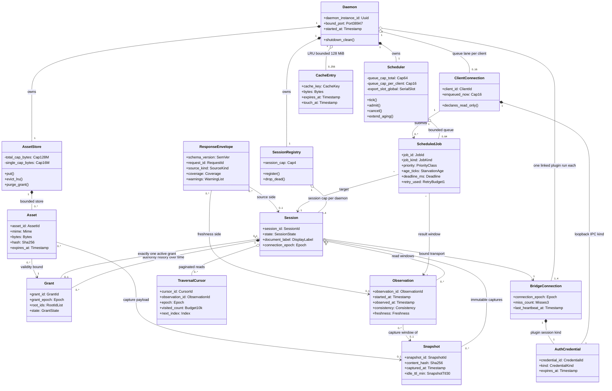

# UML Class Diagrams

> **Design reference.** Original requirements and approval labels below are historical design
> records, not a feature-availability list. See [current documentation status](../documentation-status.md)
> for implemented reads/writes, observed desktop evidence, and remaining gaps.

Status: `Proposed`

Purpose: fix the Rust domain vocabulary of the FigTether daemon so ownership, multiplicity and
invariants are visible before implementation. The model covers the daemon, scheduler, sessions,
grants, snapshots, observations, cursors, cache, assets and credentials named in PRD 8.4 and
8.5. Attribute type names are indicative shape words, for example Sha256, Uuid, Epoch, and not
literal Rust declarations; real code maps them to standard and newtype definitions.

## Diagram 1: daemon domain model with multiplicities

Read as: one daemon owns its scheduler, session registry, asset store and cache; sessions are
capped at four and each accumulates a grant history, observations, snapshots and cursors; each
scheduled job binds exactly one session and one observation; the two transport kinds carry two
distinct credential kinds that are never interchangeable.

| Class or edge                          | Reference                          |
| -------------------------------------- | ---------------------------------- |
| Daemon, SessionRegistry cap 4          | PRD 8.5.5 session limit, P06, AT05 |
| Scheduler queue caps and SerialSlot    | FR13, PRD 8.5.5, AT08              |
| ScheduledJob deadline and retry budget | FR14, PRD 8.5.5                    |
| Grant root_ids, grant_epoch, state     | FR03, PRD 8.4 entity table         |
| Session state and connection binding   | FR16, PRD 8.4 state machine        |
| Snapshot id, hash, captured_at         | FR05, PRD 8.3                      |
| Observation fields                     | FR06, FR12, PRD 8.5.2              |
| CacheEntry and LRU bound               | PRD 8.3 cache rules, PRD 8.5.5     |
| Asset and AssetStore bound             | FR11, PRD 8.5.5 asset limits       |
| TraversalCursor epoch binding          | FR07, PRD 8.3 pagination live      |
| ResponseEnvelope                       | PRD 8.5.2                          |
| BridgeConnection heartbeat fields      | FR16, PRD 8.4 heartbeat            |
| AuthCredential two kinds               | PRD 8.5.4 auth exchange rules      |

Ownership and invariants:

- Strong ownership preference: the daemon owns its Scheduler, SessionRegistry and AssetStore by
  plain fields; the design avoids Arc and Mutex wherever a single owner task suffices, and keeps
  interior mutability behind per-object single-writer channels instead of shared locks.
- Every shared type must be Send plus Sync so the async runtime can move futures between worker
  threads safely; blocking work stays out of the async lanes.
- All caps are enforced at insertion, not observed after the fact: queue 64 total and 16 per
  client, session cap 4, batch 50 ids, depth 32, traversal budget 10k nodes, cache 128 MiB with
  single asset 16 MiB, transfer cap 32 MiB, response cap 64 KiB. A rejected admission is a
  structured error such as INVALID_LIMIT or BUSY, never a silent drop.
- Epoch fields are monotonic counters and are never reused: connection_epoch increases on every
  reconnect, grant_epoch increases on scope change or revoke (FR03, FR16).
- At most one active Grant per Session; the full Grant list is kept as history for epoch audit.
  Superseded or revoked grants cannot be revived, and late results must not resurrect them
  (FR14, AT15).
- IDs stay opaque strings: session_id, snapshot_id, observation_id, asset_id, and node_id are
  never parsed as numbers or routed through document names or fileKey (PRD 8.4 entity table).
- CacheEntry keys include session or snapshot identity, grant_epoch, node ids, field projection,
  export settings and schema version; entries are evicted on revoke, TTL and LRU pressure
  (PRD 8.3). Assets are grant-bound, so purge_grant removes them with the grant.
- ResponseEnvelope never carries secrets, endpoints or design data outside declared fields; the
  credential values live only inside AuthCredential instances (FR02).

Open questions:

1. Whether AssetStore additionally keeps a per-grant index register or scans by grant binding is
   an implementation choice for the core owner.
2. Whether TraversalCursor also pins a snapshot generation when used against captured data needs
   wording in 04-data-contracts after G0 evidence.
3. The exact Rust mailbox types per single-writer owner are left to the core owner; the model
   constraint is only the no-shared-locks preference above.
