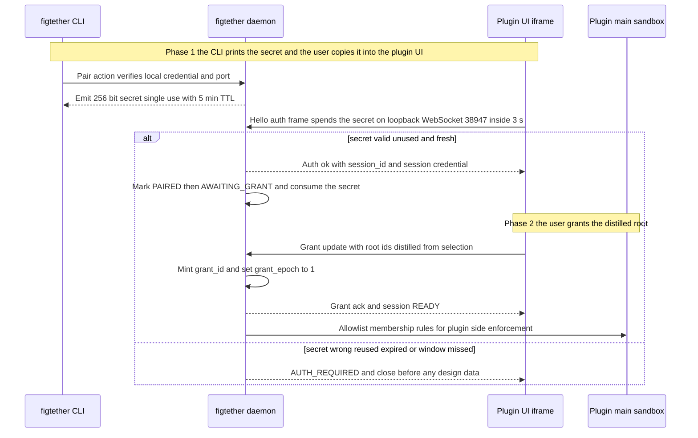
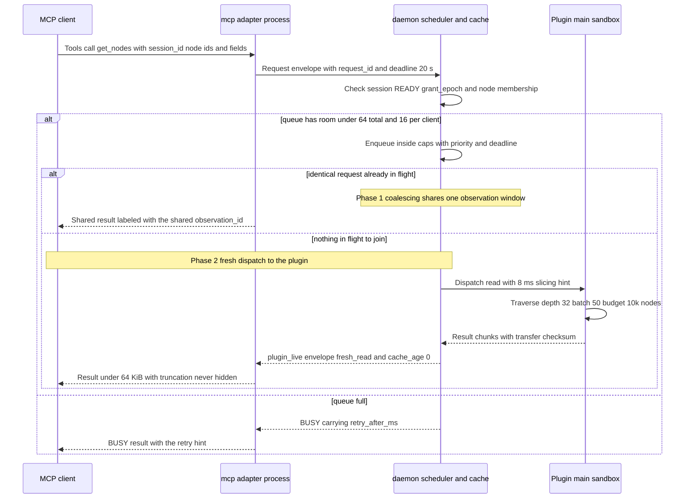
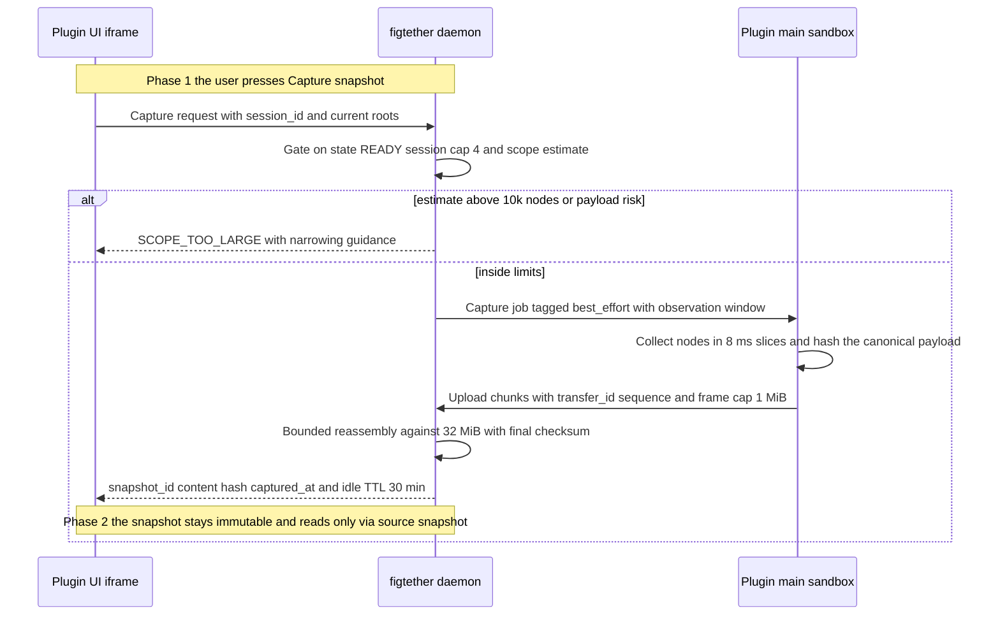
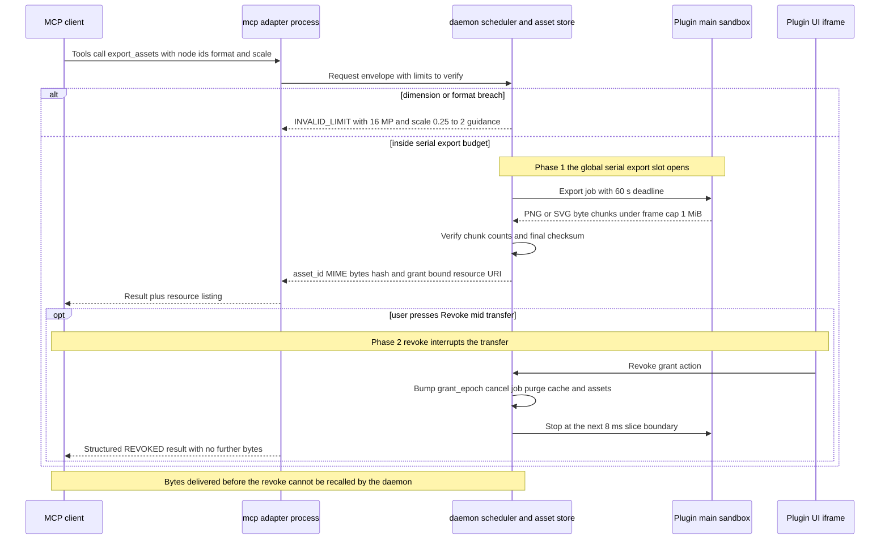
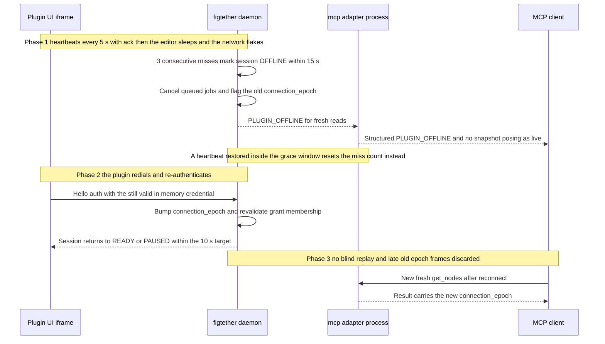
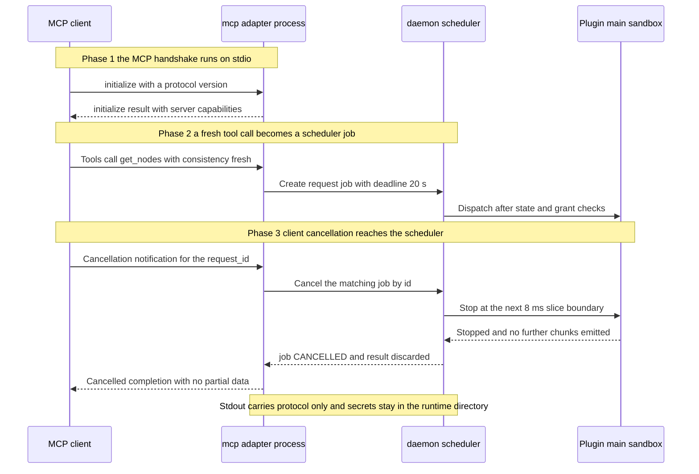

# UML Sequence Diagrams

Status: `Proposed`

Purpose: walk the six interactions that define FigTether end to end: pairing and grant, fresh
live read with coalescing and BUSY, snapshot capture, asset export with a mid transfer revoke,
heartbeat loss with an epoch guarded reconnect, and the MCP lifecycle with logical cancellation,
per PRD 4.2, 5, 8.3, 8.4, 8.5 and Appendix A. Gate G0 has not run, so the loopback transport stays D06 candidate until proven on Windows and macOS.

## S1: pairing and grant establishment

Read as: the CLI prints a single use secret, the plugin UI spends it inside the 3 second window, and the user grants roots so the session reaches READY with double enforcement live in both sides.

| Element                               | Reference            |
| ------------------------------------- | -------------------- |
| Secret issue single use and 5 min TTL | FR02, AT06           |
| 3 s auth window with no earlier data  | PRD 8.5.4            |
| Grant update and dual enforcement     | FR03, PRD 8.4        |
| Failure branch AUTH_REQUIRED          | PRD 8.7 errors, AT06 |

## S2: fresh live read with coalescing and BUSY

Read as: a fresh request always reaches the plugin, identical concurrent requests share one observation window, and a full queue answers BUSY with a retry hint instead of hanging.

| Element                                     | Reference               |
| ------------------------------------------- | ----------------------- |
| Fresh default never answered from cache     | FR06, PRD 8.3, D04      |
| Coalescing of identical concurrent requests | PRD 8.3 coalescing rule |
| Queue caps 64 and 16 with BUSY              | FR13, PRD 8.5.5         |
| Limits and retry max 1                      | PRD 8.5.5, FR14         |

## S3: snapshot capture, best effort

Read as: the user presses Capture in the plugin UI, the plugin collects and hashes the scope, bounded chunks travel to the daemon, and an immutable snapshot is stored labeled best_effort.

| Element                            | Reference           |
| ---------------------------------- | ------------------- |
| Capture is user initiated only     | FR05, PRD 8.5.1     |
| best_effort consistency labeling   | PRD 8.3, R14        |
| Chunking checksum and 32 MiB guard | PRD 8.5.4           |
| Snapshot TTL 30 min                | PRD 8.3 cache rules |

## S4: asset export with mid transfer revoke

Read as: an export runs serially under hard limits; a revoke during the transfer bumps the epoch, stops the job at a slice boundary, purges derived data, and bytes already delivered stay with the client.

| Element                          | Reference                         |
| -------------------------------- | --------------------------------- |
| Serial export and 60 s deadline  | FR11, PRD 8.5.5, N03              |
| INVALID_LIMIT branch             | PRD 8.5.5 export limit row        |
| Revoke stops transfer and purges | FR15, N07, AT15                   |
| Delivered bytes not recallable   | PRD 8.4 and 8.6.1 residual limits |

## S5: heartbeat loss, offline, and reconnect with epoch bump

Read as: heartbeats every 5 s stop after three misses, the session turns OFFLINE within 15 s, late old epoch frames are discarded, and reconnect requires authentication plus grant revalidation with no blind replay.

| Element                               | Reference        |
| ------------------------------------- | ---------------- |
| Heartbeat 5 s and offline at 3 misses | PRD 8.4, N08     |
| Epoch bump and revalidated grant      | FR16, FR03, AT15 |
| No blind replay of old work           | FR16, AT15       |
| Reconnect readiness 10 s target       | N08              |

## S6: MCP lifecycle with logical cancellation

Read as: the client handshakes over stdio, calls a P0 tool, and a cancellation notification reaches the scheduler, which cancels the job at a slice boundary so no partial data leaks.

| Element                             | Reference       |
| ----------------------------------- | --------------- |
| Stdio handshake and clean stdout    | FR17, AT14      |
| Cancellation forwarded to scheduler | FR14, PRD 8.5.1 |
| Stop inside an 8 ms slice           | PRD 8.5.5       |

Open questions:

1. Which exact MCP frames carry cancellation is unknown until D08 pins the rmcp version; the
   logical behavior above stays version independent.
2. Whether coalescing matches across clients or only within one client needs a scheduler owner
   decision, since PRD 8.3 allows identical concurrent requests to share an observation window.
   Exact bridge message names may shift after G0; phase structure and guards stay normative.
