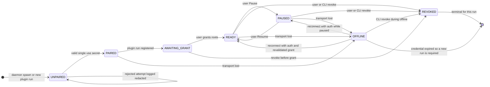
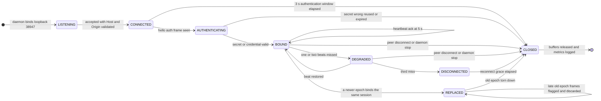
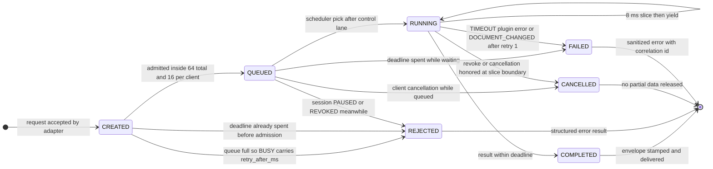

# UML State Machine Diagrams

> **Design reference.** Original requirements and approval labels below are historical design
> records, not a feature-availability list. See [current documentation status](../documentation-status.md)
> for implemented reads/writes, observed desktop evidence, and remaining gaps.

Status: `Proposed`

Purpose: freeze the behavior model the Rust core must implement for sessions, bridge connections
and scheduled jobs, so that deny paths, epoch rules and reconnection rules are unambiguous. The
session chain and every transition trace to PRD 8.4, 8.5.4 and 8.5.5, with acceptance anchors
AT06, AT09, AT15 and N08. Gate G0 has not run, so these are commitments, not measured facts.

Three machines are described: the session FSM around pairing and grants, the connection FSM
around one authenticated transport, and the job FSM inside the scheduler. Connection and job
machines are per instance; the session FSM is unique per plugin run.

## State machine 1: session FSM

Read as: authority follows the user from pairing to grant to pause or revoke, and a lost
transport can never bypass re-authentication on its way back to a usable state.

| Element | Reference |
| Secret guarded entry | FR02, AT06 |
| Grant step to READY | FR03, PRD 5.1 step 6 |
| Revoke is terminal | FR15, AT15, PRD 8.4 |
| OFFLINE only from PAIRED READY PAUSED | PRD 8.4 |
| Reconnect guarded by auth and epoch bump | FR16, AT15 |

Transition table:

| State          | Event                                        | Guard                                                                                           | Action                                                                    | Next            |
| -------------- | -------------------------------------------- | ----------------------------------------------------------------------------------------------- | ------------------------------------------------------------------------- | --------------- |
| UNPAIRED       | Pairing secret verified                      | single use, unexpired within 5 min, matched under constant time compare, sent inside 3 s window | consume secret, allocate session_id and session credential, redact logs   | PAIRED          |
| UNPAIRED       | Secret wrong reused expired or window missed | any guard above fails                                                                           | no session allocated, AUTH_REQUIRED, close connection                     | UNPAIRED        |
| PAIRED         | Plugin run registered                        | UI verified session name and fingerprint                                                        | mark session awaiting user grant                                          | AWAITING_GRANT  |
| PAIRED         | Transport lost                               | 3 missed heartbeats                                                                             | record PLUGIN_OFFLINE, credential stays only in plugin memory             | OFFLINE         |
| AWAITING_GRANT | User presses Allow session read              | at least one selectable root exists                                                             | distill root ids, mint grant_id, set grant_epoch 1                        | READY           |
| AWAITING_GRANT | User or CLI revoke                           | none                                                                                            | reject future reads, nothing cached to purge                              | REVOKED         |
| READY          | Pause                                        | none                                                                                            | answer new live and snapshot reads with PAUSED                            | PAUSED          |
| PAUSED         | Resume                                       | grant still valid                                                                               | lift the read gate without changing grant_epoch                           | READY           |
| READY          | Revoke                                       | none                                                                                            | bump grant_epoch, purge cache assets cursors, stop transfers              | REVOKED         |
| PAUSED         | Revoke                                       | none                                                                                            | purge as in READY revoke                                                  | REVOKED         |
| READY          | Transport lost                               | 3 misses                                                                                        | cancel in flight jobs, discard late old epoch frames                      | OFFLINE         |
| PAUSED         | Transport lost                               | 3 misses                                                                                        | same as READY loss                                                        | OFFLINE         |
| OFFLINE        | Reconnect authorized                         | in memory credential valid and epoch bumped                                                     | connection_epoch plus 1, revalidate grant membership, restore prior state | READY or PAUSED |
| OFFLINE        | Credential missing or expired                | re-pairing required                                                                             | abandon this run, a fresh run starts a new lifecycle                      | terminal        |
| OFFLINE        | CLI revoke                                   | none                                                                                            | purge derived data and mark revoked                                       | REVOKED         |
| REVOKED        | No event accepted                            | terminal                                                                                        | no revival of grant or snapshot identity                                  | terminal        |

## State machine 2: connection FSM

Read as: a connection is useless until the first frame authenticates inside 3 s, it stays useful
only while heartbeats keep landing, and any replacement is epoch guarded.

| Element | Reference |
| 3 s window and no data before auth | PRD 8.5.4 |
| Heartbeat and 3 miss detection | FR16, PRD 8.4 |
| REPLACED and late frame discard | FR16, AT15 |
| Loopback bind and validation | PRD 8.6.1, P10 |

Transition table:

| State          | Event                            | Guard                                   | Action                                                          | Next           |
| -------------- | -------------------------------- | --------------------------------------- | --------------------------------------------------------------- | -------------- |
| LISTENING      | Loopback connection accepted     | Host and Origin validation passed       | start the 3 s auth timer, no design data allowed yet            | CONNECTED      |
| CONNECTED      | Hello auth frame observed        | inside the 3 s window                   | classify secret exchange or credential reuse                    | AUTHENTICATING |
| CONNECTED      | Window elapsed                   | no auth received                        | close and log AUTH_REQUIRED only                                | CLOSED         |
| AUTHENTICATING | Secret or credential valid       | constant time match, single use, TTL ok | bind session, issue session credential, record connection_epoch | BOUND          |
| AUTHENTICATING | Secret invalid reused or expired | any check fails                         | close with AUTH_EXPIRED, never leak detail                      | CLOSED         |
| BOUND          | Heartbeat ack cycle              | 5 s interval                            | update last heartbeat timestamp                                 | BOUND          |
| BOUND          | Heartbeat misses                 | 1 or 2 missed                           | keep session alive and watch                                    | DEGRADED       |
| DEGRADED       | Beat restored                    | none                                    | reset miss count to 0                                           | BOUND          |
| DEGRADED       | Third miss                       | miss count reaches 3                    | mark session OFFLINE and cancel queued jobs                     | DISCONNECTED   |
| BOUND          | Peer disconnect or daemon stop   | transport lost                          | release session binding and wake pending timeouts               | CLOSED         |
| DEGRADED       | Peer disconnect or daemon stop   | transport lost                          | same cleanup as BOUND loss                                      | CLOSED         |
| DISCONNECTED   | Grace elapsed                    | no successful redial                    | finalize teardown of this instance                              | CLOSED         |
| BOUND          | Newer epoch binds same session   | duplicate connection detected           | mark this instance superseded, keep frames epoch verified       | REPLACED       |
| REPLACED       | Late frame arrives               | connection_epoch mismatch               | discard the frame, no replay                                    | REPLACED       |
| REPLACED       | Teardown of old epoch            | none                                    | stop cleanup of this instance                                   | CLOSED         |
| CLOSED         | Terminal cleanup                 | none                                    | release buffers and log sanitized metrics                       | terminal       |

## State machine 3: job FSM

Read as: a job is admitted under hard caps, dispatched by priority after the control lane,
yields in 8 ms slices, and can end only in a structured terminal outcome.

| Element | Reference |
| Admission caps and BUSY | FR13, PRD 8.5.5 |
| Aging and priority lanes | PRD 8.5.5 scheduling note |
| Deadline spent without execution | FR14, PRD 8.5.5 |
| Retry at most 1 | FR14, PRD 8.5.5 |
| Slice and yield behavior | PRD 8.5.5 |

Transition table:

| State   | Event                            | Guard                                                                           | Action                                                 | Next      |
| ------- | -------------------------------- | ------------------------------------------------------------------------------- | ------------------------------------------------------ | --------- |
| CREATED | Submit arrives                   | queue under 64 total and 16 per client, deadline not spent                      | stamp job_id priority deadline                         | QUEUED    |
| CREATED | Admission denied                 | caps exceeded or deadline spent                                                 | answer BUSY with retry_after_ms or TIMEOUT, not stored | REJECTED  |
| QUEUED  | Scheduler tick picks job         | control lane drained first, deadline live, session READY                        | dispatch to plugin with slicing hint                   | RUNNING   |
| QUEUED  | Client cancellation              | cancellation observed before dispatch                                           | remove the job                                         | CANCELLED |
| QUEUED  | Session enters PAUSED or REVOKED | state gate on dispatch                                                          | answer PAUSED or REVOKED                               | REJECTED  |
| QUEUED  | Deadline expires while waiting   | waiting time over running deadline 20 s or 60 s                                 | kill without execution and log TIMEOUT                 | FAILED    |
| RUNNING | Slice completes                  | 8 ms target reached                                                             | yield to the runtime and show progress                 | RUNNING   |
| RUNNING | Result ready                     | inside deadline, checks passed                                                  | stamp observation and hand to envelope                 | COMPLETED |
| RUNNING | Cancel or revoke honored         | request id matches                                                              | stop at next slice boundary, emit no chunks            | CANCELLED |
| RUNNING | Failure path                     | TIMEOUT, plugin error, or DOCUMENT_CHANGED with retry budget spent, retry max 1 | record sanitized error per item                        | FAILED    |

Invariants:

- No grant revival: once REVOKED or superseded, a Grant can never become active again, and late
  frames or stale job results never resurrect it (FR14, AT15).
- Epoch monotonic: connection_epoch rises on every reconnect and grant_epoch rises on scope
  change or revoke; an envelope carrying an older epoch than current is discarded (FR03, FR16).
- PAUSED rejects new live reads and new snapshot reads; only Resume, Revoke, or starting a new
  session lifecycle can restore usability, and no tool call can widen authority meanwhile
  (FR15, PRD 8.3).
- OFFLINE never silently transitions to READY without authentication and grant revalidation, and
  old work is never replayed after reconnect (FR16, AT15, AT09).
- A job never executes against a stale grant or session state; admission re-checks state stamps
  at dispatch time, not only at submission.
- Offline detection stays inside the N08 bound: heartbeats at 5 s, offline at 3 misses.

Open questions:

1. Whether OFFLINE re-entry restores the exact prior state or always returns to PAIRED for one
   explicit confirmation step is a core-owner choice; this file commits to restore plus
   revalidation and the table above tracks it.
2. Whether a RUNNING editor operation must abort on Pause or may complete inside its deadline is
   treated here as completion allowed, matching PRD 5.2 which only forbids new reads.
3. REPLACED handling for two simultaneous plugin tabs pointing at one session needs a rule once
   real editor behavior is observed at G0.
