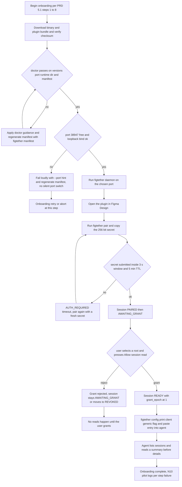
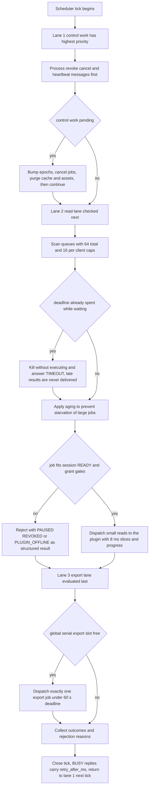
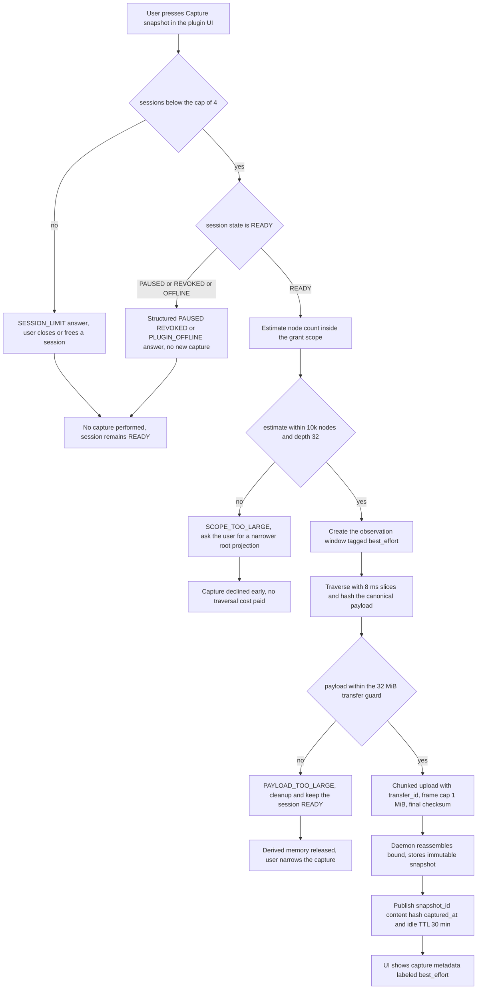

# UML Activity Diagrams

Status: `Proposed`

Purpose: render three flows as flowchart based activity diagrams: onboarding with its failure
exits, the scheduler tick with its priority lanes, and snapshot capture with its guard outcomes.
A1 follows PRD 5.1 step by step and targets N10 onboarding p90 at most 15 minutes. A2 encodes the
priority order and starvation control of PRD 8.5.5. A3 encodes the snapshot guards of PRD 8.3 and
8.5.5. Decision and activity nodes are rectangles and rhombi in Mermaid flowchart TD; semantics
follow UML activity notation. Gate G0 has not run, so these are normative proposals.

## A1: end user onboarding per PRD 5.1

Read as: install, verify, diagnose, bind port, pair within the windows, grant, print config, and
read, with every failure exit loud and recoverable rather than silent.

| Element | Reference |
| Checksum and doctor steps | FR01, FR18, PRD 5.1 steps 1 to 2, AT03 |
| Port collision loud failure | PRD 5.1 step 3, PRD 8.7 port collision row |
| 3 s and 5 min pairing guards | FR02, PRD 8.5.4 |
| Grant step and no silent widening | FR03, PRD 5.1 step 6 |
| Config print for MCP entry | FR17, PRD 5.1 step 7 |
| Summary before detail reads | FR04, FR12, PRD 5.1 step 8 |

## A2: scheduler tick with priority lanes

Read as: control work drains first, then small reads under deadlines, then one serial export;
aging keeps starved jobs alive and a full queue answers BUSY instead of hanging.

| Element | Reference |
| Revoke cancel heartbeat priority | PRD 8.5.5 scheduling note, FR15 |
| Read lane caps and deadline kill | FR13, FR14, PRD 8.5.5 |
| Aging prevents starvation | PRD 8.5.5 |
| One serial export globally | PRD 8.5.5 operation limits, N03 |
| BUSY carries retry_after_ms | FR13, PRD 8.7 error table |

## A3: snapshot capture flow with guard outcomes

Read as: capture is user driven and gated on session state, session cap, scope size and payload
size; every rejecting branch leaves the session usable and returns a structured error.

| Element | Reference |
| Session state gate | FR15, PRD 8.3 pause and revoke paragraph |
| Session cap 4 | PRD 8.5.5 session limit |
| Traversal size guards | PRD 8.5.5, SCOPE_TOO_LARGE row |
| Payload transfer guard | PRD 8.5.4, PAYLOAD_TOO_LARGE row |
| best_effort labeling and TTL | PRD 8.3, R14 |

Notes:

- Capture always labels consistency best_effort because edits can land during capture; the
  snapshot stays immutable once stored and never claims live freshness (PRD 8.3, FR05).
- Guard evaluation happens before any heavy allocation, per the commit that every cap is
  enforced at insertion (docs/00-overview/01-prd-analysis.md section 10 item 5).
- N06 and N04 stay in force during capture: slicing and bounded reassembly exist to protect the
  editor and the daemon memory profile.

Open questions:

1. Whether doctor should offer a flags-based auto fix recommending manifest regeneration without
   writing anything per PRD 5.1 step 4 is an ops decision; A1 keeps regeneration explicit.
2. Whether A3's scope estimate can be exact for dynamic-page documents before traversal is unknown
   until G0 probes run; the flow treats estimates as conservative guards.
3. A2 lane thresholds for aging increments are intentionally unspecified; they need a scheduler
   owner decision plus an AT08 soak before values are frozen.
