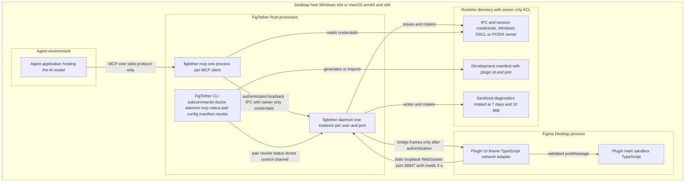

# UML Deployment View

> **Design reference.** Original requirements and approval labels below are historical design
> records, not a feature-availability list. See [current documentation status](../documentation-status.md)
> for implemented reads/writes, observed desktop evidence, and remaining gaps.

Status: `Proposed`

Purpose: map every FigTether runtime unit onto one developer desktop so process boundaries,
loopback connections, credentials at rest and platform support are explicit. The view follows
PRD 8.4 architecture, PRD 5.1 installation steps and PRD 8.6 storage rules, and ties resource
claims to the N04 benchmark targets. Gate G0 has not run, so the WebSocket transport remains the
candidate of decision D06 rather than a proven deployment fact.

## Diagram 1: one desktop host, all processes

Read as: inside one Windows or macOS host, Figma Desktop holds the plugin and its iframe, the
daemon binds one loopback port, one mcp process per MCP client bridges agent stdio, the CLI acts
locally, and a single owner-only runtime directory holds credentials, manifest and rotated logs.

| Element | Reference |
| Figma Desktop plugin split main plus iframe | S3, PRD 8.4 plugin rows |
| Daemon one instance per user and port | PRD 8.4 daemon row, FR19 |
| One mcp process per client | PRD 8.4 MCP adapter row, FR17 |
| CLI subcommand set | FR17, PRD 8.4 CLI row |
| Loopback port 38947 auth window | PRD 5.1 step 3, FR02, PRD 8.5.4 |
| postMessage validation between iframe and sandbox | PRD 8.4 architecture, FR03 double enforcement |
| Runtime directory contents | FR02, PRD 8.6.2 storage table |
| Log rotation 7 days and 10 MiB | FR18, PRD 8.6.2 |

## Constraints table

| Platform             | Scope in v0.1                                                                            | Anchor                              |
| -------------------- | ---------------------------------------------------------------------------------------- | ----------------------------------- |
| Windows x64          | Full path: Figma Desktop plugin, daemon, mcp, CLI; pairing and grant tested              | AT03, G0 desktop matrix             |
| macOS arm64 and x64  | Full path where an editor plus runner environment exists                                 | PRD 8.11 platform row               |
| Linux                | Core, CLI and fixtures only; no editor support until tested, no claims about editor use  | PRD 8.11, D06 remains untested here |
| Any host, G0 not run | WebSocket candidate D06 unproven; claims stay hypotheses until AT01, AT02, AT12 evidence | PRD 8.10 G0 row                     |

Host rules: no installer requires administrator rights by default, binaries run only after a user
action, and the daemon never binds a non-loopback interface (PRD 8.11, PRD 8.6.1 DNS rebinding
row). Port 38947 collisions fail loudly with a --port hint and an explicit manifest regeneration
instead of a silent port switch (PRD 5.1 step 3, PRD 8.7 port collision row).

## Resource note tying deployment to measurements

- The daemon is the only long-lived FigTether process; the N04 targets are idle RSS at most
  50 MiB and mixed-load peak RSS at most 256 MiB, sampled every second with allocator overhead
  recorded (N04, PRD 2.1).
- Inside the daemon, the LRU cache for design data plus assets stays within 128 MiB and a single
  asset within 16 MiB, eviction included; the cache bound is not an RSS promise because parsing
  and transport buffers add overhead (PRD 8.5.5 cache row).
- Each mcp process is a thin protocol adapter over stdio and carries no design cache of its own;
  per-client queue caps of 16 requests live in the daemon, not in the adapter (FR13, FR22 P1).
- Inside Figma Desktop the plugin budget is bounded by slicing: traversal targets 8 ms slices,
  one active editor operation per session, and one serial global export, so N06 no editor freeze
  above 1 s from our traversal remains testable on this deployment (PRD 8.5.5, N06, N03).
- Snapshots live only in bounded daemon memory with an idle TTL of 30 minutes; there is no design
  database on disk, so uninstall removes design data by stopping the daemon (PRD 8.6.2 store row,
  FR05).
- Logs stay local and sanitized, rotating at 7 days or 10 MiB, and never carry layer names, file
  ids or tokens (PRD 8.6.2 logs row, FR18).

## Credentials and secret lifecycle at deployment level

| Secret or credential      | Where it lives in this deployment                         | Creation and rotation                                             | Anchor                     |
| ------------------------- | --------------------------------------------------------- | ----------------------------------------------------------------- | -------------------------- |
| Pairing secret            | Memory in daemon and plugin UI only                       | Per pair action; consumed on use, expiry at 5 min, or daemon stop | FR02, PRD 8.6.2            |
| Plugin session credential | Plugin UI memory, never persistent storage                | Issued at auth, dropped on revoke, expiry, or plugin close        | PRD 8.5.4                  |
| IPC client credential     | Runtime directory file with owner only DACL or POSIX mode | Rotated on daemon restart and on client re-register               | PRD 8.6.2 credential row   |
| Manifest                  | Runtime directory, user edited or CLI generated           | Regenerated explicitly after port or plugin id changes            | PRD 5.1 step 3 and 4, FR18 |
| Sanitized logs            | Runtime directory files                                   | Written continuously, rotated at 7 days or 10 MiB                 | FR18, PRD 8.6.2            |
| Design data and snapshots | Daemon memory only, LRU bounded                           | Cleared on revoke, TTL, eviction, or daemon exit                  | FR05, PRD 8.6.2            |

## Failure containment across processes

- A plugin close or editor crash only moves the daemon session through the state machine to
  OFFLINE; the daemon stays healthy and the agent receives structured PLUGIN_OFFLINE instead of
  a hang (FR16, AT09).
- A daemon crash or port collision is contained to the `figtether daemon` unit; stale runtime
  files are detected, not trusted, and a restart earns new daemon_instance_id and credentials
  (PRD 8.7 daemon crash row, 8.4 instance id rules).
- An MCP client crash takes down only its own mcp process; the daemon drops that client lane and
  frees its per-client queue share, and other clients keep working (PRD 8.4 one process per
  client, FR13 fairness).
- A revoked session cannot reach log or asset leakage: revoke drops unsent frames, purges cache
  and derived assets, and continues caring only for already delivered bytes which are outside
  the daemon's reach (FR15, N07, PRD 8.4).
- A same-user malware compromise is explicitly out of the token model: localhost credentials
  resist casual misuse, not a compromised OS account, and this limit is documented rather than
  claimed away (PRD 8.6.1, R10).

Document references: see docs/README.md reading order; the container level description matches
docs/02-architecture/01-system-design.md; wire and error details belong to
docs/04-data-contracts/; security boundaries and storage rules belong to docs/05-security/;
installation steps for this view appear in docs/07-ops/.

Open questions:

1. Linux editor support: which editor environments and seat contexts must be tested before the
   platform table gains a full Linux row is open until a tested environment exists (PRD 8.11).
2. macOS arm64 versus x64 variance in WebSocket and Origin behavior needs the G0 per OS matrix
   from R02; this view keeps both architectures in one row until evidence splits them.
3. Whether the CLI control channel to the daemon is the same loopback port or a dedicated local
   IPC endpoint is a core-owner decision that must be recorded in an ADR before G1.
