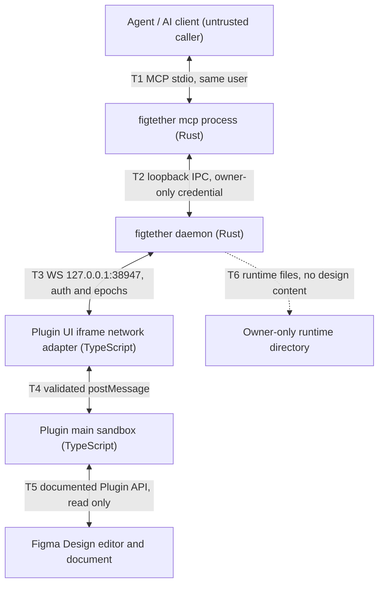

# FigTether Threat Model

> **Design reference.** Original requirements and approval labels below are historical design
> records, not a feature-availability list. See [current documentation status](../documentation-status.md)
> for implemented reads/writes, observed desktop evidence, and remaining gaps.

Status: `Proposed`

This document is the threat model for FigTether v0.1. It lists the assets that must be protected,
draws the trust boundaries between FigTether processes, performs a STRIDE analysis per boundary with
mitigations copied from PRD section 8.6.1 (`FGT-PRD-001`), records the residual risks that remain
after the mandatory controls, and maps every control to its acceptance evidence. It is the entry
point of `docs/05-security/`; pairing, identity, and grant mechanics are detailed in
`docs/05-security/02-access-control.md` and storage, logging, and export rules in
`docs/05-security/03-privacy-data-handling.md`. Nothing here describes running code; every control is
an obligation on the G0, G1, and G2 gates and must be traceable in
`docs/06-testing/03-traceability-matrix.md`.

## 1. Scope and method

| Item                      | Decision                                                                                                                                                                       |
| ------------------------- | ------------------------------------------------------------------------------------------------------------------------------------------------------------------------------ |
| Normative source          | PRD `FGT-PRD-001` sections 8.6.1, 8.6.2, 8.5.4, 8.5.5, and 8.4, plus Appendix A                                                                                                |
| Method                    | STRIDE applied per trust boundary; one row per PRD 8.6.1 threat, plus epoch and mutation rows                                                                                  |
| Interpretation authority  | `docs/00-overview/01-prd-analysis.md` Section 10 committed interpretations                                                                                                     |
| Assumed attacker position | A process running as the same OS user, an untrusted web page or iframed content reaching the loopback port, a malicious MCP client, or manipulated design content              |
| Explicitly out of model   | Defense against same-user malware or OS admin, cloud relay abuse, protection of editor internal memory, and governance of the AI client context                                |
| Write path                | Proposed by `ADR-013` and pending product approval; section 4.1 and the write residuals of section 5 are the write counterpart of the read analysis, not a shipped control set |

## 2. Protected assets

| ID  | Asset                                                                                                               | Where it lives                                                                                     | Primary controls                                                                                                                                            |
| --- | ------------------------------------------------------------------------------------------------------------------- | -------------------------------------------------------------------------------------------------- | ----------------------------------------------------------------------------------------------------------------------------------------------------------- |
| AS1 | Design data: layer tree, geometry, typography, fills, effects, component and variable references, PNG and SVG bytes | Editor memory, plugin memory in flight, daemon cache and asset store, MCP responses, agent context | Grant scope double enforcement (`FR03`, `AT17`); bounded memory with eviction (`FR13`, `FR15`); no content in logs (`FR18`); response size caps (`FR07`)    |
| AS2 | Pairing secret: 256 bit random, single use, 5 minute TTL                                                            | Daemon memory, local CLI display, plugin UI entry field in flight                                  | `FR02`; verified by `AT06` (wrong, expired, replayed secret)                                                                                                |
| AS3 | Session credentials: plugin session credential and daemon bound IPC client credential                               | Plugin UI memory; owner only runtime directory                                                     | `FR02`; storage rules in `03-privacy-data-handling.md`; rotation on daemon restart (`FR16`, `AT09`)                                                         |
| AS4 | Runtime directory files: credential records, daemon instance and manifest records                                   | Owner only runtime directory per platform                                                          | Ownership verified before use; fail closed if permissions are inadequate (PRD 8.6.2); stale files never trusted (`FR16`)                                    |
| AS5 | Agent prompt context: materialized design facts the model receives                                                  | AI client process, outside FigTether                                                               | Summary first, field projection, pagination, 64 KiB response cap (`FR07`); secret and bridge endpoint are never tool parameters (PRD 8.5.1)                 |
| AS6 | Snapshot and materialized copies: immutable snapshot, cache entries, asset store entries                            | Daemon memory only for v0.1                                                                        | Immutable identity and hash (`FR05`); deleted on revoke, TTL, eviction, or exit (`FR15`, `AT15`); snapshot never poses as live (PRD Section 5.2 mode table) |

Asset movement notes:

- AS1 enters at T5, is normalized in `crates/core`, is delivered at T1, and is mirrored into AS6 only
  as live cache entries and explicit snapshots; memory caps bound every hop (PRD 8.5.5).
- AS2 and AS3 never cross T1. The agent sees `session_id`, scope, and capabilities, never a
  credential (PRD Section 5.4 step 2, threat TH04).
- AS4 is the only location where FigTether persists anything with authorization meaning, so its
  verification and deletion rules appear in `02-access-control.md` Sections 2 and 5.
- AS5 leaves the FigTether trust boundary permanently at T1. This is the moment the revoke recall
  limitation RH03 starts to apply; nothing downstream can be pulled back (PRD 8.4).
- Design data is never written to the runtime directory; T6 moves only authorization support files
  (PRD 8.6.2 storage rows).

## 3. Trust boundaries and data flow

Caption: FigTether components and the six trust boundaries T1 to T6. Read as: the agent is an
untrusted caller at T1; only T6 persists files, and those files never contain design content.

Boundary properties (G0 and G1 must demonstrate each):

- **T1** MCP stdio: same user process; protocol frames only on stdout; secrets never appear in tool schemas (`FR17`, `FR02`).
- **T2** Loopback IPC: client credential from the runtime directory; fail closed if the directory is not owner only (`FR02`, PRD 8.6.2).
- **T3** Browser WebSocket: loopback literal bind, peer and Host validation, endpoint and message type allowlist, tested Origin validation; auth before any design data (PRD 8.5.4, `AT06`).
- **T4** postMessage between UI iframe and main sandbox: schema validated, origin checked frames only (PRD 8.5.4).
- **T5** Plugin API: allowlisted read handlers only; no eval and no shell anywhere (`FR24`, `D03`). The write path proposed by `ADR-013` adds write handlers that run only inside a write grant and only for an approved plan; the read path keeps its own boundary unchanged.
- **T6** Runtime directory: owner only; daemon restarts rotate credentials and refuse stale files (`FR16`, PRD 8.7).

Boundary assumption table:

| Boundary        | Trust assumption granted                                                                               | What invalidates the assumption                                                                       | Checked at                                          |
| --------------- | ------------------------------------------------------------------------------------------------------ | ----------------------------------------------------------------------------------------------------- | --------------------------------------------------- |
| T1              | The same user process acts as a well formed MCP client                                                 | A malicious or buggy client sends malformed protocol frames                                           | `AT14`, `AT13`                                      |
| T2              | The runtime directory is owner only                                                                    | A same-user process reads or forges the client credential (RH01)                                      | `AT06`, `AT09`, PRD 8.6.2                           |
| T3              | The peer is the paired plugin UI iframe behind the browser stack                                       | A foreign page or iframe reaches the port (TH01, TH02)                                                | `AT06`, G0 per OS                                   |
| T4              | Frames originate from the paired UI adapter                                                            | Manipulated content reaching the UI path                                                              | `AT13`                                              |
| T5              | Handlers stay within the documented read only API                                                      | Undocumented editor side effects of reads or exports                                                  | `AT18`                                              |
| T5 (write path) | A write handler runs only for a plan that passed grant, validation, scope, budget, and approval checks | An undocumented side effect of a write operation, or a handler that mutates outside the approved plan | `AT22`, `AT29` (proposed, pending product approval) |
| T6              | Directory ownership holds on the target platform                                                       | ACL misconfiguration; the fail closed rule stops startup                                              | PRD 8.6.2, `AT09`                                   |

## 4. STRIDE analysis per boundary

Mitigation wording in the "Required mitigations" column is transferred from PRD 8.6.1 (English
rendering); the residual column is the reciprocal "residual limit" entry of the same PRD row.

| ID   | Boundary     | STRIDE class                      | Threat scenario                                                                   | Required mitigations (P0)                                                                                               | Residual                                                                                           | Evidence                       |
| ---- | ------------ | --------------------------------- | --------------------------------------------------------------------------------- | ----------------------------------------------------------------------------------------------------------------------- | -------------------------------------------------------------------------------------------------- | ------------------------------ |
| TH01 | T3           | Spoofing, Information disclosure  | A foreign site or iframed content reaches localhost:38947 and drives the bridge   | Bind loopback literal; validate peer and Host; allowlist endpoints and paths; Origin validation that is actually tested | A null Origin from an iframe may be required; the token remains the primary authorization boundary | `AT06`, `FR02`, `FR03`         |
| TH02 | T3           | Spoofing                          | DNS rebinding or remote exposure makes the bridge reachable from outside the host | Never bind 0.0.0.0; no remote override; IPv6 loopback tested if supported                                               | A proxy or port forward configured by the user is outside the support profile                      | `AT06`, `FR19`, `D06`          |
| TH03 | T2, T3       | Information disclosure            | Credential leaks to logs, files, or other local processes                         | Random 256 bit secret, TTL, auth timeout, constant time comparison, log redaction                                       | Other processes with the same user rights remain a residual threat                                 | `AT06`, `FR02`, `R10`          |
| TH04 | T1           | Information disclosure            | The pairing secret or a credential is typed into the model prompt                 | Pairing through UI and CLI; the model never sees a credential; config examples contain no tokens                        | The AI client still manages the context it accepts                                                 | `FR02`, PRD 8.5.1, `AT06`      |
| TH05 | T3, T5       | Elevation of privilege            | A request reaches nodes outside the granted root set                              | Membership verified in both the plugin and the daemon; cursor and asset bound to the grant epoch                        | Data already delivered to the client cannot be recalled                                            | `FR03`, `FR16`, `AT05`, `AT17` |
| TH06 | T2, T3       | Denial of service                 | Malformed payloads or oversized transfers exhaust memory                          | Schema, depth, bytes, and queue limits applied before large allocations; fuzzing; transfer timeout                      | Editor internal export operations may not be stoppable immediately                                 | `FR07`, `FR13`, `AT08`, `AT13` |
| TH07 | T3, T4, T5   | Tampering                         | Layer names or text carry prompt injection instructions                           | Treat all design content as untrusted data; never execute instructions found inside it                                  | The agent and client still need their own tool usage policies                                      | `FR08`, `D03`, `AT10`          |
| TH08 | T3, T5       | Tampering, Elevation of privilege | Active SVG content or path traversal through exported assets                      | SVG is never executed as HTML; sanitized preview; opaque IDs; filesystem export only to user chosen directories         | Raw exports carry MIME labels and are never shown as an active page                                | `FR11`, `FR23`, `AT11`         |
| TH09 | Supply chain | Tampering                         | A compromised dependency or release artifact ships to users                       | Lockfiles, dependency audit, SBOM, checksums, provenance, release review                                                | External dependencies and Figma updates need ongoing maintenance                                   | `AT03`, PRD 8.11               |
| TH10 | T1..T5       | Spoofing, Information disclosure  | Cross session confusion: answers routed to the wrong tab or wrong grant           | Sessions, epochs, grants, assets, and cache keys isolated; no default tab routing                                       | A document name is only a label, never an authorization identity                                   | `FR03`, `FR04`, `FR22`, `AT05` |
| TH11 | T2, T3       | Tampering                         | Stale answers survive a reconnect or a scope change and are treated as current    | `connection_epoch` bumped on reconnect, `grant_epoch` bumped on scope change, late frames discarded, no blind replay    | See epoch semantics in `docs/04-data-contracts/`; nothing rescues already delivered bytes          | `FR16`, `D05`, `AT09`, `AT15`  |
| TH12 | T3, T4, T5   | Tampering                         | Bridge or tool handlers mutate the document as a side effect of reads             | Read only handlers, allowlisted bridge message types, no eval and no shell, before and after fixture hash checks        | None claimed; violation blocks release                                                             | `FR24`, `D03`, `AT18`          |
| TH13 | All          | Repudiation                       | Authorization decisions cannot be reconstructed after an incident                 | Structured local diagnostics with error codes, versions, and sanitized correlation IDs only; no design content          | Logs rotate locally at most 7 days / 10 MiB; incident review depends on retained error IDs         | `FR18`, PRD 8.7, `R13`         |

## 4.1 Write path threat classes

The write path proposed by `ADR-013` adds a class the read path cannot have: the failure of a write
is a changed design, not a wrong answer. The classes below are the write counterparts of the
STRIDE rows above. The source implementation enforces write grants, scope, budgets, and exact-plan
approval. This is not an independent security audit. `ADR-013` remains a proposed formal release
decision, and the acceptance scenarios (`AT21..AT29`) are not all established by the limited
desktop evidence; see [current status](../documentation-status.md).

| ID   | Class                             | Scenario                                                                                                 | Layer that stops it                                                                                                                                                                                                    | Evidence                      |
| ---- | --------------------------------- | -------------------------------------------------------------------------------------------------------- | ---------------------------------------------------------------------------------------------------------------------------------------------------------------------------------------------------------------------- | ----------------------------- |
| TH14 | Tampering, Elevation of privilege | A confused or compromised agent submits a destructive plan: a delete, or a move out of the granted roots | Write grant in the plugin UI, then the destructive policy in the daemon and the plugin UI: a delete or an out-of-scope move needs the `destructive` flag in the plan and a separate user toggle                        | `AT27`, `ADR-013` rule 6      |
| TH15 | Elevation of privilege            | A plan touches nodes outside the granted roots, or names a parent outside the grant                      | Scope check in the daemon and in the plugin: the preview is blocked with the reason and the apply is refused with `OUT_OF_SCOPE`                                                                                       | `AT26`, `AT22`                |
| TH16 | Denial of service                 | A plan creates or changes far more than the write budgets allow                                          | Budget layer in the daemon: operations per plan, nodes created, text characters, property changes, affected subtree per delete, plan validity, and write plans per minute                                              | `AT25`, `ADR-008` amendment   |
| TH17 | Spoofing, Tampering               | A stale approval is replayed: the plan was edited, the grant changed, or the session changed             | Approval binding: the token carries the plan hash, the session, and the grant epoch, and the daemon verifies all three plus the expiry; a grant change increments the epoch and invalidates every outstanding approval | `AT23`, `AT24`                |
| TH18 | Tampering, Repudiation            | A plan fails halfway and leaves the document partially changed                                           | Undo commit (`figma.commitUndo()` once at the end of the plan), the audit record, and an explicit partially applied report; the editor level undo of a partial plan is not proved by the automated suites              | `AT28`, `AT29`, residual RH05 |

Layers between a plan and the document, from `docs/11-write-path/01-write-path-design.md` section 6:
write grant, plan validation, scope check, budget, destructive policy, preview, approval, undo
commit, audit. `ADR-013` names four of them as the standing protection against TH14: the budget,
the scope check, the preview, and the approval.

## 5. Residual risk register

| ID   | Residual risk                                 | Why it stands after P0 controls                                                                                                                               | User facing wording obligation                                                                      |
| ---- | --------------------------------------------- | ------------------------------------------------------------------------------------------------------------------------------------------------------------- | --------------------------------------------------------------------------------------------------- |
| RH01 | Same user malware on the host                 | A process with the same OS user rights can read process memory and the owner only runtime directory (PRD 8.6.2, `R10`)                                        | Docs must state that tokens on localhost do not defend against local malware                        |
| RH02 | OS administrator or compromised device        | Privileged software bypasses every ownership check and can read all memory and files                                                                          | Docs must state that FigTether does not claim protection here                                       |
| RH03 | Data already delivered to the client or model | Revoke stops later transfers and deletes daemon side state, but recall of received bytes is impossible (PRD 8.4, Section 5.3)                                 | Revoke UI must explain this before the user depends on it (`AT15` covers the daemon side guarantee) |
| RH04 | Editor and AI client network paths            | Attribution note (Appendix A): packet capture must not conclude that the whole Figma application is offline safe; only FigTether core processes are auditable | Claims are limited to FigTether processes; see `03-privacy-data-handling.md` Section 6              |

Write path residuals, added for the path proposed by `ADR-013`. They stand even with every layer
of section 4.1 in place.

| ID   | Residual risk                         | Why it stands after the write layers                                                                                                                                                                                                                                                                                                                                 | User facing wording obligation                                                                                                              |
| ---- | ------------------------------------- | -------------------------------------------------------------------------------------------------------------------------------------------------------------------------------------------------------------------------------------------------------------------------------------------------------------------------------------------------------------------- | ------------------------------------------------------------------------------------------------------------------------------------------- |
| RH05 | A partially applied plan              | The plugin executes the operations of a plan one by one. A refusal halfway leaves the earlier operations applied. The plan is reported as partially applied and the audit record names the operation count and the counts of the created, changed, removed, and moved nodes, but only the editor undo can restore the document, and only if the undo commit happened | The docs must say that a failed plan can leave changes behind and that the user should inspect the document after a refused or failed apply |
| RH06 | The undo behaviour of an applied plan | `figma.commitUndo()` is documented by the Plugin API typings, but whether an approved plan is one step in Figma's undo history, and what the editor does with a plan that failed halfway, can only be observed in a real Figma Desktop session                                                                                                                       | The docs must not claim a single step undo before `AT29` has passed in a real session; the current wording is "in progress"                 |
| RH07 | A write grant widens the blast radius | A write grant lets an agent change the document inside its roots, so the damage of a bad plan is a changed design rather than a wrong answer. The budget, the scope check, the preview, and the approval bound the damage; they do not remove it                                                                                                                     | The docs must say that write access is a wider grant than read access, and that the user approves every plan                                |

## 6. Control to evidence mapping

| Control from this document                               | Requirement              | Acceptance scenario (condensed from Appendix A)                                                                                                                                                    | Gate         | Related doc                                            |
| -------------------------------------------------------- | ------------------------ | -------------------------------------------------------------------------------------------------------------------------------------------------------------------------------------------------- | ------------ | ------------------------------------------------------ |
| No PAT, core egress restricted to loopback               | `FR19`, `FR06`           | `AT02`: `FIGMA_TOKEN` unset, core still reads, egress denied except loopback                                                                                                                       | G0           | `docs/02-architecture/01-system-design.md`             |
| Scope enforcement double checked, session isolated       | `FR03`, `FR04`           | `AT05`: two sessions with identical node IDs exchange nothing; `AT17`: membership checked fresh, stale results rejected                                                                            | G1           | `02-access-control.md` Section 4                       |
| Pairing secret lifecycle and anti spoofing on the bridge | `FR02`                   | `AT06`: wrong, expired, and replayed tokens plus wrong Host and Origin are rejected                                                                                                                | G1/G2        | `02-access-control.md` Section 2                       |
| Reconnect hygiene, epoch invalidation                    | `FR16`                   | `AT09`: plugin close and reopen, sleep and wake, daemon restart, delayed old epoch frame refused                                                                                                   | G1/G2        | `docs/06-testing/02-acceptance-catalog.md`             |
| Revoke deletes state and stops transfers                 | `FR15`                   | `AT15`: cache and assets deleted, retry blocked, no job replay after reconnect                                                                                                                     | G1/G2        | `03-privacy-data-handling.md` Section 2                |
| Parser, depth, and chunk limits with fuzzing             | `FR07`, `FR13`           | `AT13`: recursion, numeric extremes, invalid IDs, unknown enums, malformed chunks, zip bombs for P1                                                                                                | G1/G3        | `docs/04-data-contracts/06-resource-limits.md`         |
| Read only operations, no document mutation               | `FR24`                   | `AT18`: fixture hash and properties unchanged after reads and exports                                                                                                                              | G0/G2        | `02-access-control.md` Section 3                       |
| Attribution of network paths                             | `FR19`                   | `N09`: zero official MCP or REST requests from core; connection capture attributed per process                                                                                                     | G0           | `docs/06-testing/04-benchmark-plan.md`                 |
| Write grant, plan validation, scope check, budget        | ADR-013 rules 1, 3, 6    | `AT21`: a write without a write grant is refused; `AT26`: an out-of-scope write is refused                                                                                                         | not assigned | `docs/11-write-path/01-write-path-design.md` section 6 |
| Preview, approval, undo commit, audit                    | ADR-013 rules 3, 4, 5, 7 | `AT22`: a preview does not change the document; `AT24`: a changed plan hash is refused; `AT28`: an approved apply leaves an audit record; `AT29`: the editor level undo check needs a real session | not assigned | `docs/05-security/02-access-control.md` section 3.1    |

## 6.1 Adversarial validation

Every control in the table above is checked by a deterministic test. The controls are also
attacked by an autonomous agent, because a documented control is not the same thing as a control
that holds. Two layers:

| Layer                           | What it is                                                                                                                  | Where it lives                          | State                                                                                                           |
| ------------------------------- | --------------------------------------------------------------------------------------------------------------------------- | --------------------------------------- | --------------------------------------------------------------------------------------------------------------- |
| Deterministic adversarial suite | The eight threat classes of the local trust boundary, encoded as tests against the shipped daemon with no model in the loop | `crates/e2e/tests/adversarial.rs`       | Runs in CI                                                                                                      |
| Autonomous assessment           | PentAGI flows, one per threat class, against a dedicated daemon on a dedicated port                                         | `security/pentagi/`, `scripts/pentagi/` | Written and scripted, not yet executed: Docker is unavailable on the authoring machine, so no result is claimed |

The plan, the rules of engagement, the threat to flow mapping, and the evidence rules are in
`docs/05-security/04-pentagi-validation.md`. The validation also found a design gap in the control
endpoints, which is described in section 8 of that document and closed in the daemon and the CLI.

## 7. Attack surface inventory

| Surface              | Position          | Allowlist or rule                                                                                                                                                                                                    | Evidence        |
| -------------------- | ----------------- | -------------------------------------------------------------------------------------------------------------------------------------------------------------------------------------------------------------------- | --------------- |
| WebSocket port 38947 | T3, loopback only | Loopback literal bind; Host and peer validation; allowlisted paths and message types (hello and auth, capabilities, grant update, request, progress, chunk, result, error, cancel, heartbeat, revoke) from PRD 8.5.4 | `AT06`          |
| MCP stdio            | T1                | Only the frozen tool surface of PRD 8.5.1; identifiers are opaque strings; secret and endpoint never parameters                                                                                                      | `AT14`          |
| IPC endpoint         | T2                | Client credential from runtime directory only; pairing secret never grants CLI rights                                                                                                                                | `AT06`, `AT09`  |
| postMessage channel  | T4                | Schema validated frames with typed payloads and epoch fields                                                                                                                                                         | `AT13`          |
| CLI subcommands      | Local user        | doctor, daemon, mcp, status, pair, config, manifest, revoke; revoke works while the plugin is unresponsive                                                                                                           | `AT03`, PRD 8.7 |
| Runtime directory    | T6                | Owner only; deleted at shutdown; stale files detected and rejected                                                                                                                                                   | `AT09`          |
| Filesystem export    | Local user action | Only user chosen directories; never an agent supplied path                                                                                                                                                           | `AT11`          |

## 8. Open items

- Origin validation behavior on each OS and each tested Figma Desktop release, including the null
  Origin case, is an ADR-002 transport criterion pending G0 evidence (`D06`, `R02`).
- IPv6 loopback support matrix is unmeasured; TH02 mitigation states the test obligation, not a result.
- Constant time comparison implementation review is scheduled at G1 security review (PRD 8.10.2).
- Zip bomb handling for the P1 offline bundle is fuzz scoped at G3 (`AT13`, `FR21`).

## 9. Review checklist for the G1 security review

- Every TH row has an owner, a failing test setup, and a passing result on the exact release commit
  (Appendix A evidence template in `docs/07-ops/04-release-process.md`).
- TH01 and TH02 tests run against Figma Design desktop on Windows and macOS, never only on mocks
  (`AT06`, `R02`).
- TH03 review confirms constant time comparison and confirms that no log line carries a secret or a
  credential (`FR02`, `FR18`).
- TH05 and TH10 isolation tests use two sessions with identical node IDs and two granting tabs
  (`AT05`, `AT17`).
- TH06 fuzz corpus covers malformed chunks, recursion, numeric extremes, invalid IDs, and unknown
  enums (`AT13`).
- TH12 before and after fixture hashes prove that reads and exports mutate nothing (`AT18`, `FR24`).

## 10. Cross references

- Access control and grant enforcement details: `docs/05-security/02-access-control.md`.
- Write path contracts, grant mode, budgets, and rollout: `docs/11-write-path/01-write-path-design.md`; decision: `docs/02-architecture/adr/ADR-013-bidirectional-write-path.md`.
- Storage, sanitization, and export hygiene: `docs/05-security/03-privacy-data-handling.md`.
- Wire contracts and limits backing TH06 mitigations: `docs/04-data-contracts/01-mcp-envelope.md` and
  `docs/04-data-contracts/06-resource-limits.md`.
- Test strategy and traceability: `docs/06-testing/02-acceptance-catalog.md`,
  `docs/06-testing/03-traceability-matrix.md`, `docs/06-testing/04-benchmark-plan.md`.
- Transport decision pending G0 evidence: `docs/02-architecture/adr/ADR-002` (`D06`).
- Planned implementation roots: `crates/daemon`, `crates/core`, `crates/mcp`, `crates/protocol`,
  `crates/assets`, and `plugins/figma/{main,ui}`, created at implementation time per PRD 8.4.
