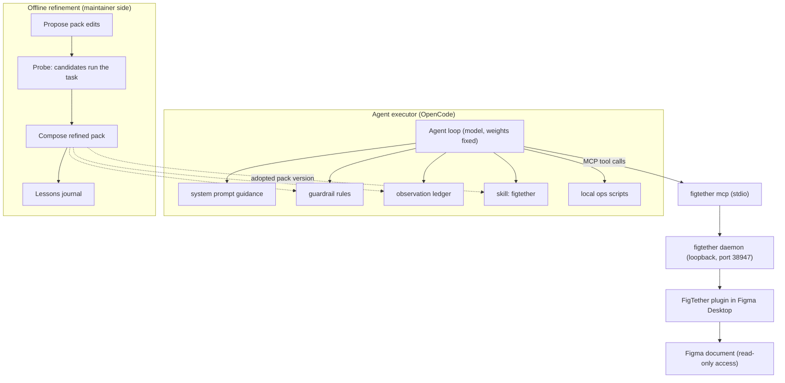

# Harness2 Integration Architecture for FigTether

Status: `Proposed`

Purpose: This document defines two integrations between FigTether and the Harness2 methodology
(H2). Integration A places FigTether inside an agent harness: it maps the eight harness components
to concrete FigTether provisions inside OpenCode and any MCP client. Integration B adopts the
upstream Propose-Probe-Compose loop as the way FigTether improves its shipped harness pack over
time. This document does not change any contract in `docs/04-data-contracts/`; where the pack
references those contracts, it cites them, it never redefines them.

## 1. Harness layers and where FigTether sits

Harness2 decomposes an agent runtime into layers with distinct runtime roles [H2]. FigTether
occupies one layer and supplies artifacts for the others:

| Layer                          | Members (Harness2)                        | FigTether involvement                                                                                                                         |
| ------------------------------ | ----------------------------------------- | --------------------------------------------------------------------------------------------------------------------------------------------- |
| Context construction           | system prompt, guardrails, memory, skills | Pack files provide the content for all four slots. FigTether core does not inject anything into the model context; the client loads the pack. |
| Tool interface                 | tool guidance, scripts                    | FigTether's primary home. The MCP tool surface (`docs/04-data-contracts/02-tool-catalog.md`) and CLI (`crates/cli`) are the tool interface.   |
| Orchestration (delegated work) | subagents                                 | Pack guidance only; FigTether never spawns agents.                                                                                            |
| Middleware                     | plugins                                   | Optional shaping (redaction, freshness enforcement) on top of what the envelope already guarantees.                                           |

A plain MCP client that only registers the FigTether tools and ignores the pack still gets a
correct tool interface, but it loses context discipline: it may read detail before summary
(`P04`), accept stale cache without checking `cache_age_ms` (`P03`), or invent values where the
envelope says `unavailable_fields` (`P08`). The pack exists so that discipline is loadable rather
than hoped for.

## 2. Integration A: FigTether as harness component inside OpenCode

OpenCode is the reference client because upstream Harness2 uses it as the default executor, and
because it natively exposes slots that correspond to the pack (skills, rules-like guardrails,
MCP configuration). Any MCP client can consume the tool surface (`FR17`, validated on at least two
clients by `AT14`); clients without skill slots degrade to behavior enforced by the envelope
itself.

### 2.1 Component mapping

| Harness component | FigTether provision                                                                                                                      | Pack file or contract                                                                              | PRD anchor                   |
| ----------------- | ---------------------------------------------------------------------------------------------------------------------------------------- | -------------------------------------------------------------------------------------------------- | ---------------------------- |
| system prompt     | Usage etiquette: summary-first, pick a valid `session_id` via `list_sessions`, check `source.kind` before decisions                      | `benchmarks/harness-pack/system/figtether-usage.md`                                                | `FR04`, `FR12`               |
| guardrails        | Freshness and scope rules that mirror envelope semantics; hard stops                                                                     | `benchmarks/harness-pack/guardrails/figtether-rules.md`                                            | `FR12`, `FR15`, `P03`, `P08` |
| memory            | Observation ledger: one entry per observation, no design payload                                                                         | `benchmarks/harness-pack/memory/observation-ledger.schema.json`                                    | `FR12`, section 8.5.2        |
| tool guidance     | Tool behavior catalog: when to call what with which parameters                                                                           | `docs/04-data-contracts/02-tool-catalog.md` mirrored into `benchmarks/harness-pack/tool-guidance/` | section 8.5.1                |
| subagents         | Delegation patterns and capacity rules (one active editor operation per session; `BUSY` carries `retry_after_ms`)                        | `benchmarks/harness-pack/subagents/figtether-delegation.md`                                        | `FR13`, `AT08`               |
| skills            | Workflow playbooks (summary-first, pagination, snapshot versus live, token extraction, asset hygiene)                                    | `benchmarks/harness-pack/skills/figtether/SKILL.md`                                                | `FR07`, `FR11`               |
| scripts           | Thin wrappers around local CLI operations: `figtether doctor`, `figtether status`, `figtether config print`                              | `benchmarks/harness-pack/scripts/`                                                                 | `FR18`, section 5.1          |
| plugins           | Response middleware guidance: strip secrets-bearing fields, redact sensitive layers, enforce freshness flags before contexts are re-sent | `benchmarks/harness-pack/plugins/`                                                                 | section 8.6, `FR02`          |

The mapping is deliberately conservative: enforcement authority stays with the products (daemon,
plugin, CLI in `crates/`); only FigTether's Rust core can enforce scope or revoke. The pack shapes
what the agent asks for and how it interprets what it receives; it never replaces enforcement.

### 2.2 Client capability matrix

| Client capability                                                  | OpenCode | Generic MCP client | What degrades without the slot                                                         |
| ------------------------------------------------------------------ | -------- | ------------------ | -------------------------------------------------------------------------------------- |
| Register MCP server from `figtether config print --client generic` | yes      | yes                | Nothing; this is the baseline product flow (`FR17`, `AT14`)                            |
| Load skill (playbooks)                                             | yes      | often missing      | Detail before summary; more pagination mistakes (`P04`)                                |
| Load rules file (guardrails)                                       | yes      | partially          | Soft-fail freshness and scope manners (`P03`, `P06`)                                   |
| Read pack memory schema (ledger)                                   | yes      | custom handling    | Slower re-investigation across sessions                                                |
| Spawn subagents that inherit rules                                 | yes      | mixed              | Overloading one session; repeated `BUSY` (behavior note in `FR13`)                     |
| Middleware on tool results (plugins)                               | partial  | no                 | Extra belt-and-suspenders redaction lost; core redaction still applies (section 8.6.2) |

Graceful degradation rule: wherever a slot is missing, the pack must not assume enforcement; it
may only add guidance the client will honor. No pack behavior may claim a guarantee the envelope
does not already carry.

### 2.3 What lands where

`benchmarks/harness-pack/` is the authoritative source of pack artifacts in the FigTether repo
(file spec: `docs/08-harness2/03-harness-pack-spec.md`). User-facing distribution (a downloadable
pack bundle alongside the binary and plugin bundle) is a release decision inside
`docs/07-ops/04-release-process.md`; until then, contributors copy them from the repository.

## 3. Integration B: applying Propose-Probe-Compose to the pack

The upstream loop operates on arbitrary harness files with model weights fixed [H2]. FigTether
application: the "harness" being refined is the FigTether pack; the "task" is a professional
Figma-reading task from FigTether-Bench (defined in
`docs/08-harness2/04-evaluation-protocol.md`); the executor is the agent running with FigTether
tools attached.

### 3.1 Propose

A maintainer (or a proposal agent acting on maintainer instruction) proposes edits to pack files.
Upstream distinguishes two edit classes [H2]; FigTether keeps both:

- Invariant edits: rules that must hold on every task. Example candidate: "never continue a
  summary past a truncated observation without continuing the cursor." These target envelope
  invariants (`FR07`, `FR12`).
- Domain edits: class-specific workflow changes. Example: for the asset pipeline category, "prefer
  `SVG` for flat vector roots and `PNG` below the export size cap." These belong in the relevant
  skill playbook.

Each proposed edit carries an expected behavioral change written as a testable claim, so the next
stage can falsify it.

### 3.2 Probe

Candidate pack versions are probed by running the same FigTether-Bench task with the base pack and
with the candidate pack and contrasting behaviors. Probes are regular agent sessions; the
observation ledger and envelope logs are the probe record. Consistent with upstream, no
ground-truth feedback is used at this stage: evidence comes from behavioral contrasts, not answer
keys. Grading (with answer keys) happens later, only at judging time, under the blinding rules of
document 04.

### 3.3 Compose

The composer (maintainer or agent) merges candidates whose measured contrasts show benefit and
whose claims survived probing, yielding a refined pack version. Composition output is a new pack
version bump (`pack_version` in the pack manifest) with an evidence note referencing the probe
runs. Adopted versions are retained; older versions are kept for comparison runs.

### 3.4 Lessons journal

Per upstream harnessing-level recursion [H2], adoption writes evidence-supported lessons to a
per-category library (FigTeter-Bench categories play the role of upstream domains). Rules FigTether
adopts: tasks in a category run in order and read only earlier entries; categories may run
concurrently; libraries are separated by benchmark, executor, mode, budget, and seed. The journal
lives at `benchmarks/harness-pack/lessons/` and is the input to future pack refinements at the
next gate window.

## 4. Runtime picture

Caption: Pack-driven agent harness and the offline Propose-Probe-Compose refinement loop.

Read as: the agent executor loads pack files and reaches the Figma document only through the
FigTether MCP surface; refinement runs in a separate maintainer workflow and arrives as new
adopted pack versions, never as code in the FigTether core.

## 5. Safety boundaries

The refinement loop inherits the PRD hard rules without restating them differently:

- No document mutation: probes may read, never write; `D03` and `FR24` apply to all agent and
  probe behavior (`AT18` is the fixture-level check, the pack adds an agent-side rule).
- No eval, no shell, no arbitrary script execution in the tool chain (`D03`); pack scripts call
  the shipped CLI and nothing else.
- Secrets never enter pack files, tool arguments, or the ledger (`FR02`); pairing is user-driven
  via CLI or UI and the model never sees credentials.
- Scope is what the envelope says it is; the pack may never widen it or probe outside the granted
  root (`FR03`, `AT17`).
- The core path never calls official MCP or REST endpoints (`FR19`, `AT01`, `AT02`); the pack
  explicitly forbids the agent from substituting such endpoints as a workaround for a failed
  FigTether call.
- Contract freeze: any pack observation that suggests an envelope, tool schema, or limit change
  becomes an ADR in `docs/02-architecture/adr/` first, per the change management rules in
  `docs/README.md`.
- Network: pack evaluation runs configure executor network restrictions before execution
  (`docs/08-harness2/05-runbook.md` section 8); graders must not reach rubrics or answer data.

## 6. Owners and evidence gates

| Role               | Owns                                       | Key duties                                                                                              |
| ------------------ | ------------------------------------------ | ------------------------------------------------------------------------------------------------------- |
| Product maintainer | Pack content and playbook correctness      | Approves composed pack versions; owns FigTether-Bench task list                                         |
| Security reviewer  | Guardrails file, plugins guidance, scripts | Sign-off on any rule that touches redaction, scope, or credentials (section 8.6)                        |
| MCP owner          | Tool guidance mirror                       | Keeps `benchmarks/harness-pack/tool-guidance/` in sync with `docs/04-data-contracts/02-tool-catalog.md` |
| Core owner         | Memory ledger schema                       | Keeps the ledger keys aligned to `docs/04-data-contracts/01-mcp-envelope.md`                            |
| QA / release owner | Evaluation evidence and reports            | Runs the protocol in document 04; files results at gates                                                |

Evidence gates aligned with PRD section 8.10 and `docs/01-agile/01-sdlc-process.md`:

| Gate   | Pack and harness activity                                                                                                                                                                     |
| ------ | --------------------------------------------------------------------------------------------------------------------------------------------------------------------------------------------- |
| G0     | No pack requirement in the PRD exit criteria (`AT01`, `AT02`, `AT12`, `AT18` own this gate). The baseline pack v0 and the FigTether-Bench task list may be authored in parallel as docs work. |
| G1     | Iteration window: probe runs of pack candidates on public fixtures once the MCP surface from `E07` works; refinement loop produces pack v1 with an evidence appendix.                         |
| G2     | Pilot uses the refined pack; measured pack deltas are published inside the pilot report and reviewed under `AT16`; FigTether-Bench results per document 04.                                   |
| G3, G4 | Optional windows: lessons journal feeds further pack versions; offline bundle (`FR21`) gets a pack section.                                                                                   |

The PRD gate exit criteria remain authoritative; the entries above add pack deliverables inside
existing windows and create no new product gate.

## 7. Out of scope

- Executing Harness2 code inside FigTether at runtime; FigTether core never depends on it.
- Shipping Python artifacts in FigTether distribution; evaluation tooling stays in the developer
  workflow (`docs/08-harness2/05-runbook.md`).
- Any write-back behavior in the pack (`D03`); scripted grant changes (grants change only through
  user UI/CLI, section 8.5.1); multi-user delegation across machines.
- Claiming measured improvements before gate evidence exists; upstream deltas are not FigTether
  results (document 01, section 8).
- Manual redefinition of risks already tracked in the PRD (`R03`, `R04`, `R05`, `R13`); the pack
  references them and adds agent-side mitigation only.
