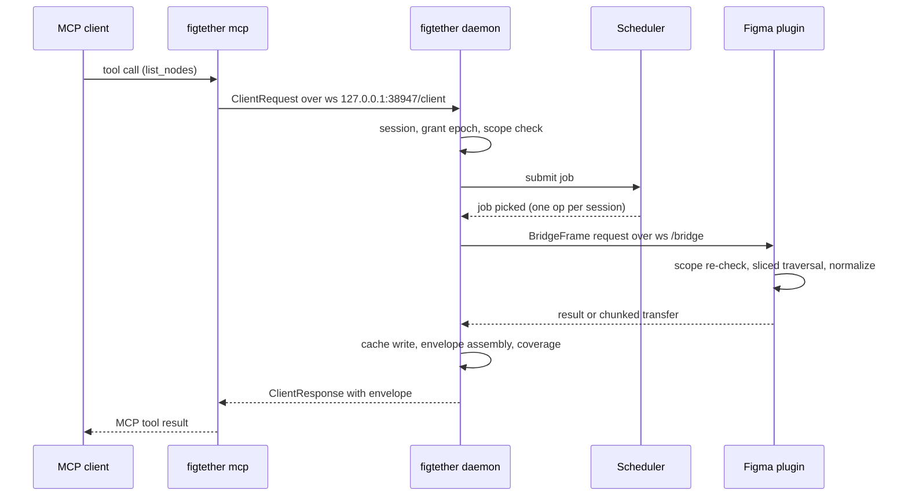

# Implementation Status

Status: `Proposed`

This document maps the running code to the design in `docs/`. It is the bridge between the
contract documents and the repository, and it is the place where a reader checks what is
actually built versus what is only designed. Every claim here is verifiable with a command in
this repository.

Scope note: the implementation targets the PRD gate `G0` (feasibility) plus the `E01` to `E03`
slice of the critical path. Gate `G0` has **not** been executed against a real Figma Desktop
session, so no claim in this document may be read as a released capability. See
`docs/06-testing/02-acceptance-catalog.md` for the evidence each acceptance test still needs.

## 1. Workspace map

| Path                   | Purpose                                                                                                                                          | Contract reference                                                                                                 |
| ---------------------- | ------------------------------------------------------------------------------------------------------------------------------------------------ | ------------------------------------------------------------------------------------------------------------------ |
| `crates/model`         | Response envelope, normalized design model, tool parameter types, error taxonomy, capability model, typed identifiers                            | `docs/04-data-contracts/01-mcp-envelope.md`, `04-normalized-model.md`, `02-tool-catalog.md`, `05-error-catalog.md` |
| `crates/protocol`      | Bridge frames, authentication payloads, chunked transfers, plugin payload shape, local client IPC                                                | `docs/04-data-contracts/03-bridge-protocol.md`, `docs/02-architecture/02-bridge-design.md`                         |
| `crates/core`          | Session and grant registry, scheduler with backpressure, bounded LRU cache, asset store, normalization, state machine, resource budgets, metrics | `docs/02-architecture/01-system-design.md`, `05-state-machines.md`, `docs/04-data-contracts/06-resource-limits.md` |
| `crates/assets`        | Asset store facade for the daemon and the CLI                                                                                                    | `docs/04-data-contracts/06-resource-limits.md`                                                                     |
| `crates/daemon`        | Loopback bridge for the plugin, authenticated client IPC, control endpoints, heartbeat, revoke, graceful shutdown                                | `docs/02-architecture/02-bridge-design.md`, `03-mcp-design.md`                                                     |
| `crates/mcp`           | MCP server over stdio with the twelve read-only tools                                                                                            | `docs/04-data-contracts/02-tool-catalog.md`                                                                        |
| `crates/cli`           | `figtether` binary: `doctor`, `daemon`, `mcp`, `status`, `pair`, `config print`, `manifest`, `revoke`                                            | `docs/07-ops/02-end-user-install.md`                                                                               |
| `crates/e2e`           | Fake plugin client, fake local client, acceptance flows                                                                                          | `docs/06-testing/02-acceptance-catalog.md`                                                                         |
| `crates/bench`         | Criterion workloads W1 to W5 and the release-evidence report generator                                                                           | `docs/06-testing/04-benchmark-plan.md`                                                                             |
| `plugins/figma/main`   | Figma plugin sandbox: allowlisted read handlers, sliced traversal, exports, capability probes                                                    | `docs/02-architecture/04-plugin-design.md`                                                                         |
| `plugins/figma/ui`     | Plugin UI iframe: pairing, grant, status, pause, resume, capture, revoke, accessibility                                                          | `docs/02-architecture/04-plugin-design.md`, PRD 5.3                                                                |
| `plugins/figma/shared` | TypeScript mirror of the Rust wire contract                                                                                                      | `docs/04-data-contracts/03-bridge-protocol.md`                                                                     |
| `schemas`              | Generated JSON Schema of the published contracts                                                                                                 | `docs/04-data-contracts/`                                                                                          |
| `fixtures`             | Public, clearly licensed fixture corpus with stable ids and hashes                                                                               | `docs/06-testing/01-test-strategy.md`                                                                              |

## 2. The contract spine

Two crates are frozen before any other code is written, because every other crate and the
plugin depend on them.

`figtether-model` defines what a result looks like:

- `Envelope` carries `schema_version`, `request_id`, `source`, `observation`, `coverage`,
  `data`, and `warnings`. The `source` distinguishes `plugin_live`, `plugin_snapshot`, and
  `offline_bundle`; the `observation` distinguishes `fresh`, `cached`, and `best_effort` and
  carries `observed_at` plus the optional `cache_age_ms`; the `coverage` states the roots, the
  returned node count, whether the result was `truncated`, the `next_cursor`, and the fields
  that were unavailable.
- `canonical_hash` hashes the compact JSON encoding with sorted keys. The hash proves two
  payloads are byte identical; it is not evidence that Figma stored that version.
- `ErrorCode` holds the 25 codes of the error catalog with a retryability verdict and a
  recovery action, and `FigError` carries the code, message, retryability, action, request id,
  and the optional retry delay.
- `NormalizedNode` and its domains (identity, geometry, layout, typography with runs, paints,
  effects, components, variables and styles, assets) keep unknown node types verbatim and
  record unavailable fields with a reason instead of dropping them.
- The twelve tool parameter structs are the single source of the published JSON Schema.

`figtether-protocol` defines how the pieces talk:

- `BridgeFrame` with the eleven allowed message types, the protocol version, the request id,
  the session id, the connection epoch, the grant epoch, and the deadline.
- The authentication payloads: `AuthRequest` with a one time secret, `AuthAccepted` with the
  session credential, the session id, the connection epoch, and the probed capabilities, and
  `AuthRejected`.
- `ChunkAssembler`, a bounded reassembler with a byte budget, a deadline, and a final checksum.
- The plugin payload contract (`PluginNode` and friends), the exact shape the TypeScript plugin
  produces and the daemon deserializes.
- `ClientRequest` and `ClientResponse`, the local IPC between the MCP adapter and the daemon.

## 3. Request flow



The agent never holds a secret, never names a bridge endpoint, and never widens a grant. The
scope is checked on the daemon side and again inside the plugin before any node is touched.

## 4. Enforced invariants in code

| Invariant                                    | Where it lives                                                                                    | Test evidence                                        |
| -------------------------------------------- | ------------------------------------------------------------------------------------------------- | ---------------------------------------------------- |
| Read-only: no tool mutates a document        | Tool parameters in `figtether-model`, no mutation handler in the plugin                           | `AT18` in `docs/06-testing/02-acceptance-catalog.md` |
| No official MCP or REST path in the core     | The core depends on `model` and `protocol` only; no HTTP client for Figma exists in the workspace | `AT01`, `AT02`                                       |
| Fresh by default, cached only when asked     | `ConsistencyRequest` default and the cache lookup in the daemon                                   | `AT04`                                               |
| Bounded queues, caches, transfers, responses | `ResourceLimits` in `figtether-core`                                                              | `AT07`, `AT08`                                       |
| Fail-closed authentication                   | First frame auth with a constant time compare and a 3 second window                               | `AT06`                                               |
| Epochs defeat stale answers                  | `connection_epoch` and `grant_epoch` on every frame and every cache key                           | `AT09`, `AT15`                                       |
| Scope enforced on both sides                 | `SessionRegistry::is_in_scope` and the plugin side membership check                               | `AT05`, `AT17`                                       |
| Secrets never reach the agent                | Pairing secret is minted by the daemon, shown by the CLI, never sent to a tool                    | `AT06`                                               |

## 5. Verification status

Run from the repository root:

```sh
cargo test --workspace
cargo clippy --workspace --all-targets -- -D warnings
cargo fmt --all --check
npm run format:check
```

The authoritative result of each run belongs in the release evidence file produced by
`crates/bench` (see `docs/06-testing/04-benchmark-plan.md` section 3). This document does not
restate test counts as a permanent number, because a count without a commit is not evidence.

## 6. What is still open

These are the gaps between the code and the PRD, stated plainly:

1. **No real editor session yet.** Every plugin side test runs against a fake plugin client.
   The PRD requires desktop verification in Figma Desktop before any editor facing claim
   (`G0` criteria, `AT03`, `AT12`).
2. **Watch and resync (FR20) are not implemented.** The tool surface returns
   `CAPABILITY_UNAVAILABLE` instead of pretending to work.
3. **Offline bundles (FR21) and multi-client fairness (FR22) are not implemented.**
4. **The `snapshot_id` member of the envelope is still a marked proposal.** The PRD 8.5.2
   envelope has no explicit capture identity although FR04 and FR05 require it
   (`docs/00-overview/01-prd-analysis.md`, gap 9).
5. **Version pins and platform claims are not proven.** The `rmcp` pin (3.6.0) is recorded in
   `Cargo.lock`, but client compatibility (`AT14`) needs two real MCP clients.
6. **Performance numbers do not exist yet.** The benchmark crate measures the offline domain;
   the editor benchmarks (`N03`, `N06`, `N08`) need a desktop session.

## 7. How to read the rest of the documentation

Start with `docs/00-overview/01-prd-analysis.md` for the product intent, then
`docs/02-architecture/01-system-design.md` for the system, then this document for the code that
exists. `docs/06-testing/03-traceability-matrix.md` maps every requirement to the code that
implements it and to the test that proves it.
