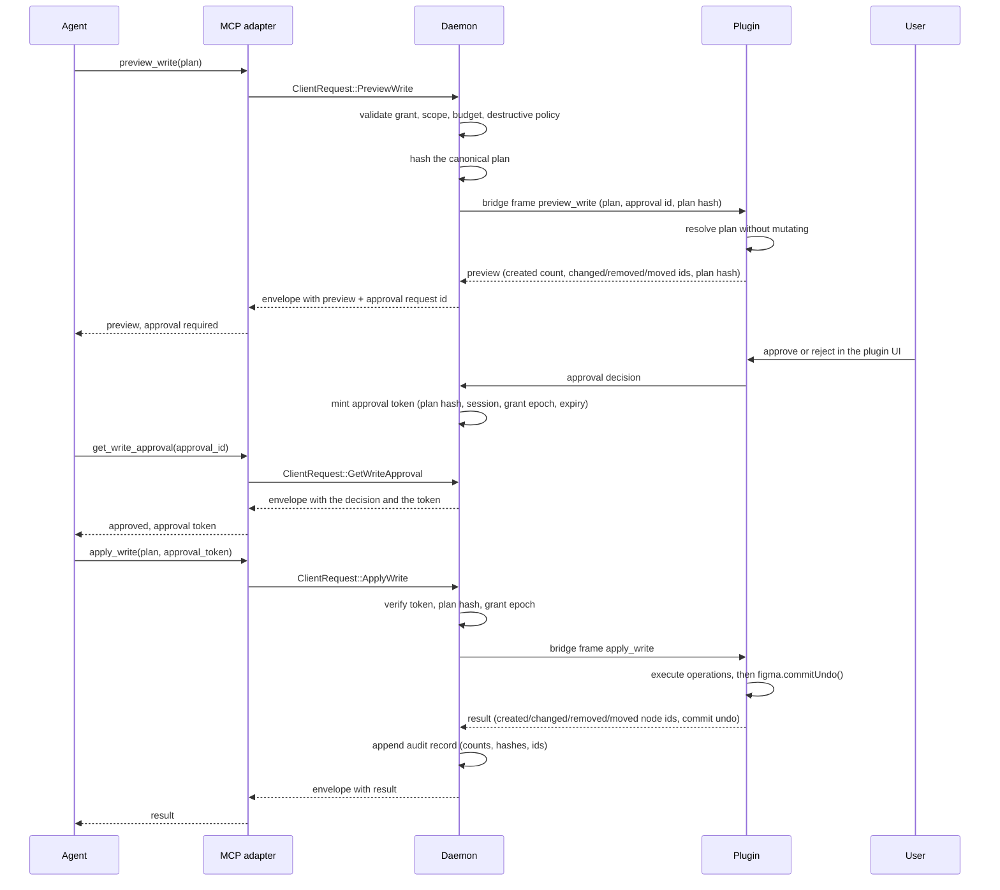

# Write path design

> **Design reference.** Original requirements and approval labels below are historical design
> records, not a feature-availability list. See [current documentation status](../documentation-status.md)
> for implemented reads/writes, observed desktop evidence, and remaining gaps.

Status: `Proposed` (implementation target of `ADR-013`)

This document fixes the contracts of the write path: what a plan is, how it is validated, how it is
previewed, how it is approved, how it is applied, and what is recorded. The decision and its
alternatives are in `ADR-013`.

## 1. The shape of the loop

Figure 1: The write path from the agent proposal to the applied plan.



Read as: the agent proposes, the plugin resolves without mutating, the user decides in the plugin
UI, and only the approved plan reaches the document. The daemon never mutates the document itself.

The agent never mutates the document. It proposes, the user decides, the plugin applies.

## 2. Contracts

### 2.1 Write plan

A plan is a list of operations plus the metadata that binds it to a session.

```text
WritePlan
  plan_id            opaque, minted by the agent, echoed back in the preview
  session_id         the session the plan targets
  operations         ordered list of WriteOperation
  intent             short free text, shown to the user, never executed
  destructive        true when the plan contains a delete or an out-of-scope move
```

The daemon hashes the canonical form of the plan before it forwards it, and the hash travels with
the plan on the bridge. The plugin compares the hash it receives with the hash of the plan it
resolved, so a plan that changed in transit is refused instead of previewed or applied.

The canonical form is the compact JSON encoding of the plan with every object key in lexicographic
order. The hash is `sha256:` followed by the hex digest of those bytes, so the canonical hash of a
plan is the string `sha256:<64 hex digits>`. The published schema of the plan is
`schemas/write_plan.schema.json`.

### 2.2 Operations

| Operation        | Effect in the plugin                                | Notes                                          |
| ---------------- | --------------------------------------------------- | ---------------------------------------------- |
| `create_node`    | creates a node of a type and appends it to a parent | parent must be inside the write grant          |
| `insert_child`   | moves an existing node into another parent          | reparenting refusal cases are mapped to errors |
| `set_properties` | sets a bounded set of properties on a node          | only the allowlisted property names            |
| `set_text`       | replaces the characters of a text node              | requires `figma.loadFontAsync` first           |
| `set_fills`      | replaces the fills of a node                        | paint payloads are normalized, never raw       |
| `delete_node`    | removes a node and its children                     | requires the destructive flag                  |
| `move_node`      | changes the position of a node                      | must stay inside the granted roots             |

The property allowlist is closed. It contains the geometry, size, layout, appearance, and naming
properties that a design system needs, and nothing that changes structure implicitly. A property
outside the list is a plan error, not a best effort.

### 2.3 Preview

```text
WritePreview
  plan_id
  plan_hash          sha256 over the canonical plan, the binding token
  created            node ids that would be created
  created_count      number of nodes the plan would create
  approval_id        the approval the user has to grant for this plan
  changed            node ids whose properties would change
  removed            node ids that would be removed
  moved              node ids that would be reparented or repositioned
  operations_count
  warnings           reasons a part of the plan could not be resolved
  blocked            true when the plan cannot be applied as written
```

A node that does not exist yet has no id, so the preview reports the number of planned creations in
`created_count` and the created ids stay empty until the plan is applied. The applied result
reports the real ids. The `approval_id` travels next to the counts, because the preview and the
approval request are one answer: the id names the request the user answers in the plugin UI.

The preview resolves identifiers against the live document. It never mutates. A plan that names a
node that does not exist, a parent that is not in the grant, or a property that is not allowlisted
produces a blocked preview with the reason, not a partial apply. The published schema of the preview
is `schemas/write_preview.schema.json`.

### 2.4 Approval

```text
WriteApproval
  approval_id
  plan_hash          the hash the user approved
  session_id
  grant_epoch        the grant the approval is bound to
  issued_at
  expires_at
  approved_by        "user"
```

The approval token travels with the apply request. The daemon verifies the hash, the session, the
grant epoch, and the expiry. A grant change invalidates every outstanding approval.

The token is deterministic and opaque, but not a secret. Its format is
`w:<approval_id>:<plan_hash>:<session_id>:<grant_epoch>:<issued_at>`, where the timestamp is RFC 3339. The plan hash is embedded without its `sha256:` prefix, because the fields are separated by
colons and the canonical hash carries one. The parser restores the prefix, so the parsed hash
compares equal to the canonical plan hash. The token grants nothing on its own: the daemon holds
the authoritative approval record and refuses everything the token does not prove.

The published schema of the approval is `schemas/write_approval.schema.json`.

### 2.5 Result

```text
WriteResult
  plan_id
  plan_hash
  approval_id
  created            node ids that exist after the apply
  changed            node ids that were changed
  removed            node ids that were removed
  moved              node ids that were moved
  undo_committed     true when figma.commitUndo() ran
  version_saved      the version id when a version checkpoint was written
  warnings
```

The result is the only place where the node ids of an applied plan are visible. The audit record of
section 5 keeps counts, so the ids stay with the caller that asked for the plan. The published
schema of the result is `schemas/write_result.schema.json`.

### 2.6 Errors

Eight new codes, extending the existing taxonomy:

| Code                      | Meaning                                                             | Retryable                         |
| ------------------------- | ------------------------------------------------------------------- | --------------------------------- |
| `WRITE_NOT_GRANTED`       | the session has no write grant                                      | no                                |
| `APPROVAL_REQUIRED`       | no valid approval token for this plan                               | no, the user has to approve first |
| `APPROVAL_EXPIRED`        | the approval expired or was invalidated                             | no                                |
| `PLAN_HASH_MISMATCH`      | the plan differs from the approved plan                             | no                                |
| `PLAN_INVALID`            | the plan is structurally invalid                                    | no                                |
| `BUDGET_EXCEEDED`         | the plan exceeds an operation budget                                | no, the plan has to shrink        |
| `DESTRUCTIVE_NOT_ALLOWED` | a destructive operation without the flag or without the user toggle | no                                |
| `MUTATION_REFUSED`        | the editor refused the mutation, for example a reparenting cycle    | conditional                       |

`FONT_UNAVAILABLE` is not a new code: a text change that needs a font the editor cannot load reuses
the code of the PRD 8.7 table. `OUT_OF_SCOPE` still answers a plan that names a node outside the
granted roots. The catalog with the recovery rules is
`docs/04-data-contracts/05-error-catalog.md` section 2.1.

## 3. Budgets

Defaults, in the same spirit as the read budgets and changeable only downwards:

| Budget                             | Default    | Why                                                     |
| ---------------------------------- | ---------- | ------------------------------------------------------- |
| Operations per plan                | 50         | a plan is a change set, not a script                    |
| Nodes created per plan             | 100        | bounds the blast radius of one approval                 |
| Text characters per plan           | 20,000     | bounds a runaway string                                 |
| Property changes per plan          | 200        | bounds a mass restyle                                   |
| Affected subtree size per delete   | 50 nodes   | a delete that swallows a library is not a design change |
| Plan validity                      | 10 minutes | an approval is a short lived decision                   |
| Write plans per minute per session | 10         | a burst of writes means a loop, not a design            |

Every budget produces `BUDGET_EXCEEDED` with the limit in the message. No budget is advisory.

The rate window counts the plans a session starts, not the operations inside them. One admitted plan
is one slot of the rolling window, and the per plan budgets bound what one of them may change. The
reason is the default profile: with 10 operations per minute and 50 operations per plan, a plan of
the maximum size would consume the whole minute budget on its own, so every large plan would be
impossible. A refused plan changes nothing and does not consume a slot.

## 4. Grant model

The grant gains a mode:

| Mode    | Reads                    | Writes                                   |
| ------- | ------------------------ | ---------------------------------------- |
| `read`  | allowed inside the roots | refused with `WRITE_NOT_GRANTED`         |
| `write` | allowed inside the roots | allowed inside the roots, after approval |

The mode is a user decision in the plugin UI, it is a separate action from the read grant, and it
can be narrowed to fewer roots than the read grant. A mode change increments the grant epoch, which
invalidates outstanding approvals, cursors, and assets, exactly like the existing rules.

The grant update on the bridge carries two fields, and they never mean the same thing:

| Field          | Values           | Meaning                                                   |
| -------------- | ---------------- | --------------------------------------------------------- |
| `mode`         | `read`, `write`  | the mode of the write grant                               |
| `session_mode` | `live`, `paused` | the pause extension of the session, the read path control |

A missing field means the conservative value: a missing `mode` is the read mode, and a missing
`session_mode` is live. A peer that does not know a field therefore keeps the read only behaviour.
The published schema of the mode is `schemas/grant_mode.schema.json`.

## 5. Undo and versions

- The plugin calls `figma.commitUndo()` once, after the last operation of an approved plan. The
  plan is then a single step in Figma's undo history.
- The plugin may call `figma.saveVersionHistoryAsync` before applying, with a title that names the
  plan. This depends on the seat and the file's version history, so it is best effort and its
  absence is reported in the result, never hidden.
- FigTether does not expose `figma.triggerUndo()`. It reverts to the last committed state, which
  is not necessarily the agent's write, so a tool could destroy the user's own work.
- The audit record exists so the user can see what happened, not to undo it. The daemon stores the
  plan id, the plan hash, the approval id, the number of operations, the counts of the created,
  changed, removed, and moved nodes, and the timestamp. It holds no node ids, no layer names, no
  text content, and no other design content. The node ids of an applied plan are visible in the
  write result of section 2.5, which is the answer the caller already holds.

## 6. Security layers between a plan and the document

| Layer              | Where                | What it stops                                                            |
| ------------------ | -------------------- | ------------------------------------------------------------------------ |
| Write grant        | plugin UI, registry  | an agent that only has read access                                       |
| Plan validation    | daemon               | a malformed or oversized plan, an unknown property, a missing identifier |
| Scope check        | daemon and plugin    | a plan that touches nodes outside the granted roots                      |
| Budget             | daemon               | a plan that creates or changes more than the limits allow                |
| Destructive policy | daemon and plugin UI | a delete or a move without an explicit flag and an explicit user toggle  |
| Preview            | plugin               | a blind mutation the user cannot review                                  |
| Approval           | plugin UI, daemon    | a write the user did not accept                                          |
| Undo commit        | plugin               | a write the user cannot take back in the editor                          |
| Audit              | daemon               | an unexplained change, for a human review afterwards                     |

## 7. MCP surface

Three new tools, and the tool catalog stops being uniformly read only.

| Tool                 | Purpose                                                                                            | Annotations                                                        |
| -------------------- | -------------------------------------------------------------------------------------------------- | ------------------------------------------------------------------ |
| `preview_write`      | submit a plan, receive the preview and the approval request                                        | `readOnlyHint: true`, `destructiveHint: false`: it changes nothing |
| `get_write_approval` | read the decision of the user and, when the plan was approved, the token that authorizes the apply | `readOnlyHint: true`, `destructiveHint: false`: it changes nothing |
| `apply_write`        | apply an approved plan with its approval token                                                     | `readOnlyHint: false`, `destructiveHint: true`                     |

The read tools keep `readOnlyHint: true` and `destructiveHint: false`. The annotation on a tool is
a hint for the client, not an authorization: the enforcement is the grant, the validation, and the
approval.

The parameters of the three tools are published as `schemas/preview_write_params.schema.json`,
`schemas/get_write_approval_params.schema.json`, and `schemas/apply_write_params.schema.json`.

Amendment: `get_write_approval` completes the surface. The approval contract of section 2.4 and
the sequence of section 1 produce an approval request and a decision; without a tool that reads
the decision, the agent could only learn about it by applying and being refused. The tool reads
approval state only: it never approves anything on behalf of the user, and it never widens a
grant. The tool level contract is in `docs/04-data-contracts/02-tool-catalog.md` sections 3.13 to
3.15.

## 8. Rollout

| Stage | Scope                                                          | Gate                                               |
| ----- | -------------------------------------------------------------- | -------------------------------------------------- |
| W1    | scratch pages only, create and text, no delete                 | editor session, undo verified                      |
| W2    | any granted root, full operation set, delete behind the toggle | budget and scope tests, preview reviewed by a user |
| W3    | multi client, write grants with different scopes               | isolation tests between sessions                   |

Nothing in this path ships before the editor session proves the undo behaviour. The automated
suites can prove the contracts, the budget, the scope, and the approval; they cannot prove that
Figma's undo stack reverts the plan as one step.

## 9. Open questions

1. Does the undo commit behave the same for a plan that touched several pages, and for a plan that
   failed halfway? A partially applied plan has to be reported as partially applied, and its undo
   behaviour is unverified.
2. Is the version history writable for every seat, and does the version title survive a rename?
3. Should a write grant be able to exclude a subtree of a granted root, or is the root the finest
   unit?
4. How should the preview render a plan that creates a component instance with swapped
   properties, where the resulting tree depends on the library?
