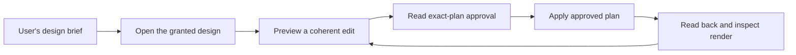

# Agent integration analysis, 21 October 2026

FigTether should let someone ask their connected agent to design in a shared Figma frame
without first studying this repository. The transport already supports model-independent
reads and approved writes. The integration around that transport is incomplete: setup,
tool discovery, visual feedback, and task guidance need to work in each supported host.

This is an analysis and proposed implementation order. No production MCP tools, client
configuration, skills, or running Figma sessions were changed for this investigation. The
[versioned evidence](../../benchmarks/published/agent-integration-2026-10-21.json)
retains source/build hashes, protocol observations, timing, cost gaps, and untested behavior.

## What is confirmed

**Pairing is not host registration.** Pairing connects the Figma plugin to the daemon. Each
agent host must also connect its MCP adapter and expose the tools. The current Codex session's
available tool catalog contained zero tools named for FigTether; the successful smoke check
launched the adapter explicitly through a script. This is a tool-visibility observation, not
a diagnosis of a personal configuration file. A host readiness check should distinguish
daemon running, plugin paired, frames shared, adapter registered, and tools visible.

| Finding                                             | Code / evidence                                                                                                                           | Effect on the user                                                                                                     |
| --------------------------------------------------- | ----------------------------------------------------------------------------------------------------------------------------------------- | ---------------------------------------------------------------------------------------------------------------------- |
| Canvas-first instructions already exist             | `INSTRUCTIONS` and `get_info` in `crates/mcp/src/tools.rs`; fresh initialization smoke check passes                                       | Merely adding another paragraph telling agents to use Figma would repeat existing guidance                             |
| Instructions are 1,841 characters                   | Deterministic extraction of the current Rust constant                                                                                     | This investigation does not establish instruction truncation as the cause                                              |
| Generic configuration is the only generated variant | `ClientKind` in `crates/cli/src/cli.rs`; `snippet` in `crates/cli/src/commands/config.rs`                                                 | Users must translate the configuration for their actual host                                                           |
| The focused skill is repository-local               | `.agents/skills/figtether-design/SKILL.md`                                                                                                | Connecting the executable from another workspace does not distribute that skill                                        |
| Visual delivery through MCP is incomplete           | Server enables tools only; `result.rs` emits text/structured content; daemon export normalization stores bytes and returns asset metadata | A host cannot get a usable rendered image from an opaque asset ID through the current MCP surface alone                |
| Tool descriptions are uneven                        | `inspect_design` emphasizes implementation context; write descriptions emphasize plan mechanics and manual approval                       | Tool search and model selection can miss the user's task wording; descriptions also lag the user-enabled Auto workflow |
| Discovery is a multi-call procedure                 | Status, sessions, root IDs, bounded reads, export, then plan construction                                                                 | Agents must reconstruct the workflow before they can design                                                            |
| Some advertised paths remain incomplete             | `get_snapshot_info` explicitly returns unavailable; previous desktop evidence retains rich-read timeout and pagination failures           | A technically discoverable tool is not necessarily a dependable first step                                             |

The new smoke run started an isolated daemon and synthetic plugin, initialized the actual
MCP adapter, listed 15 tools, and discovered the synthetic granted root with write access.
Single-call timings were 19.46 ms for initialization, 1.62 ms for tool listing, and 1.11 ms
for session discovery. These are individual protocol observations, not model performance
percentiles or live-editor timings. No model API was invoked. Model tokens and billing
are unmeasured.

The current shell can find Codex CLI 0.163.0 and Claude Code 2.1.198. Gemini CLI and Docker
were not found on its PATH. This does not establish what Gemini application the user is
running. No personal host configuration was inspected or changed, and no paid model task
was launched. The smoke test therefore establishes protocol behavior, not a successful
Codex, Gemini, or Claude design run.

## Why an agent may inspect the repository first

The user reports repository exploration before canvas work. The following are plausible
contributors; a real host trace is needed to attribute an individual occurrence:

1. The agent starts in the FigTether development checkout, surrounded by source, tests,
   research, and implementation documentation. Its ordinary coding workflow can treat that
   repository as the requested work product. An instruction file read required by the host
   is different from unnecessary source exploration.
2. An MCP connection supplies tools and server guidance. It does not replace higher-priority
   host instructions, install a full skill everywhere, or guarantee the model will select a
   tool immediately.
3. The agent has no single operation that resolves a named shared frame, explains available
   actions and limits, returns a bounded view, and supplies a visible render.
4. Export metadata without image delivery can push the agent toward shell scripts or source
   inspection to retrieve the very image the workflow tells it to inspect.
5. Tool failures can turn design work into bridge debugging. The earlier rich-read and cursor
   issues are recorded in the [desktop website evidence](../../benchmarks/published/website-2026-10-21.json);
   their current status needs focused reproduction before claiming a fix.
6. An existing host may still point to an older installed executable or cache an earlier
   tool catalog. This investigation tested the explicit release binary, not those settings.

This also means that a flat rule saying "never read files" would be counterproductive.
User-provided briefs and assets may be necessary. Bridge debugging and implementing an
application legitimately require source access. Guidance should distinguish design,
implementation, and bridge-debugging tasks.

## Model support and host support are separate

A model chooses actions; its host discovers tools, translates schemas, presents images,
loads skills, and handles permissions. A successful model run in one host does not establish
the same behavior in another. MCP negotiates protocol capabilities; the server cannot use
that negotiation to take over the host's instruction hierarchy. See the
[MCP architecture](https://modelcontextprotocol.io/specification/2025-11-25/architecture) and
[initialization lifecycle](https://modelcontextprotocol.io/specification/2025-11-25/basic/lifecycle).

| Host                        | Official integration mechanism                                                                                   | FigTether implication                                                                                                                                                                                                                        |
| --------------------------- | ---------------------------------------------------------------------------------------------------------------- | -------------------------------------------------------------------------------------------------------------------------------------------------------------------------------------------------------------------------------------------- |
| Codex CLI / local IDE setup | MCP server command in `config.toml` or `codex mcp add`; local skill discovery from `.agents/skills`              | Generate the actual TOML/registration instructions and distribute the skill beyond this checkout. [MCP docs](https://learn.chatgpt.com/docs/extend/mcp?surface=cli), [skill docs](https://learn.chatgpt.com/docs/build-skills)               |
| Gemini CLI                  | `mcpServers` in settings; server instructions enter its context; skills use `.gemini/skills` or `.agents/skills` | Generic JSON is a starting point, but discovery, activation, permissions, and rich images need a real CLI test. [MCP docs](https://geminicli.com/docs/tools/mcp-server/), [skill docs](https://geminicli.com/docs/cli/skills/)               |
| Claude Code                 | CLI registration / MCP configuration; `.claude/skills`; tool search can defer schemas                            | Clear server/tool wording and an appropriate skill distribution path matter. Do not assume this repository's skill path is sufficient. [MCP docs](https://code.claude.com/docs/en/mcp), [skill docs](https://code.claude.com/docs/en/skills) |
| Other local MCP hosts       | Their own configuration, schema adaptation, instruction handling, image support, and permissions                 | Keep a standard core, publish tested host/version combinations, and provide a concise fallback workflow                                                                                                                                      |
| Browser/cloud-only hosts    | Depend on their connector and execution environment                                                              | Do not promise access to a local stdio process or the user's loopback daemon                                                                                                                                                                 |

Documentation supports these configuration mechanisms. It does not prove FigTether is
compatible with every release, plugin policy, model, or deployment of those hosts. Current
upstream docs also describe features newer than the locally installed Claude Code version;
version-specific behavior must be checked rather than assumed.

## Recommended implementation order

### 0. Verify host tool visibility

Test registration, restart/catalog refresh when required, and a successful scoped read in
each real host. Record the executable path/version without exposing credentials. Setup
should offer a clear action for each missing connection step. A green paired status in the
Figma plugin must not imply that every local agent can already call its tools.

### 1. Complete visual delivery and repair the dependable read path

Add a bounded, grant-checked image retrieval path. Return an MCP image content block for a
PNG preview, with text/structured metadata and explicit size limits. Keep full-resolution
delivery separate if needed. An asset reference must be checked against the current grant
when retrieved; expiry, revocation, cross-session access, and oversized exports need tests.
Never expose a local path or installation credential to make an image fetch work.

MCP defines image blocks in tool results. Gemini CLI documents rich tool responses, and
Claude Code documents inline MCP images. The actual rendering and size handling still need
host-specific verification. See the [MCP tool result contract](https://modelcontextprotocol.io/specification/2025-11-25/server/tools),
[Gemini rich content](https://geminicli.com/docs/tools/mcp-server/#returning-rich-content-from-tools),
and [Claude MCP images](https://code.claude.com/docs/en/mcp#images-in-tool-results).

Reproduce the earlier timeout, pagination, selection, and inspection cases against the new
build. Fix confirmed contract defects and make unavailable paths explicit before the agent
chooses them. Do not hide failures behind a successful empty response.

### 2. Add one task-oriented entry tool

Proposed name: `open_design`. This is not implemented yet. It would accept a known session
and granted frame ID, or resolve a named frame within existing grants. With multiple matching
frames or sessions it should return choices rather than select another agent's work.

Its bounded response should contain the shared frame's name/ID, editing availability,
coverage, lightweight tree/geometry, render, supported operations, relevant budgets, and
the next permitted action. It must not pair, expand grants, enable Auto, approve, or mutate.
If reading or editing is unavailable, return the specific Bridge UI action the user needs.
Retain low-level tools for detailed work and advanced clients.

The intended design loop becomes:

### 3. Distribute one canonical workflow with host adapters

Keep one workflow source for design discovery, bounded reads, native node creation,
approval, recovery, and visual verification. Generate concise MCP instructions, task-focused
tool descriptions, and host skill packages from it. This prevents manual-approval wording
from diverging from user-enabled Auto behavior. Put essential instructions first and keep
provider-specific metadata optional.

Proposed commands such as `figtether setup --client codex|gemini|claude` should be labeled
future work until implemented. Setup should preview concrete configuration changes, preserve
existing settings, use absolute executable paths, support removal, and verify the registered
binary. A user-chosen design workspace should work without opening the bridge's source tree.
It should not silently change global prompts, host tool approvals, or workspace trust.

Skills and optional host plugins can improve discovery. They do not replace a usable standard
MCP interface, and clients that cannot load them still need a complete tool-based workflow.

### 4. Test behavior in actual hosts and models

Use fresh host sessions and separate fixtures for: a new page, a targeted edit, and recovery
from missing editing access or a warning. Run each in an empty design workspace and in the
FigTether checkout to measure repository-context drift. Keep the brief, frame state, grant,
approval mode, server build, and host/model versions recorded. Repeat enough runs before
claiming a reliable improvement; report trial counts and failures.

| Metric                             | What to retain                                                                                                |
| ---------------------------------- | ------------------------------------------------------------------------------------------------------------- |
| Time to first canvas observation   | Start of user task to first successful scoped read/render                                                     |
| Unnecessary repository exploration | Source reads/searches before canvas work, excluding required host instructions and requested inputs           |
| Time to first useful preview       | First coherent, valid proposal for the requested design                                                       |
| Completion and visual evidence     | Native editable result, changed node IDs, readback, render, and review against the brief                      |
| Recovery and permissions           | Failures, retries, missing grants, pending/expired approvals, warning behavior                                |
| Context and cost                   | Exposed tool/schema size, model-reported input/output tokens and billing when available; otherwise unmeasured |

Protocol tests and deterministic UI rules cannot establish model task performance or design
quality. Capture the host-side tool trace with appropriate privacy controls; MCP logs alone
cannot observe unrelated filesystem calls. Do not publish private prompts, design contents,
credentials, or personal configuration. Keep sanitized per-run evidence and build hashes.

## Where PentAGI fits

PentAGI is suited to adversarial checks of the daemon and new image/download boundary. It
does not establish that Gemini, Claude, or Codex choose the right design tools. See the
[upstream project](https://github.com/vxcontrol/pentagi) and this repository's
[isolated assessment runbook](../../security/pentagi/README.md).

Extend the assessment with image ownership, stale asset references after grant changes,
capability replay, excessive render size, cross-origin access, and attempts to bypass
warning-gated approval. Use an isolated daemon, synthetic designs, and separate credentials.
No PentAGI assessment was executed during this analysis; Docker was not on the current PATH.

The immediate engineering priority is a complete visual tool loop and client-specific setup.
The claim to aim for is documented, tested interoperability across selected hosts and models,
with an extensible standard core. "Every model and every harness works" would exceed the
evidence and the server's control.
