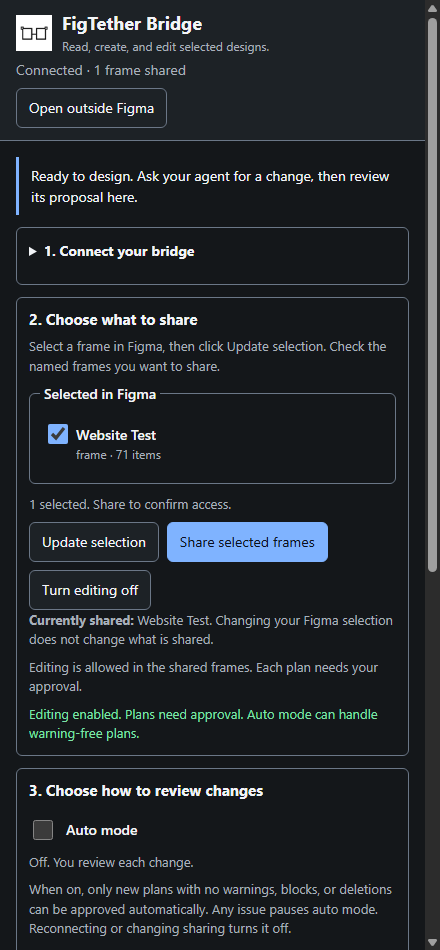

# Bridge usability revision, 21 October 2026

The intended user wants to connect an agent, choose a design, and understand what will
change. They should not need to interpret node IDs, grant epochs, or transport logs to do
that. This revision addresses the reported activity numbering, confusing frame candidates,
movable controls, and repeated manual review of clean plans.

This is an implementation review with controlled interaction evidence. It is not a user
study, accessibility certification, or a new live Figma design benchmark. See the
[versioned verification record](../../benchmarks/published/bridge-ux-2026-10-21.json).

## Evidence and scope

A fresh Figma Desktop capture found the plugin closed. It did not provide an observable
native Bridge flow, so no native interaction pass is inferred from it. The before/after
captures use the actual Bridge HTML, CSS, DOM adapter, and controller with resettable test
ports in an isolated Chrome profile. A separate native daemon test uses an authenticated
synthetic plugin and actual browser HTTP controls. The shared daemon and Gemini's session
were not restarted, revoked, or mutated by these tests.

The existing compact system-font UI, dark/light tokens, blue primary actions, and section
containers were retained. The hierarchy now follows connect, choose frames, review changes,
and recover. Frame labels use names and item counts; technical identifiers stay in Session
details. Controls wrap at narrow widths, with 40px buttons and 44px frame rows. These are
project layout targets, not proof of full accessibility conformance.

## Flow findings and changes

| User task                         | Previous friction                                          | Implemented behavior                                                                   | Evidence / limit                                                                                            |
| --------------------------------- | ---------------------------------------------------------- | -------------------------------------------------------------------------------------- | ----------------------------------------------------------------------------------------------------------- |
| Connect                           | Pairing and technical status dominate after connection     | Pair instructions collapse; next-step text describes the current task                  | Connected and unpaired fixture captures                                                                     |
| Choose a design                   | Root numbers and node IDs obscure the actual frame         | Named frame choices; Update selection, Share selected frames, Currently shared         | DOM interaction verifies the confirmed frame name; changing selection does not widen access                 |
| Decide whether the agent may edit | Reading and editing can appear interchangeable             | Explicit Allow editing control and current editing feedback                            | Controller tests retain a separate write grant                                                              |
| Review a change                   | Repeated approvals interrupt clean work                    | Manual review remains default; human opt-in Auto handles new clean plans               | Controller plus daemon checks; warnings, deletions, blocks, or incomplete checks prevent automatic approval |
| Work on another monitor           | Plugin controls are confined to Figma                      | Open outside Figma opens a local browser companion                                     | Real local HTTP/browser test; native Figma launch gesture remains untested in this revision                 |
| Understand recent activity        | Numbered markers and raw operation syntax are hard to scan | Unnumbered event list, readable operation labels, count, clear action, bounded history | Actual DOM checks: no markers, 200-event cap, clear/count agreement                                         |
| End access safely                 | Shared sessions affect multiple agents                     | Stop sharing requires confirmation and explicitly names all session agents             | Controller and browser confirmation checks; separate names do not enforce agent isolation                   |

## Auto mode contract

Auto mode starts off and must be enabled by the user after sharing frames and allowing
editing. It does not approve a proposal already on screen. A warning or incomplete preview
pauses it; reconnecting, changing access, or disabling editing turns it off. Failures remain
visible. The daemon separately checks preview evidence, session identity, and plan hash
before accepting an automatic decision. Exact-plan tokens, scope, and write budgets remain
enforced when the agent applies a plan. Agents are instructed to check approval status,
and must not enable Auto or drive the user's approval controls.

Closing the browser does not end sharing or disable Auto. Both the UI and tutorial say so.
The browser capability expires after 30 minutes and is invalidated on plugin disconnect,
reconnect, revocation, or opening a replacement window. This is a control-window lifetime,
not an Auto session timer.

## Why a browser companion

Figma documents its plugin UI as an iframe in a modal, with positions constrained to the
editor viewport. A browser companion is therefore a separate local control surface, while
the plugin stays running and performs Figma operations. This implementation uses
`figma.openExternal` to open the local URL. See Figma's primary documentation for
[showUI](https://developers.figma.com/docs/plugins/api/properties/figma-showui/),
[UI lifecycle](https://developers.figma.com/docs/plugins/api/figma-ui/), and
[openExternal](https://developers.figma.com/docs/plugins/api/properties/figma-openexternal/).

The companion uses an in-memory capability for one authenticated plugin connection. The
fragment is removed from the address immediately; no browser storage, pairing secret, or
installation credential is used. Protected routes require bearer authentication and reject
foreign origins. Browser commands carry the current grant epoch; approval actions also
carry the displayed approval ID and plan hash. An old or disconnected window disables its
controls. This does not replace the daemon's existing mutation checks.

## Remaining user needs

These are product hypotheses to validate with users, not findings from interviews:

1. **Simpler first installation.** Source builds, manifest IDs, and two terminals remain
   substantial setup work. A signed distribution and guided setup are separate release work;
   the tutorial does not pretend a published installer or npm CLI exists.
2. **Agent identity and isolation.** Two agents can still share one grant. Named frames help
   coordination, but per-agent scopes and visible ownership need a separate design.
3. **Understand the visual effect before approval.** Counts and intent do not show layout
   quality. A trustworthy before/after preview would help users judge complex changes.
4. **Recovery without jargon.** The guide explains disconnected, expired, read-only, and
   revoked states. Observe first-time users recovering from those states in the native editor.
5. **Complete accessibility verification.** Keyboard and narrow-width checks are useful,
   but native editor focus, screen-reader announcements, contrast across themes, and zoom
   need a dedicated assistive-technology pass.

The new controls require an updated daemon and rebuilt/reopened plugin. Feature negotiation
disables unsupported browser and Auto controls when the plugin meets an older daemon.
Restart shared components only when all agents are finished.
