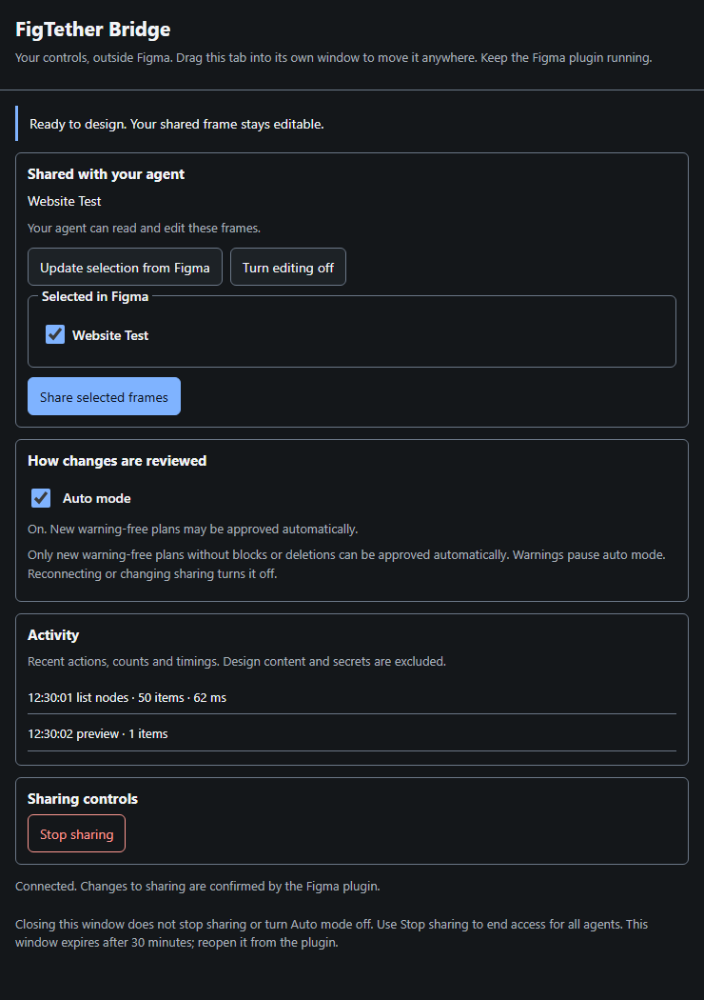

# Use FigTether Bridge

The Bridge controls **what your agent can see, whether it can edit, and which changes it
may apply**. Start with manual review. Move the controls to a browser companion and opt
into Auto mode when you need them.

Build/install using the [README tutorial](../README.md#build-and-connect). Update both the
daemon and plugin for the new features. The new plugin disables unsupported controls when
it connects to an older daemon.

## 1. Connect once

In Terminal A, start the bridge and leave it running:

```sh
figtether
```

In Terminal B, get the one-time pairing secret:

```sh
figtether pair
```

The secret comes from **Terminal B**, not Figma or your model provider. Paste only its value
into **Pairing secret** in the plugin and click **Pair**. It expires after five minutes and
works once. Keep it out of chat, screenshots, and MCP configuration. Generate a fresh secret
if it expires. Pairing connects the bridge; it does not share any frame.

When connected, the setup section collapses. Status and the next-step message stay visible.
You do not need to pair again while the session remains authenticated.

## 2. Share the frame by name

1. Select the frame you want to work on in Figma. For a new design, create an empty frame
   and give it a recognizable name, such as **Website Test**.
2. Click **Update selection** in the Bridge.
3. Check the names you want to share. A single selected frame is checked for you.
4. Click **Share selected frames**. Access changes only when you click this button.
5. Check **Currently shared**, which describes active access rather than the selection list.
6. Click **Allow editing** if the agent should create or change layers.

Selecting another frame does not change sharing. Update and share again to change access.
This returns the session to reading only and turns Auto mode off; enable editing again if
needed. If a frame name changes, update the selection to refresh it.


This is a controlled browser preview, not proof of a native Figma connection. The
[verification record](../benchmarks/published/bridge-ux-2026-10-21.json) separates browser,
daemon, automated, and native-editor coverage.

Choose a frame when creating a design. If you select a text layer or an individual object,
the list describes that object; the agent does not automatically gain access to its parent.
Names help you recognize the choice; grants still use stable node IDs internally.

## 3. Choose how to review changes

### Manual review, the default

Ask your connected agent for a design change. **Proposed change** shows its intent, counts,
and warnings. **Approve the plan** approves that exact proposal; the agent retrieves its
token and applies it. Editing access alone does not approve a plan.

**Reject the plan** leaves the document unchanged by that proposal. Ask the agent for a
revised plan. A **blocked** plan cannot be approved. Warnings require your review: manual
approval is possible for an unblocked plan, but a warning never qualifies for auto approval.

Use Figma's Undo after an applied change if needed. The plugin reports whether it committed
an undo step; manual undo restoration was not verified in the current UI test.

### Auto mode, your explicit choice

After sharing frames and allowing editing, turn **Auto mode** on yourself. It covers new
proposals and does not retroactively approve the proposal already on screen.

| What happens                                                  | How the Bridge responds                                      |
| ------------------------------------------------------------- | ------------------------------------------------------------ |
| New complete preview, no warnings, blocks, or deletions       | Approves that exact plan. The agent still needs to apply it. |
| Warning, blocked plan, deletion, or incomplete preview checks | Pauses auto mode for your review.                            |
| Partial write, reported write warnings, or an error           | Stops automation so you can inspect what happened.           |
| Reconnect, re-pair, pause, or change to shared access         | Turns auto mode off; enable it again deliberately.           |

The plugin and daemon both check automatic approvals. Scope, plan hashes, approval expiry,
budgets, and the separate editing grant still apply. Agents cannot enable Auto mode through
MCP. **A warning-free plan does not guarantee a good-looking or correct design.** Review the
result and give your agent feedback.

## 4. Move controls outside Figma

Click **Open outside Figma** in the header. Drag the resulting browser tab into a separate
window, then move or resize it anywhere. The Figma plugin dialog itself remains inside
Figma's viewport, as documented by [showUI](https://developers.figma.com/docs/plugins/api/properties/figma-showui/).
The plugin opens the local companion using [openExternal](https://developers.figma.com/docs/plugins/api/properties/figma-openexternal/).

The companion shows selected/shared frames, editing access, Auto mode, proposals, activity,
and Stop sharing. Its controls go through the same plugin controller. Keep the plugin
running. Closing the browser window alone does not stop sharing or Auto mode; turn auto
mode off or stop sharing before leaving work unattended.

The private launch capability lives in memory. It is different from the pairing secret
and MCP credential, expires after 30 minutes, and ends on reconnect or revoke. Reopening
the companion replaces its previous link. A reloaded or expired tab may need to be reopened
from Figma. Do not share private launch links. Disconnected/expired controls are disabled.



This capture uses an isolated daemon and synthetic plugin. See the [verification record](../benchmarks/published/bridge-ux-2026-10-21.json).

## 5. Understand activity

Rows show the time, a readable action, item count, and duration when available, without
numbered markers. The count describes the visible history, capped at the latest 200 events.
**Clear activity** clears the view; it does not undo edits or stop sharing.

Logs exclude design text, layer names, file IDs, plan contents, and credentials.
**Session details** contains technical status and last-write details for troubleshooting.
An operation succeeding does not establish that its visual result is good.

## 6. Stop or recover

**Stop sharing** asks for confirmation and ends reading and editing for all agents using
the session. Separate frame names are a work convention, not enforced agent isolation.
Content already sent to a client cannot be recalled.

| What you see                             | What to do                                                                    |
| ---------------------------------------- | ----------------------------------------------------------------------------- |
| Command not found                        | Follow the [PATH instructions](quickstart.md#figtether-is-not-recognized).    |
| Nothing selected                         | Select a frame in Figma, then Update selection.                               |
| Reading works, editing does not          | Check Currently shared, then Allow editing.                                   |
| Agent is waiting                         | Check Proposed change. Auto mode may be off or paused.                        |
| New controls unavailable                 | Update daemon and plugin, then restart/reopen when other agents are finished. |
| Browser companion expired                | Open a new companion from the plugin.                                         |
| Session revoked                          | Run `figtether pair`, pair again, then share frames and allow editing again.  |
| Old build keeps sharing buttons disabled | Rebuild and reopen the Bridge plugin, then pair again.                        |

When all agents are finished, stop sharing and stop the daemon with Ctrl+C. Leave shared
access running if another agent still needs it. See the [quickstart](quickstart.md) and
[agent workflow](agent-workflow.md) for setup and tool limitations.
