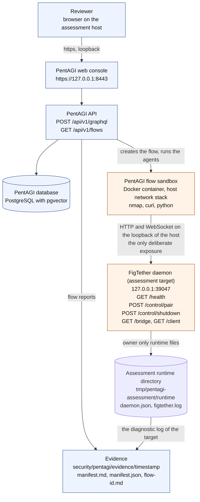

# PentAGI assessment of the FigTether daemon

Status: `Proposed`

This directory holds the procedure that runs an autonomous penetration test against the FigTether
daemon and reads its result. The tester is [PentAGI](https://github.com/vxcontrol/pentagi), the
self hosted multi agent system of VXControl. PentAGI describes a target and a goal in plain
language, a team of agents plans the work, runs professional security tools inside a sandboxed
Docker container, and writes a report.

The assessment does not use the MCP surface of FigTether, and it does not use an editor. It attacks
the daemon over its own network surface, on the loopback interface, with the tools an agent has.

## 1. What this assessment is for

FigTether keeps its data local. The daemon binds `127.0.0.1` only, the plugin and the local clients
reach it over that loopback interface, and the trust model of the product says that a process on
the same machine, a web page that a browser loads, and a foreign MCP client are all untrusted
callers. The threat model turns that trust model into rows, and this assessment is the adversarial
check of the rows that the loopback surface carries.

| What is validated | Where it is written down |
| ------------------ | ------------------------ |
| `TH01`, `TH02` spoofing of the bridge through a foreign `Host` or `Origin` header, and the reach of the bridge from a web page | `docs/05-security/01-threat-model.md` section 4, section 7 |
| `TH03`, `TH04` the credential lifecycle of the pairing secret and of the installation credential | `docs/05-security/01-threat-model.md` section 2, assets `AS2` and `AS3` |
| `TH05`, `TH10` the isolation of two sessions that use identical node ids | `docs/05-security/01-threat-model.md` section 4 |
| `TH06` the resource contract of the daemon under pressure | `docs/05-security/01-threat-model.md` section 4 |
| `TH11` the epoch rules that keep a stale answer from being served | `docs/05-security/01-threat-model.md` section 4 |
| `TH13` the sanitized diagnostics | `docs/05-security/01-threat-model.md` section 4 |
| `AT06` wrong, expired, and replayed secrets, and a wrong `Host` or `Origin` | `docs/06-testing/02-acceptance-catalog.md` |
| `AT13` the parsers and the path resolution under extreme input | `docs/06-testing/02-acceptance-catalog.md` |
| `AT17` the freshness of the membership check while a scope moves | `docs/06-testing/02-acceptance-catalog.md` |
| The requirements behind the rows: `FR02`, `FR03`, `FR04`, `FR07`, `FR13`, `FR14`, `FR16`, `FR18`, `FR19` | `FGT-PRD-001` sections 8.5.4, 8.5.5, 8.6.1, 8.7 |

The assessment answers one question for every row: does the daemon still behave the way the threat
model says it behaves, when a tool that was not written by the maintainer drives it?

What the assessment cannot answer, and why:

- It does not test the plugin side of the bridge. The plugin path needs a running Figma editor, and
  the assessment runs without one. The flows therefore impersonate the plugin, which is the stronger
  position anyway, because the impersonated plugin chooses its own client id and its own scope.
- It does not read design content. The data plane needs a client that holds the installation
  credential of the daemon. That credential lives in the runtime directory of the daemon, and the
  assessment does not hand it to a language model. Flow 05 asks for it only when the operator
  attaches it on purpose, and reports the gap when it is absent.
- It does not replace the acceptance tests. The acceptance tests in `docs/06-testing/` are the
  evidence of the gate. The assessment is an independent, adversarial second opinion.

## 2. Architecture of the assessment



The diagram has one deliberate edge, the one from the flow sandbox to the daemon. The daemon binds
the loopback address only, so a sandbox that runs on a Docker bridge network cannot reach it at
all, not even to be refused: such a sandbox reaches the host through the gateway address of the
bridge, and the daemon does not bind that address. The sandboxes of this assessment therefore
share the network stack of the host, so that `127.0.0.1` inside a sandbox is the loopback
interface of the assessment host and the target of every flow prompt is the real target. The price
of that choice is written down in `security/pentagi/.env.example`: a sandbox that shares the
network stack of the host binds its out of band listeners directly on the interfaces of the host,
without a port mapping, so `DOCKER_PUBLIC_IP` does not limit them in that mode. Run the assessment
on a host that is not reachable from the network, or restrict the port window with a firewall in
front of the host.

## 3. Files of this assessment

| Path | Purpose |
| ---- | ------- |
| `security/pentagi/README.md` | This runbook |
| `security/pentagi/.env.example` | The environment of the PentAGI instance, with the safe defaults |
| `security/pentagi/docker-compose.override.yml` | The override that applies the safe defaults to the upstream compose file |
| `security/pentagi/flows/` | One flow prompt per threat class |
| `scripts/pentagi/start-target.sh`, `scripts/pentagi/start-target.ps1` | Start the daemon as the assessment target |
| `scripts/pentagi/run-assessment.sh`, `scripts/pentagi/run-assessment.ps1` | Create one flow per prompt and write the identifiers into a JSON summary |
| `scripts/pentagi/collect-evidence.sh`, `scripts/pentagi/collect-evidence.ps1` | Collect the flow reports and the daemon log into an evidence directory |
| `security/pentagi/evidence/` | The evidence of a run. Ignored by git, because it is local agent output |

## 4. Prerequisites

| Requirement | Detail |
| ----------- | ------ |
| Docker and Docker Compose | The upstream requirements are Docker with Compose, at least 2 vCPU, 4 GB of memory, 20 GB of free disk, and internet access for the images |
| An LLM provider | At least one of OpenAI, Anthropic, Gemini, Bedrock, Ollama, DeepSeek, GLM, Kimi, Qwen, MiniMax, Mistral, xAI, or any OpenAI compatible endpoint. The provider name is the one that is submitted with the `createFlow` mutation |
| An API token | Created in the web console under Settings, PentAGI API. It is shown only once. The scripts read it from the environment and never print it |
| The FigTether binary | `cargo build --release` in the repository root. The scripts find it in `target/release`, in `target/debug`, in `CARGO_TARGET_DIR`, or on `PATH` |
| `curl` | The shell scripts use `curl` for every call to the API and for the health check |
| An isolated host | The assessment runs an autonomous agent with security tools on the machine. Use a machine that holds no real design data, no production daemon, and no account that matters |

## 5. The step by step run

### 5.1 Bring up PentAGI

1. Install PentAGI with the upstream installer, or with the upstream compose file. The upstream
   repository is <https://github.com/vxcontrol/pentagi>, the license is Apache-2.0, and the
   installer supports Linux, macOS, and Windows.
2. Merge the values of `security/pentagi/.env.example` into the `.env` file of the instance. Fill in
   the cookie salt, the database password, and the key of the model provider. Never commit the
   filled in file.
3. Start the stack with the upstream compose file and the override of this assessment:

   ```sh
   docker compose -f docker-compose.yml -f security/pentagi/docker-compose.override.yml up -d
   ```

   The override only sets environment variables. It does not touch the port lists, because Compose
   appends port lists instead of replacing them. The listen addresses are pinned through the `.env`
   file of the instance.
4. Open the console on <https://localhost:8443>, sign in with `admin@pentagi.com` and `admin`, and
   change the default password before anything else happens.
5. Create an API token under Settings, PentAGI API. Copy it into the environment of the shell that
   runs the scripts:

   ```sh
   export PENTAGI_API_TOKEN='the token that the console showed once'
   export PENTAGI_BASE_URL='https://localhost:8443'
   ```

   The token stays in the environment. It is never written into a file of this repository, and the
   scripts never print it.

### 5.2 Start the assessment target

The daemon of the assessment runs on a dedicated port and with a dedicated runtime directory, so it
never occupies the default bridge port `38947` and never touches the runtime directory of a real
installation. The script refuses the default port and refuses the platform runtime directory.

```sh
cargo build --release
sh scripts/pentagi/start-target.sh
```

The PowerShell twin does the same thing:

```powershell
cargo build --release
pwsh -File scripts/pentagi/start-target.ps1
```

The script prints the port, the runtime directory, the binary it used, and the answer of the health
endpoint, and it waits until that endpoint answers. It is safe to run twice: when a daemon already
answers on the assessment port, the existing one is reused and no second daemon is started.

```text
==> assessment target
port: 39047
runtime directory: <repository>/tmp/pentagi-assessment/runtime
binary: <repository>/target/release/figtether
health: answered (GET http://127.0.0.1:39047/health)
the assessment target is ready
```

### 5.3 Create the flows

```sh
sh scripts/pentagi/run-assessment.sh \
    --base-url "$PENTAGI_BASE_URL" \
    --token "$PENTAGI_API_TOKEN" \
    --provider openai
```

The script reads every markdown file of `security/pentagi/flows/`, extracts the target description
between the `<!-- BEGIN TARGET -->` and `<!-- END TARGET -->` markers, and submits it with the
`createFlow` mutation. Afterwards it lists the flows of the instance and writes the identifiers
into `tmp/pentagi-assessment/flows.json`.

```text
==> assessment
base url: https://localhost:8443
model provider: openai
flow directory: <repository>/security/pentagi/flows
summary file: <repository>/tmp/pentagi-assessment/flows.json
flow list: <repository>/tmp/pentagi-assessment/flows-api-list.json
created 01-foreign-web-page-reaches-the-loopback-daemon.md -> flow 12 (created)
...
created flows: 6
reused flows: 0
failed flows: 0
summary file: <repository>/tmp/pentagi-assessment/flows.json
```

The script is safe to run twice. When the summary file of a previous run names a flow that still
exists on the instance, the script reuses that flow instead of starting the same prompt again, and
it writes the identifier into the new summary. A prompt that was changed, a flow that was deleted,
or a summary that was removed all lead to a new flow.

The console shows the flows while they run. A flow that runs long can be stopped from the console.

### 5.4 Collect the evidence

```sh
sh scripts/pentagi/collect-evidence.sh \
    --base-url "$PENTAGI_BASE_URL" \
    --token "$PENTAGI_API_TOKEN"
```

The script writes one directory per run under `security/pentagi/evidence/<timestamp>/` and fills it
with the raw API payload of every flow, a readable report of every flow, the diagnostic log of the
assessment target, and the manifest of the run. The manifest states that the evidence is
unauthenticated agent output.

### 5.5 Stop the assessment target

```sh
curl --request POST \
    --header "Host: 127.0.0.1:39047" \
    http://127.0.0.1:39047/control/shutdown
```

The endpoint asks the daemon to stop gracefully. The runtime directory of the assessment stays on
disk and can be removed by hand.

### 5.6 The scripts and their parameters

| Script | Parameters | Default |
| ------ | ---------- | ------- |
| `start-target.sh`, `start-target.ps1` | `--port`, `--runtime-dir`, `--binary`, `--timeout` | port `39047`, runtime directory `tmp/pentagi-assessment/runtime`, timeout `30` seconds |
| `run-assessment.sh`, `run-assessment.ps1` | `--base-url`, `--token`, `--provider`, `--flow-dir`, `--out`, `--timeout`, `--insecure` | provider `openai`, flow directory `security/pentagi/flows`, summary `tmp/pentagi-assessment/flows.json`, timeout `60` seconds |
| `collect-evidence.sh`, `collect-evidence.ps1` | `--base-url`, `--token`, `--flows-file`, `--runtime-dir`, `--out-dir`, `--timeout`, `--insecure` | flow summary `tmp/pentagi-assessment/flows.json`, runtime directory `tmp/pentagi-assessment/runtime`, evidence directory `security/pentagi/evidence` |

The shell twins take the long option names, the PowerShell twins take the same names as parameters,
and PowerShell binds `--base-url` to `-BaseUrl` because the binding is case insensitive. The
environment variables `PENTAGI_BASE_URL` and `PENTAGI_API_TOKEN` are read by every script when the
matching parameter is absent.

Both scripts fail with a clear message and with the exit code `2` when the token or the base URL is
missing:

```text
run-assessment: the PentAGI API token is missing: pass --token <token> or set PENTAGI_API_TOKEN
run-assessment: the PentAGI base URL is missing: pass --base-url <url> or set PENTAGI_BASE_URL
```

The evidence collector prints the same two messages with the prefix `collect-evidence:`.

The flag `--insecure` skips the verification of the TLS certificate of the console. Use it only
when the console runs with the self signed certificate of a local installation and the certificate
is not in the trust store of the machine.

## 6. The flows

| Flow | Threat class | Rows | Test |
| ---- | ------------ | ---- | ---- |
| `01-foreign-web-page-reaches-the-loopback-daemon.md` | A foreign web page reaches the loopback daemon | `TH01`, `TH02` | Forged `Host`, forged `Origin`, `Origin: null`, the WebSocket upgrade, and the reasoning about DNS rebinding |
| `02-control-endpoints-reachable-from-a-browser.md` | The control endpoints are reachable from a browser | `TH01`, `TH03` | A pairing secret and a shutdown driven with browser headers |
| `03-credential-replay-and-channel-confusion.md` | Credential replay and credential confusion between the two channels | `TH03`, `TH04`, `TH11` | A replayed pairing secret, a secret on the client channel, an installation credential on the plugin channel, and the epoch rules |
| `04-cross-session-scope-escape.md` | Scope escape between two sessions | `TH05`, `TH10`, `TH11` | Two sessions with identical node ids, a frame that carries a foreign identity, a moved scope, and the session limit |
| `05-editor-slot-denial-of-service.md` | Resource exhaustion and the single editor operation slot | `TH06`, `TH11` | Silent connections, a growing table of pending secrets, oversized and malformed frames, and the queue limits |
| `06-health-and-status-information-disclosure.md` | Information disclosure through the health and status surfaces | `TH03`, `TH13` | The field list of the status, the paths that walk out of the route, and the counters |

Every prompt carries the same rules, and the rules are part of the assessment:

1. The only target is the daemon at `127.0.0.1:39047`.
2. No other host, address, domain, or port may be contacted, and no scan may be run at all.
3. Nothing outside the daemon may be touched: no other service, no file of the host, no other
   process, no other container.
4. No software is installed and no configuration of the daemon is changed.
5. The only secret the flow may use is the pairing secret that the flow mints itself.
6. No secret is written into the report.
7. A step that cannot be carried out inside the rules is reported as "not attempted: out of scope"
   instead of being carried out.
8. The flow stops when the daemon stops answering. The operator restarts the target.

The port `39047` is part of the target description of every prompt. When the assessment runs on
another port, the prompts have to be edited, because the target description is the exact string
that is submitted to the API.

## 7. How to read the report

Every flow produces a report. The evidence collector stores two files per flow:

| File | Content |
| ---- | ------- |
| `flow-<id>.md` | The readable report: the flow header, then every task with its input and its result, and every subtask with its description and its result |
| `flow-<id>.json` | The raw API payload of the same flow. Use it when a line of the report looks cut off |

The manifest of the run, `manifest.md` and `manifest.json`, names the collected files with their
size and their SHA-256 digest, and it carries the review statement:

> This evidence is unauthenticated agent output. A PentAGI flow is written by a language model that
> ran tools on its own, and the collected text is not a statement of the FigTether maintainers.
> Nothing in this directory counts as a finding before a human reviewer has read the report, replayed
> the described requests against the assessment target, and confirmed that the observed answers
> match the behaviour of the daemon. A claim of a vulnerability is not a vulnerability until the
> reproduction is replayed by hand.

The reading order for a reviewer:

1. Read the manifest. It tells you what was collected and it names the files.
2. Read the report of the flow, and separate the three kinds of sentences it holds: what the agent
   did, what it observed, and what it concluded. Only the second kind is evidence.
3. For every sentence that claims a weakness, find the request or the frame that belongs to it, and
   replay that request by hand against the assessment target with `curl`. The daemon log in
   `figtether.log` of the evidence directory shows what the daemon did with it, with the error code
   and the correlation id.
4. A claim that the replay does not reproduce is not a finding. It is recorded as a false positive of
   the agent, and that is a useful result as well.
5. A claim that the replay does reproduce is a candidate. It belongs in the threat model row that it
   belongs to, with the reproduction steps, and it needs a reviewer signature in the same shape as
   the evidence template of the release process.
6. An agent that reports a refusal is not reporting a weakness. The refusals are the result that the
   threat model expects, and they are what the assessment is looking for.

## 8. Safety rules

For the reviewer:

1. Run the assessment on a machine that holds nothing that matters: no production daemon, no
   real design data, no account that matters, no credential of a real installation.
2. The sandbox of a flow runs security tools with the rights of the agent. Keep the machine
   isolated from the network while the assessment runs, or accept that the sandbox shares the
   network stack of the host, which is what `DOCKER_NETWORK=host` means.
3. Never put a credential of a real installation into a flow. The credential of the local client is
   the only one that can reach the data plane, and it stays out of the agent by default. When it is
   needed for the resource test, attach it as a file of the flow and remove it afterwards.
4. The API token of PentAGI grants the full API of the instance. Create a token for the assessment,
   give it the shortest lifetime that the run needs, and revoke it after the run.
5. Read the report as untrusted input. A report is text that an autonomous agent wrote while it ran
   tools. It can carry claims, and it can carry text that was meant to steer the reader.
6. Stop the target when the run is over, and remove the evidence directory if the run held anything
   that should not stay on the machine.

For the flows themselves, the rules of section 6 are binding. They are part of every prompt, so a
flow cannot drift away from them, and a flow that finds a step outside of them reports the gap
instead of taking the step.

## 9. Limitations of this assessment

- Docker was not available on the machine that wrote these files. The PentAGI run has therefore not
  been executed, and no result, no finding, and no severity is claimed anywhere in this directory.
  Everything above is a procedure, not an outcome.
- The scripts of this assessment were checked locally. The shell scripts pass `sh -n`, the PowerShell
  scripts parse, and the two PowerShell twins were run without a token to show that they fail with
  the documented message and the exit code `2`. The flow creation and the evidence collection were
  checked against a local mock of the PentAGI API, not against PentAGI itself.
- The target of the assessment is the daemon alone. The plugin, the editor, the MCP adapter, and
  the desktop application are out of scope, and the rows that need them stay open.
- A finding of this assessment is a candidate. It becomes a finding of the project when a reviewer
  replays the reproduction, when the row of the threat model names it, and when the acceptance
  evidence of the gate carries it.

## 10. References

- PentAGI: <https://github.com/vxcontrol/pentagi>, Apache-2.0, by VXControl. The upstream compose
  file, the `.env.example`, and the upstream documentation are the source of every environment
  variable of this assessment.
- FigTether threat model: `docs/05-security/01-threat-model.md`
- FigTether acceptance catalog: `docs/06-testing/02-acceptance-catalog.md`
- FigTether access control: `docs/05-security/02-access-control.md`
- FigTether resource limits: `docs/04-data-contracts/06-resource-limits.md`
